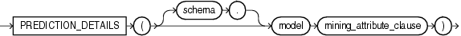

Syntax



> ```
> PREDICTION_DETAILS ( [ schema . ] model mining_attribute_clause )
> ```
  
  

mining\_attribute\_clause::=


> ```
> USING
> { * 
> | { [ schema . ] table . * 
>   | expr [ AS alias ]
>   }
>     [, { [ schema . ] table . * 
>        | expr [ AS alias ]
>        }
>     ]...
> }
> ```
  
  

Purpose

This function is for use with decision tree models created by the `DBMS_DATA_MINING` package or with Oracle Data Miner. It returns an XML string containing model-specific information related to the scoring of the input row. In this release, the return value takes the following form:

```
<Node id= "integer"/>
```

where `integer` is the identifier of a data mining tree node. The form of the output is subject to change. It may be enhanced to provide additional prediction information in future releases.

The `mining_attribute_clause` behaves as described for the `PREDICTION` function. Refer to [mining\_attribute\_clause](functions132.md).

See Also:

- [Oracle Data Mining Concepts](https://docs.oracle.com/cd/E11882_01/datamine.112/e16808/toc.htm) for detailed information about Oracle Data Mining
- [Oracle Data Mining Application Developer's Guide](https://docs.oracle.com/cd/E11882_01/datamine.112/e12218/models_deploying.htm#DMPRG004) for detailed information about scoring with the Data Mining SQL functions

Example

The following example uses all attributes from the `mining_data_apply_v` view that are relevant predictors for the `DT_SH_Clas_sample` decision tree model. For customers who work in technical support and are under age 25, it returns the tree node that results from scoring those records with the `DT_SH_Clas_sample` model.

This example, and the prerequisite data mining operations, including the creation of the view, can be found in the demo files `$ORACLE_HOME/rdbms/demo/dmdtdemo.sql`. General information on data mining demo files is available in [Oracle Data Mining Administrator's Guide](https://docs.oracle.com/cd/E11882_01/datamine.112/e16807/sampleprogs.htm#DMADM009). The example is presented here to illustrate the syntactic use of the function.

```
SELECT cust_id, education,
   PREDICTION_DETAILS(DT_SH_Clas_sample using *) treenode
   FROM mining_data_apply_v
   WHERE occupation = 'TechSup' AND age < 25
   ORDER BY cust_id;

   CUST_ID EDUCATION             TREENODE
---------- --------------------- -------------------------
    100234 < Bach.               <Node id="21"/>
    100320 < Bach.               <Node id="21"/>
    100349 < Bach.               <Node id="21"/>
    100419 < Bach.               <Node id="21"/>
    100583 < Bach.               <Node id="13"/>
    100657 HS-grad               <Node id="21"/>
    101171 < Bach.               <Node id="21"/>
    101225 < Bach.               <Node id="21"/>
    101338 < Bach.               <Node id="21"/>
 
9 rows selected.
```