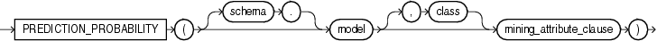

Syntax



> ```
> PREDICTION_PROBABILITY ( [ schema . ] model [ , class ] 
>    mining_attribute_clause )
> ```
  
  

mining\_attribute\_clause::=


> ```
> USING
> { * 
> | { [ schema . ] table . * 
>   | expr [ AS alias ]
>   }
>     [, { [ schema . ] table . * 
>        | expr [ AS alias ]
>        }
>     ]...
> }
> ```
  
  

Purpose

This function is for use with classification models created by the `DBMS_DATA_MINING` package or with Oracle Data Miner. It is not valid with other types of models. It returns the probability for a given prediction as an Oracle `NUMBER`.

If you specify the optional `class` parameter, then the function returns the probability for the specified class. This is equivalent to the probability associated with choosing the given target class value.

If you omit the `class` parameter, then the function returns the probability associated with the best prediction. You can use this form in conjunction with the `PREDICTION` function to obtain the best pair of prediction value and probability.

The `mining_attribute_clause` behaves as described for the `PREDICTION` function. Refer to [mining\_attribute\_clause](functions132.md).

See Also:

- [Oracle Data Mining Concepts](https://docs.oracle.com/cd/E11882_01/datamine.112/e16808/toc.htm) for detailed information about Oracle Data Mining
- [Oracle Data Mining Application Developer's Guide](https://docs.oracle.com/cd/E11882_01/datamine.112/e12218/models_deploying.htm#DMPRG004) for detailed information about scoring with the Data Mining SQL functions

Example

The following example returns the 10 customers living in Italy who are most likely to use an affinity card.

This example, and the prerequisite data mining operations, including the creation of the view, can be found in the demo files `$ORACLE_HOME/rdbms/demo/dmdtdemo.sql`. General information on data mining demo files is available in [Oracle Data Mining Administrator's Guide](https://docs.oracle.com/cd/E11882_01/datamine.112/e16807/sampleprogs.htm#DMADM009). The example is presented here to illustrate the syntactic use of the function.

```
SELECT cust_id FROM (
   SELECT cust_id
   FROM mining_data_apply_v
   WHERE country_name = 'Italy'
   ORDER BY PREDICTION_PROBABILITY(DT_SH_Clas_sample, 1 USING *)
      DESC, cust_id)
   WHERE rownum < 11;
 
   CUST_ID
----------
    100081
    100179
    100185
    100324
    100344
    100554
    100662
    100733
    101250
    101306
 
10 rows selected.
```