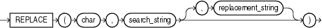

Syntax



> ```
> REPLACE(char, search_string
>         [, replacement_string ]
>        )
> ```
  
  

Purpose

`REPLACE` returns `char` with every occurrence of `search_string` replaced with `replacement_string`. If `replacement_string` is omitted or null, then all occurrences of `search_string` are removed. If `search_string` is null, then `char` is returned.

Both `search_string` and `replacement_string`, as well as `char`, can be any of the data types `CHAR`, `VARCHAR2`, `NCHAR`, `NVARCHAR2`, `CLOB`, or `NCLOB`. The string returned is in the same character set as `char`. The function returns `VARCHAR2` if the first argument is not a LOB and returns `CLOB` if the first argument is a LOB.

`REPLACE` provides functionality related to that provided by the `TRANSLATE` function. `TRANSLATE` provides single-character, one-to-one substitution. `REPLACE` lets you substitute one string for another as well as to remove character strings.

See Also:

[TRANSLATE](functions216.md)

Examples

The following example replaces occurrences of `J` with `BL`:

```
SELECT REPLACE('JACK and JUE','J','BL') "Changes"
     FROM DUAL;

Changes
--------------
BLACK and BLUE
```