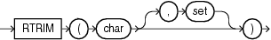

Syntax



> ```
> RTRIM(char [, set ])
> ```
  
  

Purpose

`RTRIM` removes from the right end of `char` all of the characters that appear in `set`. This function is useful for formatting the output of a query.

If you do not specify `set`, then it defaults to a single blank. If `char` is a character literal, then you must enclose it in single quotation marks. `RTRIM` works similarly to `LTRIM`.

Both `char` and `set` can be any of the data types `CHAR`, `VARCHAR2`, `NCHAR`, `NVARCHAR2`, `CLOB`, or `NCLOB`. The string returned is of `VARCHAR2` data type if `char` is a character data type, `NVARCHAR2` if `char` is a national character data type, and a LOB if `char` is a LOB data type.

See Also:

[LTRIM](functions096.md)

Examples

The following example trims all the right-most occurrences of less than sign (`<`), greater than sign (`>`), and equal sign (`=`) from a string:

```
SELECT RTRIM('<=====>BROWNING<=====>', '<>=') "RTRIM Example"
  FROM DUAL;

RTRIM Example
---------------
<=====>BROWNING
```