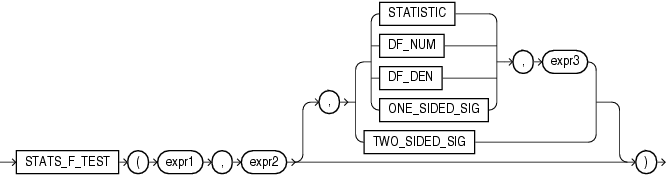

Syntax



> ```
> STATS_F_TEST(expr1, expr2
>              [, { { STATISTIC
>                   | DF_NUM
>                   | DF_DEN
>                   | ONE_SIDED_SIG
>                   } , expr3
>                 | TWO_SIDED_SIG
>                 }
>              ]
>             )
> ```
  
  

Purpose

`STATS_F_TEST` tests whether two variances are significantly different. The observed value of f is the ratio of one variance to the other, so values very different from 1 usually indicate significant differences.

This function takes three arguments: `expr1` is the grouping or independent variable and `expr2` is the sample of values. The function returns one number, determined by the value of the third argument. If you omit the third argument, then the default is `TWO_SIDED_SIG`. The meaning of the return values is shown in Table 5-5.

Table 5-5 STATS\_F\_TEST Return Values

| Return Value | Meaning |
| --- | --- |
| `STATISTIC` | The observed value of f |
| `DF_NUM` | Degree of freedom for the numerator |
| `DF_DEN` | Degree of freedom for the denominator |
| `ONE_SIDED_SIG` | One-tailed significance of f |
| `TWO_SIDED_SIG` | Two-tailed significance of f |

The one-tailed significance is always in relation to the upper tail. The final argument, `expr3`, indicates which of the two groups specified by expr1 is the high value or numerator (the value whose rejection region is the upper tail).

The observed value of f is the ratio of the variance of one group to the variance of the second group. The significance of the observed value of f is the probability that the variances are different just by chance—a number between 0 and 1. A small value for the significance indicates that the variances are significantly different. The degree of freedom for each of the variances is the number of observations in the sample minus 1.

STATS\_F\_TEST Example The following example determines whether the variance in credit limit between men and women is significantly different. The results, a p\_value not close to zero, and an f\_statistic close to 1, indicate that the difference between credit limits for men and women are not significant.

```
SELECT VARIANCE(DECODE(cust_gender, 'M', cust_credit_limit, null)) var_men,
       VARIANCE(DECODE(cust_gender, 'F', cust_credit_limit, null)) var_women,
       STATS_F_TEST(cust_gender, cust_credit_limit, 'STATISTIC', 'F') f_statistic,
       STATS_F_TEST(cust_gender, cust_credit_limit) two_sided_p_value
  FROM sh.customers;

   VAR_MEN  VAR_WOMEN F_STATISTIC TWO_SIDED_P_VALUE
---------- ---------- ----------- -----------------
12879896.7   13046865  1.01296348        .311928071
```