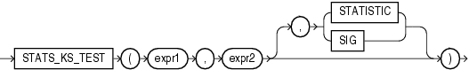

Syntax



> ```
> STATS_KS_TEST(expr1, expr2
>               [, { STATISTIC | SIG } ]
>              )
> ```
  
  

Purpose

`STATS_KS_TEST` is a Kolmogorov-Smirnov function that compares two samples to test whether they are from the same population or from populations that have the same distribution. It does not assume that the population from which the samples were taken is normally distributed.

This function takes three arguments: two expressions and a return value of type `VARCHAR2`. `expr1` classifies the data into the two samples. `expr2` contains the values for each of the samples. If `expr1` classifies the rows into only one sample or into more than two samples, then an error is raised.The function returns one value determined by the third argument. If you omit the third argument, then the default is `SIG`. The meaning of the return values is shown in Table 5-6.

Table 5-6 STATS\_KS\_TEST Return Values

| Return Value | Meaning |
| --- | --- |
| `STATISTIC` | Observed value of D |
| `SIG` | Significance of D |

STATS\_KS\_TEST Example Using the Kolmogorov Smirnov test, the following example determines whether the distribution of sales between men and women is due to chance:

```
SELECT stats_ks_test(cust_gender, amount_sold, 'STATISTIC') ks_statistic,
       stats_ks_test(cust_gender, amount_sold) p_value
  FROM sh.customers c, sh.sales s
  WHERE c.cust_id = s.cust_id;

KS_STATISTIC    P_VALUE
------------ ----------
  .003841396 .004080006
```