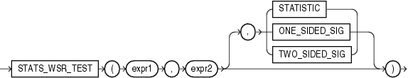

Syntax



> ```
> STATS_WSR_TEST(expr1, expr2
>                [, { STATISTIC
>                   | ONE_SIDED_SIG
>                   | TWO_SIDED_SIG
>                   }
>                ]
>               )
> ```
  
  

Purpose

`STATS_WSR_TEST` is a Wilcoxon Signed Ranks test of paired samples to determine whether the median of the differences between the samples is significantly different from zero. The absolute values of the differences are ordered and assigned ranks. Then the null hypothesis states that the sum of the ranks of the positive differences is equal to the sum of the ranks of the negative differences.

This function takes three arguments: `expr1` and `expr2` are the two samples being analyzed, and the third argument is a return value of type `VARCHAR2`. If you omit the third argument, then the default is `TWO_SIDED_SIG`. The meaning of the return values is shown in Table 5-10.

Table 5-10 STATS\_WSR\_TEST\_\* Return Values

| Return Value | Meaning |
| --- | --- |
| `STATISTIC` | The observed value of Z |
| `ONE_SIDED_SIG` | One-tailed significance of Z |
| `TWO_SIDED_SIG` | Two-tailed significance of Z |

One-sided significance is always with respect to the upper tail. The high value (the value whose rejection region is the upper tail) is `expr1`.