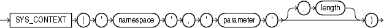

Syntax



> ```
> SYS_CONTEXT('namespace', 'parameter' [, length ])
> ```
  
  

Purpose

`SYS_CONTEXT` returns the value of `parameter` associated with the context `namespace` at the current instant. You can use this function in both SQL and PL/SQL statements. `SYS_CONTEXT` must be executed locally.

For `namespace` and `parameter`, you can specify either a string or an expression that resolves to a string designating a namespace or an attribute. If you specify literal arguments for `namespace` and `parameter`, and you are using `SYS_CONTEXT` explicitly in a SQL statement—rather than in a PL/SQL function that in turn is in mentioned in a SQL statement—then Oracle Database evaluates `SYS_CONTEXT` only once per SQL statement execution for each call site that invokes the `SYS_CONTEXT` function.

The context `namespace` must already have been created, and the associated `parameter` and its value must also have been set using the `DBMS_SESSION`.`set_context` procedure. The `namespace` must be a valid SQL identifier. The `parameter` name can be any string. It is not case sensitive, but it cannot exceed 30 bytes in length.

The data type of the return value is `VARCHAR2`. The default maximum size of the return value is 256 bytes. You can override this default by specifying the optional `length` parameter, which must be a `NUMBER` or a value that can be implicitly converted to `NUMBER`. The valid range of values is 1 to 4000 bytes. If you specify an invalid value, then Oracle Database ignores it and uses the default.

Oracle provides the following built-in namespaces:

- `USERENV` - Describes the current session. The predefined parameters of namespace `USERENV` are listed in Table 5-11.
- `SYS_SESSION_ROLES` - Indicates whether a specified role is currently enabled for the session. This namespace is available starting with Oracle Database 11g Release 2 (11.2.0.4).

See Also:

- [Oracle Database Security Guide](https://docs.oracle.com/cd/E11882_01/network.112/e36292/app_context.htm#DBSEG14002) for information on using the application context feature in your application development
- [CREATE CONTEXT](statements_5002.md) for information on creating user-defined context namespaces
- [Oracle Database PL/SQL Packages and Types Reference](https://docs.oracle.com/cd/E11882_01/appdev.112/e40758/d_sessio.htm#ARPLS054) for information on the `DBMS_SESSION`.`set_context` procedure

Examples

The following statement returns the name of the user who logged onto the database:

```
CONNECT OE
Enter password: password

SELECT SYS_CONTEXT ('USERENV', 'SESSION_USER') 
   FROM DUAL;

SYS_CONTEXT ('USERENV', 'SESSION_USER')
------------------------------------------------------
OE
```

The following example queries the `SESSION_ROLES` data dictionary view to show that `RESOURCE` is the only role currently enabled for the session. It then uses the `SYS_CONTEXT` function to show that the `RESOURCE` role is currently enabled for the session and the `DBA` role is not.

```
CONNECT OE
Enter password: password

SELECT role FROM session_roles;

ROLE
--------
RESOURCE

SELECT SYS_CONTEXT('SYS_SESSION_ROLES', 'RESOURCE')
  FROM DUAL

SYS_CONTEXT('SYS_SESSION_ROLES','RESOURCE')
--------------------------------------
TRUE

SELECT SYS_CONTEXT('SYS_SESSION_ROLES', 'DBA')
  FROM DUAL;

SYS_CONTEXT('SYS_SESSION_ROLES','DBA')
--------------------------------------
FALSE
```

Note:

For simplicity in demonstrating this feature, these examples do not perform the password management techniques that a deployed system normally uses. In a production environment, follow the Oracle Database password management guidelines, and disable any sample accounts. See [Oracle Database Security Guide](https://docs.oracle.com/cd/E11882_01/network.112/e36292/app_devs.htm#DBSEG50053) for password management guidelines and other security recommendations.

The following hypothetical example returns the group number that was set as the value for the attribute `group_no` in the PL/SQL package that was associated with the context `hr_apps` when `hr_apps` was created:

```
SELECT SYS_CONTEXT ('hr_apps', 'group_no') "User Group" 
   FROM DUAL;
```

Table 5-11 Predefined Parameters of Namespace USERENV

| Parameter | Return Value |
| --- | --- |
| `ACTION` | Identifies the position in the module (application name) and is set through the `DBMS_APPLICATION_INFO` package or OCI. |
| `AUDITED_CURSORID` | Returns the cursor ID of the SQL that triggered the audit. This parameter is not valid in a fine-grained auditing environment. If you specify it in such an environment, then Oracle Database always returns `NULL`. |
| `AUTHENTICATED_IDENTITY` | Returns the identity used in authentication. In the list that follows, the type of user is followed by the value returned:  - Kerberos-authenticated enterprise user: kerberos principal name - Kerberos-authenticated external user: kerberos principal name; same as the schema name - SSL-authenticated enterprise user: the DN in the user's PKI certificate - SSL-authenticated external user: the DN in the user's PKI certificate - Password-authenticated enterprise user: nickname; same as the login name - Password-authenticated database user: the database username; same as the schema name - OS-authenticated external user: the external operating system user name - Radius-authenticated external user: the schema name - Proxy with DN: Oracle Internet Directory DN of the client - Proxy with certificate: certificate DN of the client - Proxy with username: database user name if client is a local database user; nickname if client is an enterprise user. - SYSDBA/SYSOPER using Password File: login name - SYSDBA/SYSOPER using OS authentication: operating system user name |
| `AUTHENTICATION_DATA` | Data being used to authenticate the login user. For X.503 certificate authenticated sessions, this field returns the context of the certificate in HEX2 format.  Note: You can change the return value of the `AUTHENTICATION_DATA` attribute using the `length` parameter of the syntax. Values of up to 4000 are accepted. This is the only attribute of `USERENV` for which Oracle Database implements such a change. |
| `AUTHENTICATION_METHOD` | Returns the method of authentication. In the list that follows, the type of user is followed by the method returned:  - Password-authenticated enterprise user, local database user, or SYSDBA/SYSOPER using Password File; proxy with username using password: PASSWORD - Kerberos-authenticated enterprise or external user: KERBEROS - SSL-authenticated enterprise or external user: SSL - Radius-authenticated external user: RADIUS - OS-authenticated external user or SYSDBA/SYSOPER: OS - Proxy with certificate, DN, or username without using password: NONE - Background process (job queue slave process): JOB - Parallel Query Slave process: PQ\_SLAVE  You can use `IDENTIFICATION_TYPE` to distinguish between external and enterprise users when the authentication method is Password, Kerberos, or SSL. |
| `BG_JOB_ID` | Job ID of the current session if it was established by an Oracle Database background process. Null if the session was not established by a background process. |
| `CLIENT_IDENTIFIER` | Returns an identifier that is set by the application through the `DBMS_SESSION.SET_IDENTIFIER` procedure, the OCI attribute `OCI_ATTR_CLIENT_IDENTIFIER`, or Oracle Dynamic Monitoring Service (DMS). This attribute is used by various database components to identify lightweight application users who authenticate as the same database user. |
| `CLIENT_INFO` | Returns up to 64 bytes of user session information that can be stored by an application using the `DBMS_APPLICATION_INFO` package. |
| `CURRENT_BIND` | The bind variables for fine-grained auditing. You can specify this attribute only inside the event handler for the fine-grained auditing feature. |
| `CURRENT_EDITION_ID` | The identifier of the current edition. |
| `CURRENT_EDITION_NAME` | The name of the current edition. |
| `CURRENT_SCHEMA` | The name of the currently active default schema. This value may change during the duration of a session through use of an `ALTER` `SESSION` `SET` `CURRENT_SCHEMA` statement. This may also change during the duration of a session to reflect the owner of any active definer's rights object. When used directly in the body of a view definition, this returns the default schema used when executing the cursor that is using the view; it does not respect views used in the cursor as being definer's rights.  Note: Oracle recommends against issuing the SQL statement `ALTER` `SESSION` `SET` `CURRENT_SCHEMA` from within all types of stored PL/SQL units except logon triggers. |
| `CURRENT_SCHEMAID` | Identifier of the currently active default schema. |
| `CURRENT_SQL`  `CURRENT_SQL` `n` | `CURRENT_SQL` returns the first 4K bytes of the current SQL that triggered the fine-grained auditing event. The `CURRENT_SQL` `n` attributes return subsequent 4K-byte increments, where `n` can be an integer from 1 to 7, inclusive. `CURRENT_SQL1` returns bytes 4K to 8K; `CURRENT_SQL2` returns bytes 8K to 12K, and so forth. You can specify these attributes only inside the event handler for the fine-grained auditing feature. |
| `CURRENT_SQL_LENGTH` | The length of the current SQL statement that triggers fine-grained audit or row-level security (RLS) policy functions or event handlers. You can specify this attribute only inside the event handler for the fine-grained auditing feature. |
| `CURRENT_USER` | The name of the database user whose privileges are currently active. This may change during the duration of a session to reflect the owner of any active definer's rights object. When no definer's rights object is active, `CURRENT_USER` returns the same value as `SESSION_USER`. When used directly in the body of a view definition, this returns the user that is executing the cursor that is using the view; it does not respect views used in the cursor as being definer's rights. |
| `CURRENT_USERID` | The identifier of the database user whose privileges are currently active. |
| `DATABASE_ROLE` | The database role using the `SYS_CONTEXT` function with the `USERENV` namespace. The role is one of the following: `PRIMARY`, `PHYSICAL` `STANDBY`, `LOGICAL` `STANDBY`, `SNAPSHOT` `STANDBY`. |
| `DB_DOMAIN` | Domain of the database as specified in the `DB_DOMAIN` initialization parameter. |
| `DB_NAME` | Name of the database as specified in the `DB_NAME` initialization parameter. |
| `DB_UNIQUE_NAME` | Name of the database as specified in the `DB_UNIQUE_NAME` initialization parameter. |
| `DBLINK_INFO` | Returns the source of a database link session. Specifically, it returns a string of the form:  ``` SOURCE_GLOBAL_NAME=dblink_src_global_name, DBLINK_NAME=dblink_name, SOURCE_AUDIT_SESSIONID=dblink_src_audit_sessionid ```  where:  - `dblink_src_global_name` is the unique global name of the source database - `dblink_name` is the name of the database link on the source database - `dblink_src_audit_sessionid` is the audit session ID of the session on the source database that initiated the connection to the remote database using `dblink_name` |
| `ENTRYID` | The current audit entry number. The audit entryid sequence is shared between fine-grained audit records and regular audit records. You cannot use this attribute in distributed SQL statements. The correct auditing entry identifier can be seen only through an audit handler for standard or fine-grained audit. |
| `ENTERPRISE_IDENTITY` | Returns the user's enterprise-wide identity:  - For enterprise users: the Oracle Internet Directory DN. - For external users: the external identity (Kerberos principal name, Radius schema names, OS user name, Certificate DN). - For local users and SYSDBA/SYSOPER logins: `NULL`.  The value of the attribute differs by proxy method:  - For a proxy with DN: the Oracle Internet Directory DN of the client - For a proxy with certificate: the certificate DN of the client for external users; the Oracle Internet Directory DN for global users - For a proxy with username: the Oracle Internet Directory DN if the client is an enterprise users; `NULL` if the client is a local database user. |
| `FG_JOB_ID` | Job ID of the current session if it was established by a client foreground process. Null if the session was not established by a foreground process. |
| `GLOBAL_CONTEXT_MEMORY` | Returns the number being used in the System Global Area by the globally accessed context. |
| `GLOBAL_UID` | Returns the global user ID from Oracle Internet Directory for Enterprise User Security (EUS) logins; returns null for all other logins. |
| `HOST` | Name of the host machine from which the client has connected. |
| `IDENTIFICATION_TYPE` | Returns the way the user's schema was created in the database. Specifically, it reflects the `IDENTIFIED` clause in the `CREATE` / `ALTER` `USER` syntax. In the list that follows, the syntax used during schema creation is followed by the identification type returned:  - `IDENTIFIED` `BY` `password`: LOCAL - `IDENTIFIED` `EXTERNALLY`: EXTERNAL - `IDENTIFIED` `GLOBALLY`: GLOBAL SHARED - `IDENTIFIED` `GLOBALLY` `AS` `DN`: GLOBAL PRIVATE |
| `INSTANCE` | The instance identification number of the current instance. |
| `INSTANCE_NAME` | The name of the instance. |
| `IP_ADDRESS` | IP address of the machine from which the client is connected. If the client and server are on the same machine and the connection uses IPv6 addressing, then `::1` is returned. |
| `ISDBA` | Returns `TRUE` if the user has been authenticated as having DBA privileges either through the operating system or through a password file. |
| `LANG` | The abbreviated name for the language, a shorter form than the existing ' `LANGUAGE` ' parameter. |
| `LANGUAGE` | The language and territory currently used by your session, along with the database character set, in this form:  language\_territory.characterset |
| `MODULE` | The application name (module) set through the `DBMS_APPLICATION_INFO` package or OCI. |
| `NETWORK_PROTOCOL` | Network protocol being used for communication, as specified in the ' `PROTOCOL` = `protocol` ' portion of the connect string. |
| `NLS_CALENDAR` | The current calendar of the current session. |
| `NLS_CURRENCY` | The currency of the current session. |
| `NLS_DATE_FORMAT` | The date format for the session. |
| `NLS_DATE_LANGUAGE` | The language used for expressing dates. |
| `NLS_SORT` | `BINARY` or the linguistic sort basis. |
| `NLS_TERRITORY` | The territory of the current session. |
| `OS_USER` | Operating system user name of the client process that initiated the database session. |
| `POLICY_INVOKER` | The invoker of row-level security (RLS) policy functions. |
| `PROXY_ENTERPRISE_IDENTITY` | Returns the Oracle Internet Directory DN when the proxy user is an enterprise user. |
| `PROXY_USER` | Name of the database user who opened the current session on behalf of `SESSION_USER`. |
| `PROXY_USERID` | Identifier of the database user who opened the current session on behalf of `SESSION_USER`. |
| `SERVER_HOST` | The host name of the machine on which the instance is running. |
| `SERVICE_NAME` | The name of the service to which a given session is connected. |
| `SESSION_EDITION_ID` | The identifier of the session edition. |
| `SESSION_EDITION_NAME` | The name of the session edition. |
| `SESSION_USER` | The name of the database user at logon. For enterprise users, returns the schema. For other users, returns the database user name. This value remains the same throughout the duration of the session. |
| `SESSION_USERID` | The identifier of the database user at logon. |
| `SESSIONID` | The auditing session identifier. You cannot use this attribute in distributed SQL statements. |
| `SID` | The session ID. |
| `STATEMENTID` | The auditing statement identifier. `STATEMENTID` represents the number of SQL statements audited in a given session. You cannot use this attribute in distributed SQL statements. The correct auditing statement identifier can be seen only through an audit handler for standard or fine-grained audit. |
| `TERMINAL` | The operating system identifier for the client of the current session. In distributed SQL statements, this attribute returns the identifier for your local session. In a distributed environment, this is supported only for remote `SELECT` statements, not for remote `INSERT`, `UPDATE`, or `DELETE` operations. (The return length of this parameter may vary by operating system.) |

Table 5-12 lists the parameters of namespace `USERENV` that have been deprecated. Do not specify any of these parameters. Instead use the alternatives suggested in the Comments column.

Table 5-12 Deprecated Parameters of Namespace USERENV

| Parameter | Comments |
| --- | --- |
| `AUTHENTICATION_TYPE` | This parameter returned a value indicating how the user was authenticated. The same information is now available from the new `AUTHENTICATION_METHOD` parameter combined with `IDENTIFICATION_TYPE`. |
| `EXTERNAL_NAME` | This parameter returned the external name of the user. More complete information can now be obtained from the `AUTHENTICATED_IDENTITY` and `ENTERPRISE_IDENTITY` parameter. |