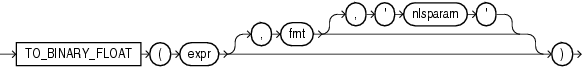

Syntax



> ```
> TO_BINARY_FLOAT(expr [, fmt [, 'nlsparam' ] ])
> ```
  
  

Purpose

`TO_BINARY_FLOAT` returns a single-precision floating-point number.

- `expr` can be a character string or a numeric value of type `NUMBER`, `BINARY_FLOAT`, or `BINARY_DOUBLE`. If `expr` is `BINARY_FLOAT`, then the function returns `expr`.
- The optional ' `fmt` ' and ' `nlsparam` ' arguments are valid only if `expr` is a character string. They serve the same purpose as for the `TO_CHAR` (number) function.
	- The incase-sensitive string ' `INF` ' is converted to positive infinity.
		- The incase-sensitive string '- `INF` ' is converted to negative identity.
		- The incase-sensitive string ' `NaN` ' is converted to `NaN` (not a number).

You cannot use a floating-point number format element (`F`, `f`, `D`, or `d`) in a character string `expr`.

Conversions from character strings or `NUMBER` to `BINARY_FLOAT` can be inexact, because the `NUMBER` and character types use decimal precision to represent the numeric value and `BINARY_FLOAT` uses binary precision.

Conversions from `BINARY_DOUBLE` to `BINARY_FLOAT` are inexact if the `BINARY_DOUBLE` value uses more bits of precision than supported by the `BINARY_FLOAT`.

See Also:

[TO\_CHAR (number)](functions201.md) and ["Floating-Point Numbers"](sql_elements001.md)

Examples

Using table `float_point_demo` created for [TO\_BINARY\_DOUBLE](functions196.md), the following example converts a value of data type `NUMBER` to a value of data type `BINARY_FLOAT`:

```
SELECT dec_num, TO_BINARY_FLOAT(dec_num)
  FROM float_point_demo;

   DEC_NUM TO_BINARY_FLOAT(DEC_NUM)
---------- ------------------------
   1234.56               1.235E+003
```