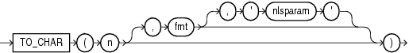

Syntax

to\_char\_number::=



> ```
> TO_CHAR(n [, fmt [, 'nlsparam' ] ])
> ```
  
  

Purpose

`TO_CHAR` (number) converts `n` to a value of `VARCHAR2` data type, using the optional number format `fmt`. The value `n` can be of type `NUMBER`, `BINARY_FLOAT`, or `BINARY_DOUBLE`. If you omit `fmt`, then `n` is converted to a `VARCHAR2` value exactly long enough to hold its significant digits.

If `n` is negative, then the sign is applied after the format is applied. Thus `TO_CHAR(-1, '$9')` returns -$1, rather than $-1.

Refer to ["Format Models"](sql_elements004.md) for information on number formats.

The `'nlsparam'` argument specifies these characters that are returned by number format elements:

- Decimal character
- Group separator
- Local currency symbol
- International currency symbol

This argument can have this form:

```
'NLS_NUMERIC_CHARACTERS = ''dg''
   NLS_CURRENCY = ''text''
   NLS_ISO_CURRENCY = territory '
```

The characters `d` and `g` represent the decimal character and group separator, respectively. They must be different single-byte characters. Within the quoted string, you must use two single quotation marks around the parameter values. Ten characters are available for the currency symbol.

If you omit `'nlsparam'` or any one of the parameters, then this function uses the default parameter values for your session.

See Also:

["Security Considerations for Data Conversion"](sql_elements002.md)

Examples

The following statement uses implicit conversion to combine a string and a number into a number:

```
SELECT TO_CHAR('01110' + 1) FROM DUAL;

TO_C
----
1111
```

Compare this example with the first example for [TO\_CHAR (character)](functions199.md).

In the next example, the output is blank padded to the left of the currency symbol.

```
SELECT TO_CHAR(-10000,'L99G999D99MI') "Amount"
     FROM DUAL;

Amount
--------------
  $10,000.00-

SELECT TO_CHAR(-10000,'L99G999D99MI',
   'NLS_NUMERIC_CHARACTERS = '',.''
   NLS_CURRENCY = ''AusDollars'' ') "Amount"
     FROM DUAL;

Amount
-------------------
AusDollars10.000,00-
```

In the optional number format `fmt`, `L` designates local currency symbol and `MI` designates a trailing minus sign. See [Table 3-17, "Matching Character Data and Format Models with the FX Format Model Modifier"](sql_elements004.md) for a complete listing of number format elements.