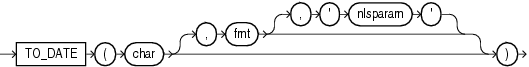

Syntax



> ```
> TO_DATE(char [, fmt [, 'nlsparam' ] ])
> ```
  
  

Purpose

`TO_DATE` converts `char` of `CHAR`, `VARCHAR2`, `NCHAR`, or `NVARCHAR2` data type to a value of `DATE` data type.

Note:

This function does not convert data to any of the other datetime data types. For information on other datetime conversions, refer to [TO\_TIMESTAMP](functions213.md), [TO\_TIMESTAMP\_TZ](functions214.md), [TO\_DSINTERVAL](functions204.md), and [TO\_YMINTERVAL](functions215.md).

The `fmt` is a datetime model format specifying the format of `char`. If you omit `fmt`, then `char` must be in the default date format. The default date format is determined implicitly by the `NLS_TERRITORY` initialization parameter or can be set explicitly by the `NLS_DATE_FORMAT` parameter. If `fmt` is `J`, for Julian, then `char` must be an integer.

Caution:

It is good practice always to specify a format mask (`fmt`) with `TO_DATE`, as shown in the examples in the section that follows. When it is used without a format mask, the function is valid only if `char` uses the same format as is determined by the `NLS_TERRITORY` or `NLS_DATE_FORMAT` parameters. Furthermore, the function may not be stable across databases unless the explicit format mask is specified to avoid dependencies.

The `'nlsparam'` argument specifies the language of the text string that is being converted to a date. This argument can have this form:

```
'NLS_DATE_LANGUAGE = language'
```

Do not use the `TO_DATE` function with a `DATE` value for the `char` argument. The first two digits of the returned `DATE` value can differ from the original `char`, depending on `fmt` or the default date format.

This function does not support `CLOB` data directly. However, `CLOB` s can be passed in as arguments through implicit data conversion.

See Also:

["Datetime Format Models"](sql_elements004.md) and ["Data Type Comparison Rules"](sql_elements002.md) for more information

Examples

The following example converts a character string into a date:

```
SELECT TO_DATE(
    'January 15, 1989, 11:00 A.M.',
    'Month dd, YYYY, HH:MI A.M.',
     'NLS_DATE_LANGUAGE = American')
     FROM DUAL;

TO_DATE('
---------
15-JAN-89
```

The value returned reflects the default date format if the `NLS_TERRITORY` parameter is set to ' `AMERICA` '. Different `NLS_TERRITORY` values result in different default date formats:

```
ALTER SESSION SET NLS_TERRITORY = 'KOREAN';

SELECT TO_DATE(
    'January 15, 1989, 11:00 A.M.',
    'Month dd, YYYY, HH:MI A.M.',
     'NLS_DATE_LANGUAGE = American')
     FROM DUAL;

TO_DATE(
--------
89/01/15
```