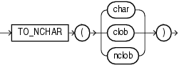

Syntax

to\_nchar\_char::=



> ```
> TO_NCHAR({char | clob | nclob})
> ```
  
  

Purpose

`TO_NCHAR` (character) converts a character string, `CHAR`, `VARCHAR2`, `CLOB`, or `NCLOB` value to the national character set. The value returned is always `NVARCHAR2`. This function is equivalent to the `TRANSLATE`... `USING` function with a `USING` clause in the national character set.

See Also:

["Data Conversion"](sql_elements002.md) and [TRANSLATE... USING](functions217.md)

Examples

The following example converts `VARCHAR2` data from the `oe.customers` table to the national character set:

```
SELECT TO_NCHAR(cust_last_name) FROM customers
   WHERE customer_id=103;

TO_NCHAR(CUST_LAST_NAME)
--------------------------------------------------
Taylor
```