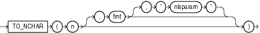

Syntax

to\_nchar\_number::=



> ```
> TO_NCHAR(n [, fmt [, 'nlsparam' ] ])
> ```
  
  

Purpose

`TO_NCHAR` (number) converts `n` to a string in the national character set. The value `n` can be of type `NUMBER`, `BINARY_FLOAT`, or `BINARY_DOUBLE`. The function returns a value of the same type as the argument. The optional `fmt` and `'nlsparam'` corresponding to `n` can be of `DATE`, `TIMESTAMP`, `TIMESTAMP` `WITH` `TIME` `ZONE`, `TIMESTAMP` `WITH` `LOCAL` `TIME` `ZONE`, `INTERVAL` `MONTH` `TO` `YEAR`, or `INTERVAL` `DAY` `TO` `SECOND` data type.

See Also:

["Security Considerations for Data Conversion"](sql_elements002.md)

Examples

The following example converts the `customer_id` values from the sample table `oe.orders` to the national character set:

```
SELECT TO_NCHAR(customer_id) "NCHAR_Customer_ID"  FROM orders 
   WHERE order_status > 9
   ORDER BY "NCHAR_Customer_ID";

NCHAR_Customer_ID
----------------------------------------
102
103
148
148
149
```