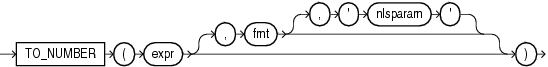

Syntax



> ```
> TO_NUMBER(expr [, fmt [, 'nlsparam' ] ])
> ```
  
  

Purpose

`TO_NUMBER` converts `expr` to a value of `NUMBER` data type. The `expr` can be a number value of `CHAR`, `VARCHAR2`, `NCHAR`, `NVARCHAR2`, `BINARY_FLOAT`, or `BINARY_DOUBLE` data type.

- If you specify an `expr` of `CHAR`, `VARCHAR2`, `NCHAR`, or `NVARCHAR2` data type, then you can optionally specify the format model `fmt`.
- If you specify an `expr` of `BINARY_FLOAT` or `BINARY_DOUBLE` data type, then you cannot specify a format model because a `BINARY_FLOAT` or `BINARY_DOUBLE` can be interpreted only by its internal representation.

Refer to ["Format Models"](sql_elements004.md) for information on format models.

The `'` `nlsparam` `'` argument in this function has the same purpose as it does in the `TO_CHAR` function for number conversions. Refer to [TO\_CHAR (number)](functions201.md) for more information.

This function does not support `CLOB` data directly. However, `CLOB` s can be passed in as arguments through implicit data conversion.

See Also:

["Data Type Comparison Rules"](sql_elements002.md) for more information.

Examples

The following examples convert character string data into a number:

```
UPDATE employees SET salary = salary + 
   TO_NUMBER('100.00', '9G999D99')
   WHERE last_name = 'Perkins';
```
```
SELECT TO_NUMBER('-AusDollars100','L9G999D99',
   ' NLS_NUMERIC_CHARACTERS = '',.''
     NLS_CURRENCY            = ''AusDollars''
   ') "Amount"
     FROM DUAL;

    Amount
----------
      -100
```