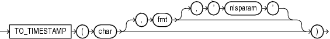

Syntax



> ```
> TO_TIMESTAMP(char [, fmt [, 'nlsparam' ] ])
> ```
  
  

Purpose

`TO_TIMESTAMP` converts `char` of `CHAR`, `VARCHAR2`, `NCHAR`, or `NVARCHAR2` data type to a value of `TIMESTAMP` data type.

The optional `fmt` specifies the format of `char`. If you omit `fmt`, then `char` must be in the default format of the `TIMESTAMP` data type, which is determined by the `NLS_TIMESTAMP_FORMAT` initialization parameter. The optional `'nlsparam'` argument has the same purpose in this function as in the `TO_CHAR` function for date conversion.

This function does not support `CLOB` data directly. However, `CLOB` s can be passed in as arguments through implicit data conversion.

See Also:

["Data Type Comparison Rules"](sql_elements002.md) for more information.

Examples

The following example converts a character string to a timestamp. The character string is not in the default `TIMESTAMP` format, so the format mask must be specified:

```
SELECT TO_TIMESTAMP ('10-Sep-02 14:10:10.123000', 'DD-Mon-RR HH24:MI:SS.FF')
   FROM DUAL;

TO_TIMESTAMP('10-SEP-0214:10:10.123000','DD-MON-RRHH24:MI:SS.FF')
---------------------------------------------------------------------------
10-SEP-02 02.10.10.123000000 PM
```

See Also:

[`NLS_TIMESTAMP_FORMAT` parameter](https://docs.oracle.com/cd/E11882_01/server.112/e40402/initparams157.htm#REFRN10131) for information on the default `TIMESTAMP` format and ["Datetime Format Models"](sql_elements004.md) for information on specifying the format mask