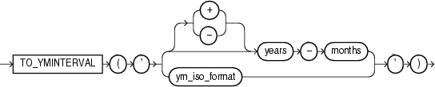
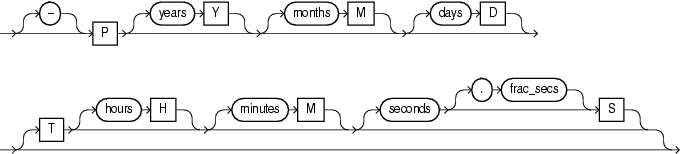

Syntax



> ```
> TO_YMINTERVAL
>   ( '  { [+|-] years - months 
>        | ym_iso_format 
>        } ' )
> ```
  
  

ym\_iso\_format::=



> ```
> [-] P [ years Y ] [months M] [days D]
>   [T [hours H] [minutes M] [seconds [. frac_secs] S ] ]
> ```
  
  

Purpose

`TO_YMINTERVAL` converts a character string of `CHAR`, `VARCHAR2`, `NCHAR`, or `NVARCHAR2` data type to an `INTERVAL` `YEAR` `TO` `MONTH` type.

`TO_YMINTERVAL` accepts argument in one of the two formats:

- SQL interval format compatible with the SQL standard (ISO/IEC 9075:2003)
- ISO duration format compatible with the ISO 8601:2004 standard

In the SQL format, `years` is an integer between 0 and 999999999, and `months` is an integer between 0 and 11. Additional blanks are allowed between format elements.

In the ISO format, years and months are integers between 0 and 999999999. Days, `hours`, `minutes`, `seconds`, and frac\_secs are non-negative integers, and are ignored, if specified. No blanks are allowed in the value. If you specify `T`, then you must specify at least one of the `hours`, `minutes`, or `seconds` values.

Examples

The following example calculates for each employee in the sample `hr.employees` table a date one year two months after the hire date:

```
SELECT hire_date, hire_date + TO_YMINTERVAL('01-02') "14 months"
   FROM employees;

HIRE_DATE 14 months
--------- ---------
17-JUN-03 17-AUG-04
21-SEP-05 21-NOV-06
13-JAN-01 13-MAR-02
20-MAY-08 20-JUL-09
21-MAY-07 21-JUL-08

. . .
```

The following example makes the same calculation using the ISO format:

```
SELECT hire_date, hire_date + TO_YMINTERVAL('P1Y2M') FROM employees;
```