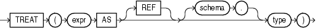

Syntax



> ```
> TREAT(expr AS [ REF ] [ schema. ]type)
> ```
  
  

Purpose

`TREAT` changes the declared type of an expression.

You must have the `EXECUTE` object privilege on `type` to use this function.

- `type` must be some supertype or subtype of the declared type of `expr`. If the most specific type of `expr` is `type` (or some subtype of `type`), then `TREAT` returns `expr`. If the most specific type of `expr` is not `type` (or some subtype of `type`), then `TREAT` returns `NULL`.
- You can specify `REF` only if the declared type of `expr` is a `REF` type.
- If the declared type of `expr` is a `REF` to a source type of `expr`, then `type` must be some subtype or supertype of the source type of `expr`. If the most specific type of `DEREF` (`expr`) is `type` (or a subtype of `type`), then `TREAT` returns `expr`. If the most specific type of `DEREF` (`expr`) is not `type` (or a subtype of `type`), then `TREAT` returns `NULL`.

This function does not support `CLOB` data directly. However, `CLOB` s can be passed in as arguments through implicit data conversion.

See Also:

["Data Type Comparison Rules"](sql_elements002.md) for more information

Examples

The following statement uses the table `oe.persons`, which is created in ["Substitutable Table and Column Examples"](statements_7002.md). The example retrieves the salary attribute of all people in the `persons` table, the value being null for instances of people that are not employees.

```
SELECT name, TREAT(VALUE(p) AS employee_t).salary salary 
   FROM persons p;

NAME                          SALARY
------------------------- ----------
Bob
Joe                           100000
Tim                             1000
```

You can use the `TREAT` function to create an index on the subtype attributes of a substitutable column. For an example, see ["Indexing on Substitutable Columns: Examples"](statements_5012.md).