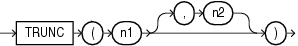

Syntax

trunc\_number::=



> ```
> TRUNC(n1 [, n2 ])
> ```
  
  

Purpose

The `TRUNC` (number) function returns `n1` truncated to `n2` decimal places. If `n2` is omitted, then `n1` is truncated to 0 places. `n2` can be negative to truncate (make zero) `n2` digits left of the decimal point.

This function takes as an argument any numeric data type or any nonnumeric data type that can be implicitly converted to a numeric data type. If you omit `n2`, then the function returns the same data type as the numeric data type of the argument. If you include `n2`, then the function returns `NUMBER`.

See Also:

[Table 3-10, "Implicit Type Conversion Matrix"](sql_elements002.md) for more information on implicit conversion

Examples

The following examples truncate numbers:

```
SELECT TRUNC(15.79,1) "Truncate" FROM DUAL;

  Truncate
----------
      15.7

SELECT TRUNC(15.79,-1) "Truncate" FROM DUAL;

  Truncate
----------
        10
```