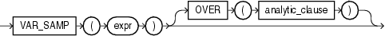

Syntax



> ```
> VAR_SAMP(expr) [ OVER (analytic_clause) ]
> ```
  
  

See Also:

["Analytic Functions"](functions004.md) for information on syntax, semantics, and restrictions

Purpose

`VAR_SAMP` returns the sample variance of a set of numbers after discarding the nulls in this set. You can use it as both an aggregate and analytic function.

This function takes as an argument any numeric data type or any nonnumeric data type that can be implicitly converted to a numeric data type. The function returns the same data type as the numeric data type of the argument.

See Also:

[Table 3-10, "Implicit Type Conversion Matrix"](sql_elements002.md) for more information on implicit conversion

If the function is applied to an empty set, then it returns null. The function makes the following calculation:

```
(SUM(expr - (SUM(expr) / COUNT(expr)))2) / (COUNT(expr) - 1)
```

This function is similar to `VARIANCE`, except that given an input set of one element, `VARIANCE` returns 0 and `VAR_SAMP` returns null.

See Also:

["About SQL Expressions"](expressions001.md) for information on valid forms of `expr` and ["Aggregate Functions"](functions003.md)

Aggregate Example

The following example returns the sample variance of the salaries in the sample `employees` table.

```
SELECT VAR_SAMP(salary) FROM employees;

VAR_SAMP(SALARY)
----------------
      15284813.7
```

Analytic Example

Refer to the analytic example for [VAR\_POP](functions230.md).