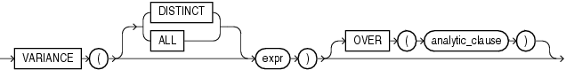

Syntax



> ```
> VARIANCE([ DISTINCT | ALL ] expr)
>         [ OVER (analytic_clause) ]
> ```
  
  

See Also:

["Analytic Functions"](functions004.md) for information on syntax, semantics, and restrictions

Purpose

`VARIANCE` returns the variance of `expr`. You can use it as an aggregate or analytic function.

Oracle Database calculates the variance of `expr` as follows:

- 0 if the number of rows in `expr` = 1
- `VAR_SAMP` if the number of rows in `expr` > 1

If you specify `DISTINCT`, then you can specify only the `query_partition_clause` of the `analytic_clause`. The `order_by_clause` and `windowing_clause` are not allowed.

This function takes as an argument any numeric data type or any nonnumeric data type that can be implicitly converted to a numeric data type. The function returns the same data type as the numeric data type of the argument.

See Also:

[Table 3-10, "Implicit Type Conversion Matrix"](sql_elements002.md) for more information on implicit conversion, ["About SQL Expressions"](expressions001.md) for information on valid forms of `expr` and ["Aggregate Functions"](functions003.md)

Aggregate Example

The following example calculates the variance of all salaries in the sample `employees` table:

```
SELECT VARIANCE(salary) "Variance"
   FROM employees;

  Variance
----------
15283140.5
```

Analytic Example

The following example returns the cumulative variance of salary values in Department 30 ordered by hire date.

```
SELECT last_name, salary, VARIANCE(salary) 
      OVER (ORDER BY hire_date) "Variance"
   FROM employees 
   WHERE department_id = 30
   ORDER BY last_name, salary, "Variance"; 

LAST_NAME                     SALARY   Variance
------------------------- ---------- ----------
Baida                           2900 16283333.3
Colmenares                      2500   11307000
Himuro                          2600   13317000
Khoo                            3100   31205000
Raphaely                       11000          0
Tobias                          2800 21623333.3
```