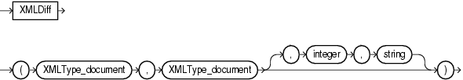

Syntax



> ```
> XMLDIFF ( XMLType_document, XMLType_document [ , integer, string ] )
> ```
  
  

Purpose

The `XMLDiff` function is the SQL interface for the XmlDiff C API. This function compares two XML documents and captures the differences in XML conforming to an Xdiff schema. The diff document is returned as an XMLType document.

- For the first two arguments, specify the names of two XMLType documents.
- For the `integer`, specify a number representing the hashLevel for a C function XmlDiff. If you do not want hashing, set this argument to 0 or omit it entirely. If you do not want hashing, but you want to specify flags, then you must set this argument to 0.
- For `string`, specify the flags that control the behavior of the function. These flags are specified by one or more names separated by semicolon. The names are the same as the names of constants for XmlDiff function.

See Also:

[Oracle XML Developer's Kit Programmer's Guide](https://docs.oracle.com/cd/E11882_01/appdev.112/e23582/adx_c_diff.htm#ADXDK2510) for more information on using this function, including examples, and [Oracle Database XML C API Reference](https://docs.oracle.com/cd/E11882_01/appdev.112/e10770/xmldiff.htm#CAXML6192) for information on the XML APIs for C

Examples

The following example compares two XML documents and returns the difference as an XMLType document:

```
SELECT XMLDIFF(
XMLTYPE('<?xml version="1.0"?>
<bk:book xmlns:bk="http://example.com">
   <bk:tr>
        <bk:td>
                <bk:chapter>
                        Chapter 1.
                </bk:chapter>
        </bk:td>
        <bk:td>
                 <bk:chapter>
                        Chapter 2.
                </bk:chapter>
        </bk:td>
   </bk:tr>
</bk:book>'),
XMLTYPE('<?xml version="1.0"?>
<bk:book xmlns:bk="http://example.com">
   <bk:tr>
        <bk:td>
                <bk:chapter>
                        Chapter 1.
                </bk:chapter>
        </bk:td>
        <bk:td/>
   </bk:tr>
</bk:book>')
)
FROM DUAL;
```