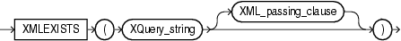

Syntax



> ```
> XMLEXISTS ( XQuery_string [ XML_passing_clause ] )
> ```
  
  

XML\_passing\_clause::=


> ```
> PASSING [ BY VALUE ] 
>     expr [ AS identifier ]
>       [, expr [ AS identifier ] 
>       ]...
> ```
  
  

Purpose

`XMLExists` checks whether a given XQuery expression returns a nonempty XQuery sequence. If so, the function returns `TRUE`; otherwise, it returns `FALSE`. The argument `XQuery_string` is a literal string, but it can contain XQuery variables that you bind using the `XML_passing_clause`.

The `expr` in the `XML_passing_clause` is an expression returning an `XMLType` or an instance of a SQL scalar data type that is used as the context for evaluating the XQuery expression. You can specify only one `expr` in the `PASSING` clause without an identifier. The result of evaluating each `expr` is bound to the corresponding identifier in the `XQuery_string`. If any `expr` that is not followed by an `AS` clause, then the result of evaluating that expression is used as the context item for evaluating the `XQuery_string`.

See Also:

[Oracle XML DB Developer's Guide](https://docs.oracle.com/cd/E11882_01/appdev.112/e23094/xdb04cre.htm#ADXDB0400) for more information on uses for this function and examples