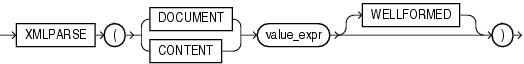

Syntax



> ```
> XMLPARSE
>   ({ DOCUMENT | CONTENT } value_expr [ WELLFORMED ]
>   )
> ```
  
  

Purpose

`XMLParse` parses and generates an XML instance from the evaluated result of `value_expr`. The `value_expr` must resolve to a string. If `value_expr` resolves to null, then the function returns null.

- If you specify `DOCUMENT`, then `value_expr` must resolve to a singly rooted XML document.
- If you specify `CONTENT`, then `value_expr` must resolve to a valid XML value.
- When you specify `WELLFORMED`, you are guaranteeing that `value_expr` resolves to a well-formed XML document, so the database does not perform validity checks to ensure that the input is well formed.

See Also:

[Oracle XML DB Developer's Guide](https://docs.oracle.com/cd/E11882_01/appdev.112/e23094/xdb13gen.htm#ADXDB1620) for more information on this function

Examples

The following example uses the `DUAL` table to illustrate the syntax of `XMLParse`:

```
SELECT XMLPARSE(CONTENT '124 <purchaseOrder poNo="12435"> 
   <customerName> Acme Enterprises</customerName>
   <itemNo>32987457</itemNo>
   </purchaseOrder>' 
WELLFORMED) AS PO FROM DUAL;
 
PO
-----------------------------------------------------------------
124 <purchaseOrder poNo="12435">
   <customerName> Acme Enterprises</customerName>
   <itemNo>32987457</itemNo>
   </purchaseOrder>
```