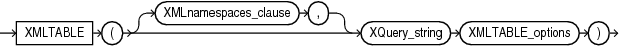
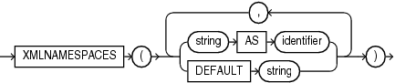
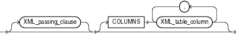
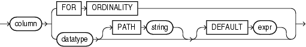

Syntax



> ```
> XMLTABLE
>  ( 
>   [ XMLnamespaces_clause , ] XQuery_string XMLTABLE_options 
>  )
> ```
  
  

XMLnamespaces\_clause::=



> ```
> XMLNAMESPACES
>   ( { string AS identifier } | { DEFAULT string }
>       [, { string AS identifier } | { DEFAULT string } ]...
>   )
> ```
  
  

Note:

You can specify at most one `DEFAULT` `string` clause.

XMLTABLE\_options::=



> ```
> [ XML_passing_clause ]
> [ COLUMNS XML_table_column [, XML_table_column]...]
> ```
  
  

XML\_passing\_clause::=


> ```
> PASSING [ BY VALUE ] 
>     expr [ AS identifier ]
>       [, expr [ AS identifier ] 
>       ]...
> ```
  
  

XML\_table\_column::=



> ```
> column
>      { FOR ORDINALITY 
>      | datatype [ PATH string ] [ DEFAULT expr ]
>      }
> ```
  
  

Purpose

`XMLTable` maps the result of an XQuery evaluation into relational rows and columns. You can query the result returned by the function as a virtual relational table using SQL.

- The `XMLNAMESPACES` clause contains a set of XML namespace declarations. These declarations are referenced by the XQuery expression (the evaluated `XQuery_string`), which computes the row, and by the XPath expression in the `PATH` clause of `XML_table_column`, which computes the columns for the entire `XMLTable` function. If you want to use qualified names in the `PATH` expressions of the `COLUMNS` clause, then you need to specify the `XMLNAMESPACES` clause.
- `XQuery_string` is a complete XQuery expression and can include prolog declarations.
- The `expr` in the `XML_passing_clause` is an expression returning an `XMLType` or an instance of a SQL scalar data type that is used as the context for evaluating the XQuery expression. You can specify only one `expr` in the `PASSING` clause without an identifier. The result of evaluating each `expr` is bound to the corresponding identifier in the `XQuery_string`. If any `expr` that is not followed by an `AS` clause, then the result of evaluating that expression is used as the context item for evaluating the `XQuery_string`.
- The optional `COLUMNS` clause defines the columns of the virtual table to be created by `XMLTable`.
	- If you omit the `COLUMNS` clause, then `XMLTable` returns a row with a single `XMLType` pseudocolumn named `COLUMN_VALUE`.
		- `FOR` `ORDINALITY` specifies that column is to be a column of generated row numbers. There must be at most one `FOR` `ORDINALITY` clause. It is created as a `NUMBER` column.
		- For each resulting column except the `FOR` `ORDINALITY` column, you must specify the column `datatype`, which can be `XMLType` or any other data type.
		- The optional `PATH` clause specifies that the portion of the XQuery result that is addressed by XQuery expression string is to be used as the column content. If you omit `PATH`, then the XQuery expression `column` is assumed. For example:
		```
		XMLTable(... COLUMNS xyz
		```
		is equivalent to
		```
		XMLTable(... COLUMNS xyz PATH 'XYZ')
		```
		You can use different `PATH` clauses to split the XQuery result into different virtual-table columns.
		- The optional `DEFAULT` clause specifies the value to use when the `PATH` expression results in an empty sequence. Its `expr` is an XQuery expression that is evaluated to produce the default value.

See Also:

[Oracle XML DB Developer's Guide](https://docs.oracle.com/cd/E11882_01/appdev.112/e23094/xdb_xquery.htm#ADXDB1700) for more information on the `XMLTable` function, including additional examples, and on XQuery in general

Examples

The following example converts the result of applying the XQuery `'/Warehouse'` to each value in the `warehouse_spec` column of the `warehouses` table into a virtual relational table with columns `Water` and `Rail`:

```
SELECT warehouse_name warehouse,
   warehouse2."Water", warehouse2."Rail"
   FROM warehouses,
   XMLTABLE('/Warehouse'
      PASSING warehouses.warehouse_spec
      COLUMNS 
         "Water" varchar2(6) PATH '/Warehouse/WaterAccess',
         "Rail" varchar2(6) PATH '/Warehouse/RailAccess') 
      warehouse2;

WAREHOUSE                           Water  Rail
----------------------------------- ------ ------
Southlake, Texas                    Y      N
San Francisco                       Y      N
New Jersey                          N      N
Seattle, Washington                 N      Y
```