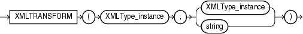

Syntax



> ```
> XMLTRANSFORM(XMLType_instance, { XMLType_instance
>                                | string
>                                }
>                    )
> ```
  
  

Purpose

`XMLTransform` takes as arguments an `XMLType` instance and an XSL style sheet, which is itself a form of `XMLType` instance. It applies the style sheet to the instance and returns an `XMLType`.

This function is useful for organizing data according to a style sheet as you are retrieving it from the database.

See Also:

[Oracle XML DB Developer's Guide](https://docs.oracle.com/cd/E11882_01/appdev.112/e23094/xdb08tra.htm#ADXDB0900) for more information on this function

Examples

The `XMLTransform` function requires the existence of an XSL style sheet. Here is an example of a very simple style sheet that alphabetizes elements within a node:

```
CREATE TABLE xsl_tab (col1 XMLTYPE);

INSERT INTO xsl_tab VALUES (
   XMLTYPE.createxml(
   '<?xml version="1.0"?> 
    <xsl:stylesheet version="1.0" xmlns:xsl="http://www.w3.org/1999/XSL/Transform" >
      <xsl:output encoding="utf-8"/>
      <!-- alphabetizes an xml tree -->  
      <xsl:template match="*">  
        <xsl:copy>
          <xsl:apply-templates select="*|text()">
            <xsl:sort select="name(.)" data-type="text" order="ascending"/>
          </xsl:apply-templates> 
        </xsl:copy> 
      </xsl:template>
      <xsl:template match="text()"> 
        <xsl:value-of select="normalize-space(.)"/>
      </xsl:template>
    </xsl:stylesheet>  '));

1 row created.
```

The next example uses the `xsl_tab` XSL style sheet to alphabetize the elements in one `warehouse_spec` of the sample table `oe.warehouses`:

```
SELECT XMLTRANSFORM(w.warehouse_spec, x.col1).GetClobVal()
   FROM warehouses w, xsl_tab x
   WHERE w.warehouse_name = 'San Francisco';

XMLTRANSFORM(W.WAREHOUSE_SPEC,X.COL1).GETCLOBVAL()
--------------------------------------------------------------------------------
<Warehouse>
  <Area>50000</Area>
  <Building>Rented</Building>
  <DockType>Side load</DockType>
  <Docks>1</Docks>
  <Parking>Lot</Parking>
  <RailAccess>N</RailAccess>
  <VClearance>12 ft</VClearance>
  <WaterAccess>Y</WaterAccess>
</Warehouse>
```