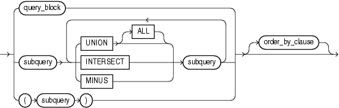
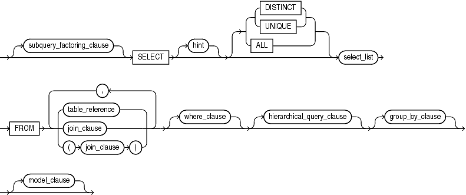

A query is an operation that retrieves data from one or more tables or views. In this reference, a top-level `SELECT` statement is called a query, and a query nested within another SQL statement is called a subquery.

This section describes some types of queries and subqueries and how to use them. The top level of the syntax is shown in this chapter. Refer to [SELECT](statements_10002.md) for the full syntax of all the clauses and the semantics of this statement.

select::=


> ```
> subquery [ for_update_clause ] ;
> ```
  
  

subquery::=



> ```
> { query_block
> | subquery { UNION [ALL] | INTERSECT | MINUS } subquery
>     [ { UNION [ALL] | INTERSECT | MINUS } subquery ]...
> | ( subquery )
> } [ order_by_clause ]
> ```
  
  

query\_block::=



> ```
> [ subquery_factoring_clause ]
> SELECT [ hint ] [ { { DISTINCT | UNIQUE } | ALL } ] select_list
>   FROM { table_reference | join_clause | ( join_clause ) }
>          [ , { table_reference | join_clause | (join_clause) } ] ...
>   [ where_clause ]
>   [ hierarchical_query_clause ]
>   [ group_by_clause ]
>   [ model_clause ]
> ```
