You can create two types of comments:

- Comments within SQL statements are stored as part of the application code that executes the SQL statements.
- Comments associated with individual schema or nonschema objects are stored in the data dictionary along with metadata on the objects themselves.

## Comments Within SQL Statements

Comments can make your application easier for you to read and maintain. For example, you can include a comment in a statement that describes the purpose of the statement within your application. With the exception of hints, comments within SQL statements do not affect the statement execution. Refer to "Hints" on using this particular form of comment.

A comment can appear between any keywords, parameters, or punctuation marks in a statement. You can include a comment in a statement in two ways:

- Begin the comment with a slash and an asterisk (/\*). Proceed with the text of the comment. This text can span multiple lines. End the comment with an asterisk and a slash (\*/). The opening and terminating characters need not be separated from the text by a space or a line break.
- Begin the comment with -- (two hyphens). Proceed with the text of the comment. This text cannot extend to a new line. End the comment with a line break.

Some of the tools used to enter SQL have additional restrictions. For example, if you are using SQL\*Plus, by default you cannot have a blank line inside a multiline comment. For more information, refer to the documentation for the tool you use as an interface to the database.

A SQL statement can contain multiple comments of both styles. The text of a comment can contain any printable characters in your database character set.

Example These statements contain many comments:

```
SELECT last_name, employee_id, salary + NVL(commission_pct, 0), 
       job_id, e.department_id
  /* Select all employees whose compensation is
  greater than that of Pataballa.*/
  FROM employees e, departments d
  /*The DEPARTMENTS table is used to get the department name.*/
  WHERE e.department_id = d.department_id
    AND salary + NVL(commission_pct,0) >   /* Subquery:       */
      (SELECT salary + NVL(commission_pct,0)
        /* total compensation is salary + commission_pct */
        FROM employees 
        WHERE last_name = 'Pataballa')
  ORDER BY last_name, employee_id;

SELECT last_name,                                   -- select the name
       employee_id                                  -- employee id
       salary + NVL(commission_pct, 0),             -- total compensation
       job_id,                                      -- job
       e.department_id                              -- and department
  FROM employees e,                                 -- of all employees
       departments d
  WHERE e.department_id = d.department_id
    AND salary + NVL(commission_pct, 0) >           -- whose compensation 
                                                    -- is greater than
        (SELECT salary + NVL(commission_pct,0)      -- the compensation
          FROM employees 
          WHERE last_name = 'Pataballa')            -- of Pataballa
  ORDER BY last_name                                -- and order by last name
           employee_id                              -- and employee id.
;
```

## Hints

Hints are comments in a SQL statement that pass instructions to the Oracle Database optimizer. The optimizer uses these hints to choose an execution plan for the statement, unless some condition exists that prevents the optimizer from doing so.

Hints were introduced in Oracle7, when users had little recourse if the optimizer generated suboptimal plans. Now Oracle provides a number of tools, including the SQL Tuning Advisor, SQL plan management, and SQL Performance Analyzer, to help you address performance problems that are not solved by the optimizer. Oracle strongly recommends that you use those tools rather than hints. The tools are far superior to hints, because when used on an ongoing basis, they provide fresh solutions as your data and database environment change.

Hints should be used sparingly, and only after you have collected statistics on the relevant tables and evaluated the optimizer plan without hints using the `EXPLAIN PLAN` statement. Changing database conditions as well as query performance enhancements in subsequent releases can have significant impact on how hints in your code affect performance.

The remainder of this section provides information on some commonly used hints. If you decide to use hints rather than the more advanced tuning tools, be aware that any short-term benefit resulting from the use of hints may not continue to result in improved performance over the long term.

Using Hints

A statement block can have only one comment containing hints, and that comment must follow the `SELECT`, `UPDATE`, `INSERT`, `MERGE`, or `DELETE` keyword.

The following syntax diagram shows hints contained in both styles of comments that Oracle supports within a statement block. The hint syntax must follow immediately after an `INSERT`, `UPDATE`, `DELETE`, `SELECT`, or `MERGE` keyword that begins the statement block.

hint::=

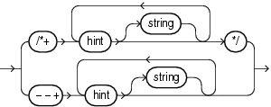

> ```
> { /*+ hint [ string ] [ hint [ string ] ]... */
> | --+ hint [ string ] [ hint [ string ] ]...
> }
> ```
  
  

where:

- The plus sign (+) causes Oracle to interpret the comment as a list of hints. The plus sign must follow immediately after the comment delimiter. No space is permitted.
- `hint` is one of the hints discussed in this section. The space between the plus sign and the hint is optional. If the comment contains multiple hints, then separate the hints by at least one space.
- `string` is other commenting text that can be interspersed with the hints.

The `--+` syntax requires that the entire comment be on a single line.

Oracle Database ignores hints and does not return an error under the following circumstances:

- The hint contains misspellings or syntax errors. However, the database does consider other correctly specified hints in the same comment.
- The comment containing the hint does not follow a `DELETE`, `INSERT`, `MERGE`, `SELECT`, or `UPDATE` keyword.
- A combination of hints conflict with each other. However, the database does consider other hints in the same comment.
- The database environment uses PL/SQL version 1, such as Forms version 3 triggers, Oracle Forms 4.5, and Oracle Reports 2.5.
- A global hint refers to multiple query blocks. Refer to "Specifying Multiple Query Blocks in a Global Hint" for more information.

Specifying a Query Block in a Hint

You can specify an optional query block name in many hints to specify the query block to which the hint applies. This syntax lets you specify in the outer query a hint that applies to an inline view.

The syntax of the query block argument is of the form `@` `queryblock`, where `queryblock` is an identifier that specifies a query block in the query. The `queryblock` identifier can either be system-generated or user-specified. When you specify a hint in the query block itself to which the hint applies, you omit the `@queryblock` syntax.

- The system-generated identifier can be obtained by using `EXPLAIN` `PLAN` for the query. Pretransformation query block names can be determined by running `EXPLAIN` `PLAN` for the query using the `NO_QUERY_TRANSFORMATION` hint. See "NO\_QUERY\_TRANSFORMATION Hint".
- The user-specified name can be set with the `QB_NAME` hint. See "QB\_NAME Hint".

Specifying Global Hints

Many hints can apply both to specific tables or indexes and more globally to tables within a view or to columns that are part of indexes. The syntactic elements `tablespec` and `indexspec` define these global hints.

tablespec::=

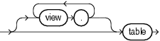

> ```
> [ view.[ view. ]... ]table
> ```
  
  

You must specify the table to be accessed exactly as it appears in the statement. If the statement uses an alias for the table, then use the alias rather than the table name in the hint. However, do not include the schema name with the table name within the hint, even if the schema name appears in the statement.

Note:

Specifying a global hint using the `tablespec` clause does not work for queries that use ANSI joins, because the optimizer generates additional views during parsing. Instead, specify `@` `queryblock` to indicate the query block to which the hint applies.

indexspec::=

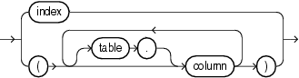

> ```
> { index
> | ( [ table. ]column [ [ table. ]column ]...)
> }
> ```
  
  

When `tablespec` is followed by `indexspec` in the specification of a hint, a comma separating the table name and index name is permitted but not required. Commas are also permitted, but not required, to separate multiple occurrences of `indexspec`.

Specifying Multiple Query Blocks in a Global Hint

Oracle Database ignores global hints that refer to multiple query blocks. To avoid this issue, Oracle recommends that you specify the object alias in the hint instead of using `tablespec` and `indexspec`.

For example, consider the following view `v` and table `t`:

```
CREATE VIEW v AS
  SELECT e.last_name, e.department_id, d.location_id
  FROM employees e, departments d
  WHERE e.department_id = d.department_id;
 
CREATE TABLE t AS
  SELECT * from employees
  WHERE employee_id < 200;
```

Note:

The following examples use the `EXPLAIN` `PLAN` statement, which enables you to display the execution plan and determine if a hint is honored or ignored. Refer to [EXPLAIN PLAN](statements_9010.md) for more information.

The `LEADING` hint is ignored in the following query because it refers to multiple query blocks, that is, the main query block containing table `t` and the view query block `v`:

```
EXPLAIN PLAN
  SET STATEMENT_ID = 'Test 1'
  INTO plan_table FOR
    (SELECT /*+ LEADING(v.e v.d t) */ *
     FROM t, v
     WHERE t.department_id = v.department_id);
```

The following `SELECT` statement returns the execution plan, which shows that the `LEADING` hint was ignored:

```
SELECT id, LPAD(' ',2*(LEVEL-1))||operation operation, options, object_name,  object_alias
  FROM plan_table
  START WITH id = 0 AND statement_id = 'Test 1'
  CONNECT BY PRIOR id = parent_id AND statement_id = 'Test 1'
  ORDER BY id;

 ID OPERATION            OPTIONS    OBJECT_NAME   OBJECT_ALIAS
--- -------------------- ---------- ------------- --------------------
  0 SELECT STATEMENT
  1   HASH JOIN
  2     HASH JOIN
  3       TABLE ACCESS   FULL       DEPARTMENTS   D@SEL$2
  4       TABLE ACCESS   FULL       EMPLOYEES     E@SEL$2
  5     TABLE ACCESS     FULL       T             T@SEL$1
```

The `LEADING` hint is honored in the following query because it refers to object aliases, which can be found in the execution plan that was returned by the previous query:

```
EXPLAIN PLAN
  SET STATEMENT_ID = 'Test 2'
  INTO plan_table FOR
    (SELECT /*+ LEADING(E@SEL$2 D@SEL$2 T@SEL$1) */ *
     FROM t, v
     WHERE t.department_id = v.department_id);
```

The following `SELECT` statement returns the execution plan, which shows that the `LEADING` hint was honored:

```
SELECT id, LPAD(' ',2*(LEVEL-1))||operation operation, options,
  object_name, object_alias
  FROM plan_table
  START WITH id = 0 AND statement_id = 'Test 2'
  CONNECT BY PRIOR id = parent_id AND statement_id = 'Test 2'
  ORDER BY id;

 ID OPERATION            OPTIONS    OBJECT_NAME   OBJECT_ALIAS
--- -------------------- ---------- ------------- --------------------
  0 SELECT STATEMENT
  1   HASH JOIN
  2     HASH JOIN
  3       TABLE ACCESS   FULL       EMPLOYEES     E@SEL$2
  4       TABLE ACCESS   FULL       DEPARTMENTS   D@SEL$2
  5     TABLE ACCESS     FULL       T             T@SEL$1
```

See Also:

Oracle Database Performance Tuning Guide for information on the following topics:
- When to use [global hints](https://docs.oracle.com/cd/E11882_01/server.112/e41573/hintsref.htm#PFGRF50104) and how Oracle interprets them
- Using [`EXPLAIN` `PLAN`](https://docs.oracle.com/cd/E11882_01/server.112/e41573/ex_plan.htm#PFGRF009) to learn how the optimizer is executing a query
- [References in hints to tables within views](https://docs.oracle.com/cd/E11882_01/server.112/e41573/hintsref.htm#PFGRF51000)

Hints by Functional Category

Table 3-21 lists the hints by functional category and contains cross-references to the syntax and semantics for each hint. An alphabetical reference of the hints follows the table.

Table 3-21 Hints by Functional Category

| Hint | Link to Syntax and Semantics |
| --- | --- |
| Optimization Goals and Approaches | ALL\_ROWS Hint  FIRST\_ROWS Hint |
| Access Path Hints | CLUSTER Hint |
| \-- | FULL Hint |
| \-- | HASH Hint |
| \-- | INDEX Hint  NO\_INDEX Hint |
| \-- | INDEX\_ASC Hint  INDEX\_DESC Hint |
| \-- | INDEX\_COMBINE Hint |
| \-- | INDEX\_JOIN Hint |
| \-- | INDEX\_FFS Hint |
| \-- | INDEX\_SS Hint |
| \-- | INDEX\_SS\_ASC Hint |
| \-- | INDEX\_SS\_DESC Hint |
| \-- | NATIVE\_FULL\_OUTER\_JOIN Hint  NO\_NATIVE\_FULL\_OUTER\_JOIN Hint |
| \-- | NO\_INDEX\_FFS Hint |
| \-- | NO\_INDEX\_SS Hint |
| Join Order Hints | ORDERED Hint |
| \-- | LEADING Hint |
| Join Operation Hints | USE\_HASH Hint  NO\_USE\_HASH Hint |
| \-- | USE\_MERGE Hint  NO\_USE\_MERGE Hint |
| \-- | USE\_NL Hint  USE\_NL\_WITH\_INDEX Hint  NO\_USE\_NL Hint |
| Parallel Execution Hints | PARALLEL Hint  NO\_PARALLEL Hint |
| \-- | PARALLEL\_INDEX Hint  NO\_PARALLEL\_INDEX Hint |
| \-- | PQ\_DISTRIBUTE Hint |
| Online Application Upgrade Hints | CHANGE\_DUPKEY\_ERROR\_INDEX Hint |
| \-- | IGNORE\_ROW\_ON\_DUPKEY\_INDEX Hint |
| \-- | RETRY\_ON\_ROW\_CHANGE Hint |
| Query Transformation Hints | FACT Hint  NO\_FACT Hint |
| \-- | MERGE Hint  NO\_MERGE Hint |
| \-- | NO\_EXPAND Hint  USE\_CONCAT Hint |
| \-- | REWRITE Hint  NO\_REWRITE Hint |
| \-- | UNNEST Hint  NO\_UNNEST Hint |
| \-- | STAR\_TRANSFORMATION Hint  NO\_STAR\_TRANSFORMATION Hint |
| \-- | NO\_QUERY\_TRANSFORMATION Hint |
| XML Hints | NO\_XMLINDEX\_REWRITE Hint |
| \-- | NO\_XML\_QUERY\_REWRITE Hint |
| Other Hints | APPEND Hint  APPEND\_VALUES Hint  NOAPPEND Hint |
| \-- | CACHE Hint  NOCACHE Hint |
| \-- | CURSOR\_SHARING\_EXACT Hint |
| \-- | DRIVING\_SITE Hint |
| \-- | DYNAMIC\_SAMPLING Hint |
| \-- | MODEL\_MIN\_ANALYSIS Hint |
| \-- | MONITOR Hint |
| \-- | NO\_MONITOR Hint |
| \-- | OPT\_PARAM Hint |
| \-- | PUSH\_PRED Hint  NO\_PUSH\_PRED Hint |
| \-- | PUSH\_SUBQ Hint  NO\_PUSH\_SUBQ Hint |
| \-- | PX\_JOIN\_FILTER Hint  NO\_PX\_JOIN\_FILTER Hint |
| \-- | QB\_NAME Hint |
| \-- | RESULT\_CACHE Hint  NO\_RESULT\_CACHE Hint |

## Alphabetical Listing of Hints

This section provides syntax and semantics for all hints in alphabetical order.

### ALL\_ROWS Hint

  
[Description of the illustration ''all\_rows\_hint.gif''](https://docs.oracle.com/cd/E11882_01/server.112/e41084/img_text/all_rows_hint.htm)  
  

The `ALL_ROWS` hint instructs the optimizer to optimize a statement block with a goal of best throughput, which is minimum total resource consumption. For example, the optimizer uses the query optimization approach to optimize this statement for best throughput:

```
SELECT /*+ ALL_ROWS */ employee_id, last_name, salary, job_id
  FROM employees
  WHERE employee_id = 107;
```

If you specify either the `ALL_ROWS` or the `FIRST_ROWS` hint in a SQL statement, and if the data dictionary does not have statistics about tables accessed by the statement, then the optimizer uses default statistical values, such as allocated storage for such tables, to estimate the missing statistics and to subsequently choose an execution plan. These estimates might not be as accurate as those gathered by the `DBMS_STATS` package, so you should use the `DBMS_STATS` package to gather statistics.

If you specify hints for access paths or join operations along with either the `ALL_ROWS` or `FIRST_ROWS` hint, then the optimizer gives precedence to the access paths and join operations specified by the hints.

### APPEND Hint

  
[Description of the illustration ''append\_hint.gif''](https://docs.oracle.com/cd/E11882_01/server.112/e41084/img_text/append_hint.htm)  
  

The `APPEND` hint instructs the optimizer to use direct-path `INSERT` with the subquery syntax of the `INSERT` statement.

- Conventional `INSERT` is the default in serial mode. In serial mode, direct path can be used only if you include the `APPEND` hint.
- Direct-path `INSERT` is the default in parallel mode. In parallel mode, conventional insert can be used only if you specify the `NOAPPEND` hint.

The decision whether the `INSERT` will go parallel or not is independent of the `APPEND` hint.

In direct-path `INSERT`, data is appended to the end of the table, rather than using existing space currently allocated to the table. As a result, direct-path `INSERT` can be considerably faster than conventional `INSERT`.

The `APPEND` hint is only supported with the subquery syntax of the `INSERT` statement, not the `VALUES` clause. If you specify the `APPEND` hint with the `VALUES` clause, it is ignored and conventional insert will be used. To use direct-path `INSERT` with the `VALUES` clause, refer to "APPEND\_VALUES Hint".

See Also:

"NOAPPEND Hint " for information on that hint and [Oracle Database Administrator's Guide](https://docs.oracle.com/cd/E11882_01/server.112/e25494/tables.htm#ADMIN01509) for information on direct-path inserts

### APPEND\_VALUES Hint

  
[Description of the illustration ''append\_values\_hint.gif''](https://docs.oracle.com/cd/E11882_01/server.112/e41084/img_text/append_values_hint.htm)  
  

The `APPEND_VALUES` hint instructs the optimizer to use direct-path `INSERT` with the `VALUES` clause. If you do not specify this hint, then conventional `INSERT` is used.

In direct-path `INSERT`, data is appended to the end of the table, rather than using existing space currently allocated to the table. As a result, direct-path `INSERT` can be considerably faster than conventional `INSERT`.

The `APPEND_VALUES` hint can be used to greatly enhance performance. Some examples of its uses are:

- In an Oracle Call Interface (OCI) program, when using large array binds or array binds with row callbacks
- In PL/SQL, when loading a large number of rows with a `FORALL` loop that has an `INSERT` statement with a `VALUES` clause

The `APPEND_VALUES` hint is only supported with the `VALUES` clause of the `INSERT` statement. If you specify the `APPEND_VALUES` hint with the subquery syntax of the `INSERT` statement, it is ignored and conventional insert will be used. To use direct-path `INSERT` with a subquery, refer to "APPEND Hint".

See Also:

[Oracle Database Administrator's Guide](https://docs.oracle.com/cd/E11882_01/server.112/e25494/tables.htm#ADMIN01509) for information on direct-path inserts

### CACHE Hint

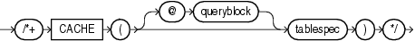

> ```
> /*+ CACHE ( [ @ queryblock ] tablespec ) */
> ```
  
  

(See "Specifying a Query Block in a Hint", tablespec::=)

The `CACHE` hint instructs the optimizer to place the blocks retrieved for the table at the most recently used end of the LRU list in the buffer cache when a full table scan is performed. This hint is useful for small lookup tables.

In the following example, the `CACHE` hint overrides the default caching specification of the table:

```
SELECT /*+ FULL (hr_emp) CACHE(hr_emp) */ last_name
  FROM employees hr_emp;
```

The `CACHE` and `NOCACHE` hints affect system statistics `table scans (long tables)` and `table scans (short tables)`, as shown in the `V$SYSSTAT` data dictionary view.

### CHANGE\_DUPKEY\_ERROR\_INDEX Hint

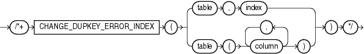

> ```
> /*+ CHANGE_DUPKEY_ERROR_INDEX 
>   ( { table, index
>     | table (column [, column]... )
>     }
>   ) */
> ```
  
  

Note:

The `CHANGE_DUPKEY_ERROR_INDEX`, `IGNORE_ROW_ON_DUPKEY_INDEX`, and `RETRY_ON_ROW_CHANGE` hints are unlike other hints in that they have a semantic effect. The general philosophy explained in "Hints" does not apply for these three hints.

The `CHANGE_DUPKEY_ERROR_INDEX` hint provides a mechanism to unambiguously identify a unique key violation for a specified set of columns or for a specified index. When a unique key violation occurs for the specified index, an ORA-38911 error is reported instead of an ORA-001.

This hint applies to `INSERT`, `UPDATE` operations. If you specify an index, then the index must exist and be unique. If you specify a column list instead of an index, then a unique index whose columns match the specified columns in number and order must exist.

This use of this hint results in error messages if specific rules are violated. Refer to IGNORE\_ROW\_ON\_DUPKEY\_INDEX Hint for details.

Note:

This hint disables both `APPEND` mode and parallel DML.

### CLUSTER Hint

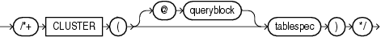

> ```
> /*+ CLUSTER ( [ @ queryblock ] tablespec ) */
> ```
  
  

(See "Specifying a Query Block in a Hint", tablespec::=)

The `CLUSTER` hint instructs the optimizer to use a cluster scan to access the specified table. This hint applies only to tables in an indexed cluster.

### CURSOR\_SHARING\_EXACT Hint

  
[Description of the illustration ''cursor\_sharing\_exact\_hint.gif''](https://docs.oracle.com/cd/E11882_01/server.112/e41084/img_text/cursor_sharing_exact_hint.htm)  
  

Oracle can replace literals in SQL statements with bind variables, when it is safe to do so. This replacement is controlled with the `CURSOR_SHARING` initialization parameter. The `CURSOR_SHARING_EXACT` hint instructs the optimizer to switch this behavior off. When you specify this hint, Oracle executes the SQL statement without any attempt to replace literals with bind variables.

### DRIVING\_SITE Hint

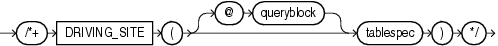

> ```
> /*+ DRIVING_SITE ( [ @ queryblock ] tablespec ) */
> ```
  
  

(See "Specifying a Query Block in a Hint", tablespec::=)

The `DRIVING_SITE` hint instructs the optimizer to execute the query at a different site than that selected by the database. This hint is useful if you are using distributed query optimization.

For example:

```
SELECT /*+ DRIVING_SITE(departments) */ * 
  FROM employees, departments@rsite 
  WHERE employees.department_id = departments.department_id;
```

If this query is executed without the hint, then rows from `departments` are sent to the local site, and the join is executed there. With the hint, the rows from `employees` are sent to the remote site, and the query is executed there and the result set is returned to the local site.

### DYNAMIC\_SAMPLING Hint

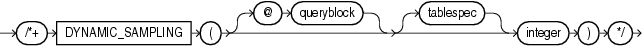

> ```
> /*+ DYNAMIC_SAMPLING ( [ @ queryblock ] [ tablespec ] integer ) */
> ```
  
  

(See "Specifying a Query Block in a Hint", tablespec::=)

The `DYNAMIC_SAMPLING` hint instructs the optimizer how to control dynamic sampling to improve server performance by determining more accurate predicate selectivity and statistics for tables and indexes.

You can set the value of `DYNAMIC_SAMPLING` to a value from 0 to 10. The higher the level, the more effort the compiler puts into dynamic sampling and the more broadly it is applied. Sampling defaults to cursor level unless you specify `tablespec`.

The `integer` value is `0` to `10,` indicating the degree of sampling.

If a cardinality statistic already exists for the table, then the optimizer uses it. Otherwise, the optimizer enables dynamic sampling to estimate the cardinality statistic.

If you specify `tablespec` and the cardinality statistic already exists, then:

- If there is no single-table predicate (a `WHERE` clause that evaluates only one table), then the optimizer trusts the existing statistics and ignores this hint. For example, the following query will not result in any dynamic sampling if `employees` is analyzed:
	```
	SELECT /*+ DYNAMIC_SAMPLING(e 1) */ count(*)
	  FROM employees e;
	```
- If there is a single-table predicate, then the optimizer uses the existing cardinality statistic and estimates the selectivity of the predicate using the existing statistics.

To apply dynamic sampling to a specific table, use the following form of the hint:

```
SELECT /*+ DYNAMIC_SAMPLING(employees 1) */ *
  FROM employees 
  WHERE ...
```

See Also:

[Oracle Database Performance Tuning Guide](https://docs.oracle.com/cd/E11882_01/server.112/e41573/stats.htm#PFGRF30101) for information about dynamic sampling and the sampling levels that you can set

### FACT Hint

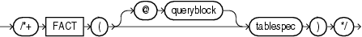

> ```
> /*+ FACT ( [ @ queryblock ] tablespec ) */
> ```
  
  

(See "Specifying a Query Block in a Hint", tablespec::=)

The `FACT` hint is used in the context of the star transformation. It instructs the optimizer that the table specified in `tablespec` should be considered as a fact table.

### FIRST\_ROWS Hint

  
[Description of the illustration ''first\_rows\_hint.gif''](https://docs.oracle.com/cd/E11882_01/server.112/e41084/img_text/first_rows_hint.htm)  
  

The `FIRST_ROWS` hint instructs Oracle to optimize an individual SQL statement for fast response, choosing the plan that returns the first `n` rows most efficiently. For `integer`, specify the number of rows to return.

For example, the optimizer uses the query optimization approach to optimize the following statement for best response time:

```
SELECT /*+ FIRST_ROWS(10) */ employee_id, last_name, salary, job_id
  FROM employees
  WHERE department_id = 20;
```

In this example each department contains many employees. The user wants the first 10 employees of department 20 to be displayed as quickly as possible.

The optimizer ignores this hint in `DELETE` and `UPDATE` statement blocks and in `SELECT` statement blocks that include any blocking operations, such as sorts or groupings. Such statements cannot be optimized for best response time, because Oracle Database must retrieve all rows accessed by the statement before returning the first row. If you specify this hint in any such statement, then the database optimizes for best throughput.

See Also:

"ALL\_ROWS Hint" for additional information on the `FIRST_ROWS` hint and statistics

### FULL Hint

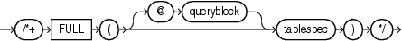

> ```
> /*+ FULL ( [ @ queryblock ] tablespec ) */
> ```
  
  

(See "Specifying a Query Block in a Hint", tablespec::=)

The `FULL` hint instructs the optimizer to perform a full table scan for the specified table. For example:

```
SELECT /*+ FULL(e) */ employee_id, last_name
  FROM hr.employees e 
  WHERE last_name LIKE :b1;
```

Oracle Database performs a full table scan on the `employees` table to execute this statement, even if there is an index on the `last_name` column that is made available by the condition in the `WHERE` clause.

The `employees` table has alias `e` in the `FROM` clause, so the hint must refer to the table by its alias rather than by its name. Do not specify schema names in the hint even if they are specified in the `FROM` clause.

### HASH Hint

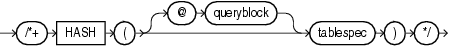

> ```
> /*+ HASH ( [ @ queryblock ] tablespec ) */
> ```
  
  

(See "Specifying a Query Block in a Hint", tablespec::=)

The `HASH` hint instructs the optimizer to use a hash scan to access the specified table. This hint applies only to tables in a hash cluster.

### IGNORE\_ROW\_ON\_DUPKEY\_INDEX Hint

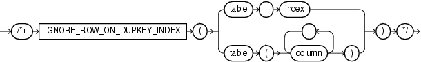

> ```
> /*+ IGNORE_ROW_ON_DUPKEY_INDEX
>   ( { table, index
>     | table (column [, column]... )
>     }
>   ) */
> ```
  
  

Note:

The `CHANGE_DUPKEY_ERROR_INDEX`, `IGNORE_ROW_ON_DUPKEY_INDEX`, and `RETRY_ON_ROW_CHANGE` hints are unlike other hints in that they have a semantic effect. The general philosophy explained in "Hints" does not apply for these three hints.

The `IGNORE_ROW_ON_DUPKEY_INDEX` hint applies only to single-table `INSERT` operations. It is not supported for `UPDATE`, `DELETE`, `MERGE`, or multitable insert operations. `IGNORE_ROW_ON_DUPKEY_INDEX` causes the statement to ignore a unique key violation for a specified set of columns or for a specified index. When a unique key violation is encountered, a row-level rollback occurs and execution resumes with the next input row. If you specify this hint when inserting data with DML error logging enabled, then the unique key violation is not logged and does not cause statement termination.

The semantic effect of this hint results in error messages if specific rules are violated:

- If you specify `index`, then the index must exist and be unique. Otherwise, the statement causes ORA-38913.
- You must specify exactly one index. If you specify no index, then the statement causes ORA-38912. If you specify more than one index, then the statement causes ORA-38915.
- You can specify either a `CHANGE_DUPKEY_ERROR_INDEX` or `IGNORE_ROW_ON_DUPKEY_INDEX` hint in an `INSERT` statement, but not both. If you specify both, then the statement causes ORA-38915.

As with all hints, a syntax error in the hint causes it to be silently ignored. The result will be that ORA-00001 will be caused, just as if no hint were used.

Note:

This hint disables both `APPEND` mode and parallel `DML`.

### INDEX Hint

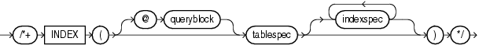

> ```
> /*+ INDEX ( [ @ queryblock ] tablespec [ indexspec [ indexspec ]... ] ) */
> ```
  
  

(See "Specifying a Query Block in a Hint", tablespec::=, indexspec::=)

The `INDEX` hint instructs the optimizer to use an index scan for the specified table. You can use the `INDEX` hint for function-based, domain, B-tree, bitmap, and bitmap join indexes.

The behavior of the hint depends on the `indexspec` specification:

- If the `INDEX` hint specifies a single available index, then the database performs a scan on this index. The optimizer does not consider a full table scan or a scan of another index on the table.
- For a hint on a combination of multiple indexes, Oracle recommends using `INDEX_COMBINE` rather than `INDEX`, because it is a more versatile hint. If the `INDEX` hint specifies a list of available indexes, then the optimizer considers the cost of a scan on each index in the list and then performs the index scan with the lowest cost. The database can also choose to scan multiple indexes from this list and merge the results, if such an access path has the lowest cost. The database does not consider a full table scan or a scan on an index not listed in the hint.
- If the `INDEX` hint specifies no indexes, then the optimizer considers the cost of a scan on each available index on the table and then performs the index scan with the lowest cost. The database can also choose to scan multiple indexes and merge the results, if such an access path has the lowest cost. The optimizer does not consider a full table scan.

For example:

```
SELECT /*+ INDEX (employees emp_department_ix)*/ employee_id, department_id
  FROM employees 
  WHERE department_id > 50;
```

### INDEX\_ASC Hint


> ```
> /*+ INDEX_ASC ( [ @ queryblock ] tablespec [ indexspec [ indexspec ]... ] ) */
> ```
  
  

(See "Specifying a Query Block in a Hint", tablespec::=, indexspec::=)

The `INDEX_ASC` hint instructs the optimizer to use an index scan for the specified table. If the statement uses an index range scan, then Oracle Database scans the index entries in ascending order of their indexed values. Each parameter serves the same purpose as in "INDEX Hint".

The default behavior for a range scan is to scan index entries in ascending order of their indexed values, or in descending order for a descending index. This hint does not change the default order of the index, and therefore does not specify anything more than the `INDEX` hint. However, you can use the `INDEX_ASC` hint to specify ascending range scans explicitly should the default behavior change.

### INDEX\_COMBINE Hint

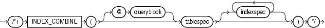

> ```
> /*+ INDEX_COMBINE ( [ @ queryblock ] tablespec [ indexspec [ indexspec ]...] ) */
> ```
  
  

(See "Specifying a Query Block in a Hint", tablespec::=, indexspec::=)

The `INDEX_COMBINE` hint instructs the optimizer to use a bitmap access path for the table. If `indexspec` is omitted from the `INDEX_COMBINE` hint, then the optimizer uses whatever Boolean combination of indexes has the best cost estimate for the table. If you specify `indexspec`, then the optimizer tries to use some Boolean combination of the specified indexes. Each parameter serves the same purpose as in "INDEX Hint". For example:

```
SELECT /*+ INDEX_COMBINE(e emp_manager_ix emp_department_ix) */ *
  FROM employees e
  WHERE manager_id = 108
     OR department_id = 110;
```

### INDEX\_DESC Hint

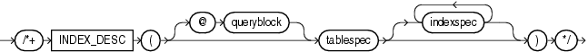

> ```
> /*+ INDEX_DESC ( [ @ queryblock ] tablespec [ indexspec [ indexspec ]... ] ) */
> ```
  
  

(See "Specifying a Query Block in a Hint", tablespec::=, indexspec::=)

The `INDEX_DESC` hint instructs the optimizer to use a descending index scan for the specified table. If the statement uses an index range scan and the index is ascending, then Oracle scans the index entries in descending order of their indexed values. In a partitioned index, the results are in descending order within each partition. For a descending index, this hint effectively cancels out the descending order, resulting in a scan of the index entries in ascending order. Each parameter serves the same purpose as in "INDEX Hint". For example:

```
SELECT /*+ INDEX_DESC(e emp_name_ix) */ *
  FROM employees e;
```

See Also:

[Oracle Database Performance Tuning Guide](https://docs.oracle.com/cd/E11882_01/server.112/e41573/optimops.htm#PFGRF10103) for information on full scans

### INDEX\_FFS Hint


> ```
> /*+ INDEX_FFS ( [ @ queryblock ] tablespec [ indexspec [ indexspec ]... ] ) */
> ```
  
  

(See "Specifying a Query Block in a Hint", tablespec::=, indexspec::=)

The `INDEX_FFS` hint instructs the optimizer to perform a fast full index scan rather than a full table scan.

Each parameter serves the same purpose as in "INDEX Hint". For example:

```
SELECT /*+ INDEX_FFS(e emp_name_ix) */ first_name
  FROM employees e;
```

### INDEX\_JOIN Hint


> ```
> /*+ INDEX_JOIN ( [ @ queryblock ] tablespec [ indexspec [ indexspec ]... ] ) */
> ```
  
  

(See "Specifying a Query Block in a Hint", tablespec::=, indexspec::=)

The `INDEX_JOIN` hint instructs the optimizer to use an index join as an access path. For the hint to have a positive effect, a sufficiently small number of indexes must exist that contain all the columns required to resolve the query.

Each parameter serves the same purpose as in "INDEX Hint". For example, the following query uses an index join to access the `manager_id` and `department_id` columns, both of which are indexed in the `employees` table.

```
SELECT /*+ INDEX_JOIN(e emp_manager_ix emp_department_ix) */ department_id
  FROM employees e
  WHERE manager_id < 110
    AND department_id < 50;
```

### INDEX\_SS Hint

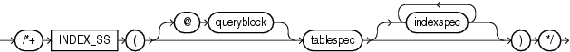

> ```
> /*+ INDEX_SS ( [ @ queryblock ] tablespec [ indexspec [ indexspec ]... ] ) */
> ```
  
  

(See "Specifying a Query Block in a Hint", tablespec::=, indexspec::=)

The `INDEX_SS` hint instructs the optimizer to perform an index skip scan for the specified table. If the statement uses an index range scan, then Oracle scans the index entries in ascending order of their indexed values. In a partitioned index, the results are in ascending order within each partition.

Each parameter serves the same purpose as in "INDEX Hint". For example:

```
SELECT /*+ INDEX_SS(e emp_name_ix) */ last_name
  FROM employees e
  WHERE first_name = 'Steven';
```

See Also:

[Oracle Database Performance Tuning Guide](https://docs.oracle.com/cd/E11882_01/server.112/e41573/optimops.htm#PFGRF10105) for information on index skip scans

### INDEX\_SS\_ASC Hint

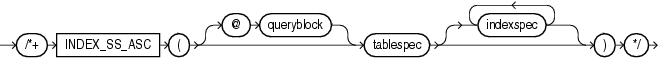

> ```
> /*+ INDEX_SS_ASC ( [ @ queryblock ] tablespec [ indexspec [ indexspec ]... ] ) */
> ```
  
  

(See "Specifying a Query Block in a Hint", tablespec::=, indexspec::=)

The `INDEX_SS_ASC` hint instructs the optimizer to perform an index skip scan for the specified table. If the statement uses an index range scan, then Oracle Database scans the index entries in ascending order of their indexed values. In a partitioned index, the results are in ascending order within each partition. Each parameter serves the same purpose as in "INDEX Hint".

The default behavior for a range scan is to scan index entries in ascending order of their indexed values, or in descending order for a descending index. This hint does not change the default order of the index, and therefore does not specify anything more than the `INDEX_SS` hint. However, you can use the `INDEX_SS_ASC` hint to specify ascending range scans explicitly should the default behavior change.

See Also:

[Oracle Database Performance Tuning Guide](https://docs.oracle.com/cd/E11882_01/server.112/e41573/optimops.htm#PFGRF10105) for information on index skip scans

### INDEX\_SS\_DESC Hint

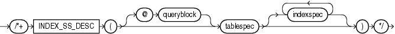

> ```
> /*+ INDEX_SS_DESC ( [ @ queryblock ] tablespec [ indexspec [ indexspec ]... ] ) */
> ```
  
  

(See "Specifying a Query Block in a Hint", tablespec::=, indexspec::=)

The `INDEX_SS_DESC` hint instructs the optimizer to perform an index skip scan for the specified table. If the statement uses an index range scan and the index is ascending, then Oracle scans the index entries in descending order of their indexed values. In a partitioned index, the results are in descending order within each partition. For a descending index, this hint effectively cancels out the descending order, resulting in a scan of the index entries in ascending order.

Each parameter serves the same purpose as in the "INDEX Hint". For example:

```
SELECT /*+ INDEX_SS_DESC(e emp_name_ix) */ last_name
  FROM employees e
  WHERE first_name = 'Steven';
```

See Also:

[Oracle Database Performance Tuning Guide](https://docs.oracle.com/cd/E11882_01/server.112/e41573/optimops.htm#PFGRF10105) for information on index skip scans

### LEADING Hint

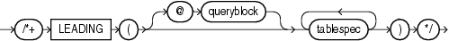

> ```
> /*+ LEADING ( [ @ queryblock ] tablespec [ tablespec ]...  ) */
> ```
  
  

(See "Specifying a Query Block in a Hint", tablespec::=)

The `LEADING` hint instructs the optimizer to use the specified set of tables as the prefix in the execution plan. This hint is more versatile than the `ORDERED` hint. For example:

```
SELECT /*+ LEADING(e j) */ *
    FROM employees e, departments d, job_history j
    WHERE e.department_id = d.department_id
      AND e.hire_date = j.start_date;
```

The `LEADING` hint is ignored if the tables specified cannot be joined first in the order specified because of dependencies in the join graph. If you specify two or more conflicting `LEADING` hints, then all of them are ignored. If you specify the `ORDERED` hint, it overrides all `LEADING` hints.

### MERGE Hint

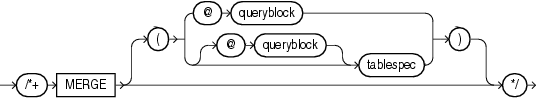

> ```
> /*+ MERGE [ ( @ queryblock )  | ( [ @ queryblock ] tablespec ) ] */
> ```
  
  

(See "Specifying a Query Block in a Hint", tablespec::=)

The `MERGE` hint lets you merge views in a query.

If a view's query block contains a `GROUP` `BY` clause or `DISTINCT` operator in the `SELECT` list, then the optimizer can merge the view into the accessing statement only if complex view merging is enabled. Complex merging can also be used to merge an `IN` subquery into the accessing statement if the subquery is uncorrelated.

For example:

```
SELECT /*+ MERGE(v) */ e1.last_name, e1.salary, v.avg_salary
   FROM employees e1,
        (SELECT department_id, avg(salary) avg_salary 
           FROM employees e2
           GROUP BY department_id) v 
   WHERE e1.department_id = v.department_id
     AND e1.salary > v.avg_salary
   ORDER BY e1.last_name;
```

When the `MERGE` hint is used without an argument, it should be placed in the view query block. When `MERGE` is used with the view name as an argument, it should be placed in the surrounding query.

### MODEL\_MIN\_ANALYSIS Hint

  
[Description of the illustration ''model\_min\_analysis\_hint.gif''](https://docs.oracle.com/cd/E11882_01/server.112/e41084/img_text/model_min_analysis_hint.htm)  
  

The `MODEL_MIN_ANALYSIS` hint instructs the optimizer to omit some compile-time optimizations of spreadsheet rules—primarily detailed dependency graph analysis. Other spreadsheet optimizations, such as creating filters to selectively populate spreadsheet access structures and limited rule pruning, are still used by the optimizer.

This hint reduces compilation time because spreadsheet analysis can be lengthy if the number of spreadsheet rules is more than several hundreds.

### MONITOR Hint

  
[Description of the illustration ''monitor\_hint.gif''](https://docs.oracle.com/cd/E11882_01/server.112/e41084/img_text/monitor_hint.htm)  
  

The `MONITOR` hint forces real-time SQL monitoring for the query, even if the statement is not long running. This hint is valid only when the parameter `CONTROL_MANAGEMENT_PACK_ACCESS` is set to `DIAGNOSTIC+TUNING`.

See Also:

[Oracle Database Performance Tuning Guide](https://docs.oracle.com/cd/E11882_01/server.112/e41573/instance_tune.htm#PFGRF94543) for more information about real-time SQL monitoring

### NATIVE\_FULL\_OUTER\_JOIN Hint

  
[Description of the illustration ''native\_foj\_hint.gif''](https://docs.oracle.com/cd/E11882_01/server.112/e41084/img_text/native_foj_hint.htm)  
  

The `NATIVE_FULL_OUTER_JOIN` hint instructs the optimizer to use native full outer join, which is a native execution method based on a hash join.

See Also:

- NO\_NATIVE\_FULL\_OUTER\_JOIN Hint
- [Oracle Database Performance Tuning Guide](https://docs.oracle.com/cd/E11882_01/server.112/e41573/optimops.htm#PFGRF94662) for more information about native full outer joins

### NOAPPEND Hint

  
[Description of the illustration ''noappend\_hint.gif''](https://docs.oracle.com/cd/E11882_01/server.112/e41084/img_text/noappend_hint.htm)  
  

The `NOAPPEND` hint instructs the optimizer to use conventional `INSERT` by disabling parallel mode for the duration of the `INSERT` statement. Conventional `INSERT` is the default in serial mode, and direct-path `INSERT` is the default in parallel mode.

### NOCACHE Hint

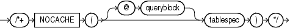

> ```
> /*+ NOCACHE ( [ @ queryblock ] tablespec ) */
> ```
  
  

(See "Specifying a Query Block in a Hint", tablespec::=)

The `NOCACHE` hint instructs the optimizer to place the blocks retrieved for the table at the least recently used end of the LRU list in the buffer cache when a full table scan is performed. This is the normal behavior of blocks in the buffer cache. For example:

```
SELECT /*+ FULL(hr_emp) NOCACHE(hr_emp) */ last_name
  FROM employees hr_emp;
```

The `CACHE` and `NOCACHE` hints affect system statistics `table` `scans(long` `tables)` and `table` `scans(short` `tables)`, as shown in the `V$SYSSTAT` view.

See Also:

[Oracle Database Performance Tuning Guide](https://docs.oracle.com/cd/E11882_01/server.112/e41573/optimops.htm#PFGRF10107) for information on automatic caching of tables, depending on their size

### NO\_EXPAND Hint

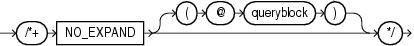

> ```
> /*+ NO_EXPAND [ ( @ queryblock ) ] */
> ```
  
  

(See "Specifying a Query Block in a Hint")

The `NO_EXPAND` hint instructs the optimizer not to consider `OR` -expansion for queries having `OR` conditions or `IN` -lists in the `WHERE` clause. Usually, the optimizer considers using `OR` expansion and uses this method if it decides that the cost is lower than not using it. For example:

```
SELECT /*+ NO_EXPAND */ *
  FROM employees e, departments d
  WHERE e.manager_id = 108
     OR d.department_id = 110;
```

See Also:

The "USE\_CONCAT Hint", which is the opposite of this hint

### NO\_FACT Hint

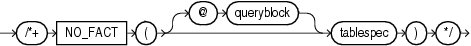

> ```
> /*+ NO_FACT ( [ @ queryblock ] tablespec ) */
> ```
  
  

(See "Specifying a Query Block in a Hint", tablespec::=)

The `NO_FACT` hint is used in the context of the star transformation. It instruct the optimizer that the queried table should not be considered as a fact table.

### NO\_INDEX Hint


> ```
> /*+ NO_INDEX ( [ @ queryblock ] tablespec [ indexspec [ indexspec ]... ] ) */
> ```
  
  

(See "Specifying a Query Block in a Hint", tablespec::=, indexspec::=)

The `NO_INDEX` hint instructs the optimizer not to use one or more indexes for the specified table. For example:

```
SELECT /*+ NO_INDEX(employees emp_empid) */ employee_id 
  FROM employees 
  WHERE employee_id > 200;
```

Each parameter serves the same purpose as in "INDEX Hint" with the following modifications:

- If this hint specifies a single available index, then the optimizer does not consider a scan on this index. Other indexes not specified are still considered.
- If this hint specifies a list of available indexes, then the optimizer does not consider a scan on any of the specified indexes. Other indexes not specified in the list are still considered.
- If this hint specifies no indexes, then the optimizer does not consider a scan on any index on the table. This behavior is the same as a `NO_INDEX` hint that specifies a list of all available indexes for the table.

The `NO_INDEX` hint applies to function-based, B-tree, bitmap, cluster, or domain indexes. If a `NO_INDEX` hint and an index hint (`INDEX`, `INDEX_ASC`, `INDEX_DESC`, `INDEX_COMBINE`, or `INDEX_FFS`) both specify the same indexes, then the database ignores both the `NO_INDEX` hint and the index hint for the specified indexes and considers those indexes for use during execution of the statement.

### NO\_INDEX\_FFS Hint

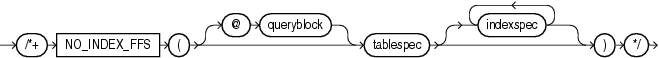

> ```
> /*+ NO_INDEX_FFS ( [ @ queryblock ] tablespec [ indexspec [ indexspec ]... ] ) */
> ```
  
  

(See "Specifying a Query Block in a Hint", tablespec::=, indexspec::=)

The `NO_INDEX_FFS` hint instructs the optimizer to exclude a fast full index scan of the specified indexes on the specified table. Each parameter serves the same purpose as in the "NO\_INDEX Hint". For example:

```
SELECT /*+ NO_INDEX_FFS(items item_order_ix) */ order_id
  FROM order_items items;
```

### NO\_INDEX\_SS Hint

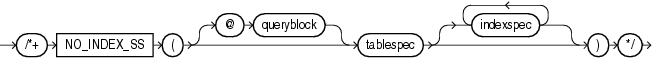

> ```
> /*+ NO_INDEX_SS ( [ @ queryblock ] tablespec [ indexspec [ indexspec ]... ] ) */
> ```
  
  

(See "Specifying a Query Block in a Hint", tablespec::=, indexspec::=)

The `NO_INDEX_SS` hint instructs the optimizer to exclude a skip scan of the specified indexes on the specified table. Each parameter serves the same purpose as in the "NO\_INDEX Hint".

See Also:

[Oracle Database Performance Tuning Guide](https://docs.oracle.com/cd/E11882_01/server.112/e41573/optimops.htm#PFGRF10105) for information on index skip scans

### NO\_MERGE Hint


> ```
> /*+ NO_MERGE [ ( @ queryblock )  | ( [ @ queryblock ] tablespec ) ] */
> ```
  
  

(See "Specifying a Query Block in a Hint", tablespec::=)

The `NO_MERGE` hint instructs the optimizer not to combine the outer query and any inline view queries into a single query.

This hint lets you have more influence over the way in which the view is accessed. For example, the following statement causes view `seattle_dept` not to be merged:

```
SELECT /*+ NO_MERGE(seattle_dept) */ e1.last_name, seattle_dept.department_name
  FROM employees e1,
       (SELECT location_id, department_id, department_name
          FROM departments
          WHERE location_id = 1700) seattle_dept
  WHERE e1.department_id = seattle_dept.department_id;
```

When you use the `NO_MERGE` hint in the view query block, specify it without an argument. When you specify `NO_MERGE` in the surrounding query, specify it with the view name as an argument.

### NO\_MONITOR Hint

  
[Description of the illustration ''no\_monitor\_hint.gif''](https://docs.oracle.com/cd/E11882_01/server.112/e41084/img_text/no_monitor_hint.htm)  
  

The `NO_MONITOR` hint disables real-time SQL monitoring for the query, even if the query is long running.

### NO\_NATIVE\_FULL\_OUTER\_JOIN Hint

  
[Description of the illustration ''no\_native\_foj\_hint.gif''](https://docs.oracle.com/cd/E11882_01/server.112/e41084/img_text/no_native_foj_hint.htm)  
  

The `NO_NATIVE_FULL_OUTER_JOIN` hint instructs the optimizer to exclude the native execution method when joining each specified table. Instead, the full outer join is executed as a union of left outer join and anti-join.

See Also:

NATIVE\_FULL\_OUTER\_JOIN Hint

### NO\_PARALLEL Hint

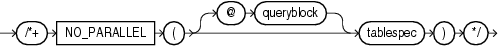

> ```
> /*+ NO_PARALLEL ( [ @ queryblock ] tablespec ) */
> ```
  
  

(See "Specifying a Query Block in a Hint", tablespec::=)

The `NO_PARALLEL` hint instructs the optimizer to run the statement serially. This hint overrides the value of the `PARALLEL_DEGREE_POLICY` initialization parameter. It also overrides a `PARALLEL` parameter in the DDL that created or altered the table. For example, the following `SELECT` statement will run serially:

```
ALTER TABLE employees PARALLEL 8;
SELECT /*+ NO_PARALLEL(hr_emp) */ last_name
  FROM employees hr_emp;
```

See Also:

- "Note on Parallel Hints" for more information on the parallel hints
- [Oracle Database Reference](https://docs.oracle.com/cd/E11882_01/server.112/e40402/initparams181.htm#REFRN10310) for more information on the `PARALLEL_DEGREE_POLICY` initialization parameter

### NOPARALLEL Hint

The `NOPARALLEL` hint has been deprecated. Use the `NO_PARALLEL` hint instead.

### NO\_PARALLEL\_INDEX Hint

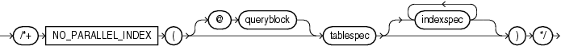

> ```
> /*+ NO_PARALLEL_INDEX ( [ @ queryblock ] tablespec [ indexspec [ indexspec ]... ] ) */
> ```
  
  

(See "Specifying a Query Block in a Hint", tablespec::=, indexspec::=)

The `NO_PARALLEL_INDEX` hint overrides a `PARALLEL` parameter in the DDL that created or altered the index, thus avoiding a parallel index scan operation.

See Also:

"Note on Parallel Hints" for more information on the parallel hints

### NOPARALLEL\_INDEX Hint

The `NOPARALLEL_INDEX` hint has been deprecated. Use the `NO_PARALLEL_INDEX` hint instead.

### NO\_PUSH\_PRED Hint

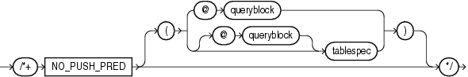

> ```
> /*+ NO_PUSH_PRED [ ( @ queryblock ) | ( [ @ queryblock ] tablespec ) ] */
> ```
  
  

(See "Specifying a Query Block in a Hint", tablespec::=)

The `NO_PUSH_PRED` hint instructs the optimizer not to push a join predicate into the view. For example:

```
SELECT /*+ NO_MERGE(v) NO_PUSH_PRED(v) */ *
  FROM employees e,
       (SELECT manager_id
          FROM employees) v
  WHERE e.manager_id = v.manager_id(+)
    AND e.employee_id = 100;
```

### NO\_PUSH\_SUBQ Hint

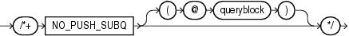

> ```
> /*+ NO_PUSH_SUBQ [ ( @ queryblock ) ] */
> ```
  
  

(See "Specifying a Query Block in a Hint")

The `NO_PUSH_SUBQ` hint instructs the optimizer to evaluate nonmerged subqueries as the last step in the execution plan. Doing so can improve performance if the subquery is relatively expensive or does not reduce the number of rows significantly.

### NO\_PX\_JOIN\_FILTER Hint

  
[Description of the illustration ''no\_px\_join\_filter\_hint.gif''](https://docs.oracle.com/cd/E11882_01/server.112/e41084/img_text/no_px_join_filter_hint.htm)  
  

This hint prevents the optimizer from using parallel join bitmap filtering.

### NO\_QUERY\_TRANSFORMATION Hint

  
[Description of the illustration ''no\_query\_transformatn\_hint.gif''](https://docs.oracle.com/cd/E11882_01/server.112/e41084/img_text/no_query_transformatn_hint.htm)  
  

The `NO_QUERY_TRANSFORMATION` hint instructs the optimizer to skip all query transformations, including but not limited to `OR` -expansion, view merging, subquery unnesting, star transformation, and materialized view rewrite. For example:

```
SELECT /*+ NO_QUERY_TRANSFORMATION */ employee_id, last_name
  FROM (SELECT * FROM employees e) v
  WHERE v.last_name = 'Smith';
```

### NO\_RESULT\_CACHE Hint

  
[Description of the illustration ''no\_result\_cache\_hint.gif''](https://docs.oracle.com/cd/E11882_01/server.112/e41084/img_text/no_result_cache_hint.htm)  
  

The optimizer caches query results in the result cache if the `RESULT_CACHE_MODE` initialization parameter is set to `FORCE`. In this case, the `NO_RESULT_CACHE` hint disables such caching for the current query.

If the query is executed from OCI client and OCI client result cache is enabled, then the `NO_RESULT_CACHE` hint disables caching for the current query.

### NO\_REWRITE Hint

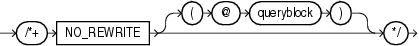

> ```
> /*+ NO_REWRITE [ ( @ queryblock ) ] */
> ```
  
  

(See "Specifying a Query Block in a Hint")

The `NO_REWRITE` hint instructs the optimizer to disable query rewrite for the query block, overriding the setting of the parameter `QUERY_REWRITE_ENABLED`. For example:

```
SELECT /*+ NO_REWRITE */ sum(s.amount_sold) AS dollars
  FROM sales s, times t
  WHERE s.time_id = t.time_id
  GROUP BY t.calendar_month_desc;
```

### NOREWRITE Hint

The `NOREWRITE` hint has been deprecated. Use the `NO_REWRITE` hint instead.

### NO\_STAR\_TRANSFORMATION Hint

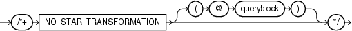

> ```
> /*+ NO_STAR_TRANSFORMATION [ ( @ queryblock ) ] */
> ```
  
  

(See "Specifying a Query Block in a Hint")

The `NO_STAR_TRANSFORMATION` hint instructs the optimizer not to perform star query transformation.

### NO\_STATEMENT\_QUEUING Hint

  
[Description of the illustration ''no\_statement\_queuing\_hint.gif''](https://docs.oracle.com/cd/E11882_01/server.112/e41084/img_text/no_statement_queuing_hint.htm)  
  

The `NO_STATEMENT_QUEUING` hint influences whether or not a statement is queued with parallel statement queuing.

When `PARALLEL_DEGREE_POLICY` is set to `AUTO`, this hint enables a statement to bypass the parallel statement queue. However, a statement that bypasses the statement queue can potentially cause the system to exceed the maximum number of parallel execution servers defined by the value of the `PARALLEL_SERVERS_TARGET` initialization parameter, which determines the limit at which parallel statement queuing is initiated.

There is no guarantee that the statement that bypasses the parallel statement queue receives the number of parallel execution servers requested because only the number of parallel execution servers available on the system, up to the value of the `PARALLEL_MAX_SERVERS` initialization parameter, can be allocated.

For example:

```
SELECT /*+ NO_STATEMENT_QUEUING */ emp.last_name, dpt.department_name
  FROM employees emp, departments dpt
  WHERE emp.department_id = dpt.department_id;
```

See Also:

"STATEMENT\_QUEUING Hint"

### NO\_UNNEST Hint

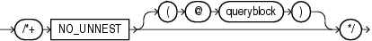

> ```
> /*+ NO_UNNEST [ ( @ queryblock ) ] */
> ```
  
  

(See "Specifying a Query Block in a Hint")

Use of the `NO_UNNEST` hint turns off unnesting.

### NO\_USE\_HASH Hint

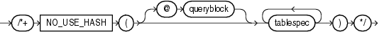

> ```
> /*+ NO_USE_HASH ( [ @ queryblock ] tablespec [ tablespec ]... ) */
> ```
  
  

(See "Specifying a Query Block in a Hint", tablespec::=)

The `NO_USE_HASH` hint instructs the optimizer to exclude hash joins when joining each specified table to another row source using the specified table as the inner table. For example:

```
SELECT /*+ NO_USE_HASH(e d) */ *
  FROM employees e, departments d
  WHERE e.department_id = d.department_id;
```

### NO\_USE\_MERGE Hint


> ```
> /*+ NO_USE_MERGE ( [ @ queryblock ] tablespec [ tablespec ]... ) */
> ```
  
  

(See "Specifying a Query Block in a Hint", tablespec::=)

The `NO_USE_MERGE` hint instructs the optimizer to exclude sort-merge joins when joining each specified table to another row source using the specified table as the inner table. For example:

```
SELECT /*+ NO_USE_MERGE(e d) */ *
   FROM employees e, departments d
   WHERE e.department_id = d.department_id
   ORDER BY d.department_id;
```

### NO\_USE\_NL Hint

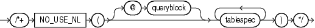

> ```
> /*+ NO_USE_NL ( [ @ queryblock ] tablespec [ tablespec ]... ) */
> ```
  
  

(See "Specifying a Query Block in a Hint", tablespec::=)

The `NO_USE_NL` hint instructs the optimizer to exclude nested loops joins when joining each specified table to another row source using the specified table as the inner table. For example:

```
SELECT /*+ NO_USE_NL(l h) */ *
  FROM orders h, order_items l
  WHERE l.order_id = h.order_id
    AND l.order_id > 2400;
```

When this hint is specified, only hash join and sort-merge joins are considered for the specified tables. However, in some cases tables can be joined only by using nested loops. In such cases, the optimizer ignores the hint for those tables.

### NO\_XML\_QUERY\_REWRITE Hint

  
[Description of the illustration ''no\_xml\_query\_rewrite\_hint.gif''](https://docs.oracle.com/cd/E11882_01/server.112/e41084/img_text/no_xml_query_rewrite_hint.htm)  
  

The `NO_XML_QUERY_REWRITE` hint instructs the optimizer to prohibit the rewriting of XPath expressions in SQL statements. By prohibiting the rewriting of XPath expressions, this hint also prohibits the use of any XMLIndexes for the current query. For example:

```
SELECT /*+NO_XML_QUERY_REWRITE*/ XMLQUERY('<A/>' RETURNING CONTENT)
  FROM DUAL;
```

See Also:

"NO\_XMLINDEX\_REWRITE Hint"

### NO\_XMLINDEX\_REWRITE Hint

  
[Description of the illustration ''no\_xmlindex\_rewrite\_hint.gif''](https://docs.oracle.com/cd/E11882_01/server.112/e41084/img_text/no_xmlindex_rewrite_hint.htm)  
  

The `NO_XMLINDEX_REWRITE` hint instructs the optimizer not to use any XMLIndex indexes for the current query. For example:

```
SELECT /*+NO_XMLINDEX_REWRITE*/ count(*) 
  FROM warehouses
  WHERE existsNode(warehouse_spec, '/Warehouse/Building') = 1;
```

See Also:

"NO\_XML\_QUERY\_REWRITE Hint" for another way to disable the use of XMLIndexes

### OPT\_PARAM Hint

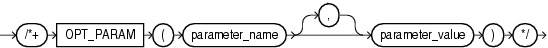

> ```
> /*+ OPT_PARAM ( parameter_name [,] parameter_value ) */
> ```
  
  

The `OPT_PARAM` hint lets you set an initialization parameter for the duration of the current query only. This hint is valid only for the following parameters: `OPTIMIZER_DYNAMIC_SAMPLING`, `OPTIMIZER_INDEX_CACHING`, `OPTIMIZER_INDEX_COST_ADJ`, `OPTIMIZER_SECURE_VIEW_MERGING`, and `STAR_TRANSFORMATION_ENABLED`. For example, the following hint sets the parameter `STAR_TRANSFORMATION_ENABLED` to `TRUE` for the statement to which it is added:

```
SELECT /*+ OPT_PARAM('star_transformation_enabled' 'true') */ *
  FROM ... ;
```

Parameter values that are strings are enclosed in single quotation marks. Numeric parameter values are specified without quotation marks.

### ORDERED Hint

  
[Description of the illustration ''ordered\_hint.gif''](https://docs.oracle.com/cd/E11882_01/server.112/e41084/img_text/ordered_hint.htm)  
  

The `ORDERED` hint instructs Oracle to join tables in the order in which they appear in the `FROM` clause. Oracle recommends that you use the `LEADING` hint, which is more versatile than the `ORDERED` hint.

When you omit the `ORDERED` hint from a SQL statement requiring a join, the optimizer chooses the order in which to join the tables. You might want to use the `ORDERED` hint to specify a join order if you know something that the optimizer does not know about the number of rows selected from each table. Such information lets you choose an inner and outer table better than the optimizer could.

The following query is an example of the use of the `ORDERED` hint:

```
SELECT  /*+ ORDERED */ o.order_id, c.customer_id, l.unit_price * l.quantity
  FROM customers c, order_items l, orders o
  WHERE c.cust_last_name = 'Taylor'
    AND o.customer_id = c.customer_id
    AND o.order_id = l.order_id;
```

### PARALLEL Hint

Note on Parallel Hints

Beginning with Oracle Database 11g Release 2 (11.2.0.1), the `PARALLEL` and `NO_PARALLEL` hints are statement-level hints and supersede the earlier object-level hints: `PARALLEL_INDEX`, `NO_PARALLEL_INDEX`, and previously specified `PARALLEL` and `NO_PARALLEL` hints. For `PARALLEL`, if you specify `integer`, then that degree of parallelism will be used for the statement. If you omit `integer`, then the database computes the degree of parallelism. All the access paths that can use parallelism will use the specified or computed degree of parallelism.

In the syntax diagrams below, `parallel_hint_statement` shows the syntax for statement-level hints, and `parallel_hint_object` shows the syntax for object-level hints. Object-level hints are supported for backward compatibility, and are superseded by statement-level hints.

parallel\_hint\_statement::=

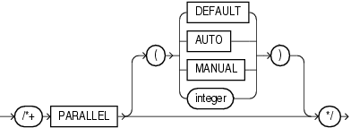

> ```
> /*+ PARALLEL [ ( DEFAULT | AUTO | MANUAL | integer ) ] */
> ```
  
  

parallel\_hint\_object::=

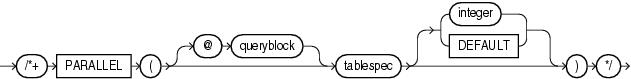

> ```
> /*+ PARALLEL ( [ @ queryblock ] tablespec [ integer | DEFAULT ] ) */
> ```
  
  

(See "Specifying a Query Block in a Hint", tablespec::=)

The `PARALLEL` hint instructs the optimizer to use the specified number of concurrent servers for a parallel operation. This hint overrides the value of the `PARALLEL_DEGREE_POLICY` initialization parameter. The hint applies to the `SELECT`, `INSERT`, `MERGE`, `UPDATE`, and `DELETE` portions of a statement, as well as to the table scan portion. If any parallel restrictions are violated, then the hint is ignored.

Note:

The number of servers that can be used is twice the value in the `PARALLEL` hint, if sorting or grouping operations also take place.

For a statement-level PARALLEL hint:

- `PARALLEL`: The statement always is run parallel, and the database computes the degree of parallelism, which can be 2 or greater.
- `PARALLEL` (`DEFAULT`): The optimizer calculates a degree of parallelism equal to the number of CPUs available on all participating instances times the value of the `PARALLEL_THREADS_PER_CPU` initialization parameter.
- `PARALLEL` (`AUTO`): The database computes the degree of parallelism, which can be 1 or greater. If the computed degree of parallelism is 1, then the statement runs serially.
- `PARALLEL` (`MANUAL`): The optimizer is forced to use the parallel settings of the objects in the statement.
- `PARALLEL` (`integer`): The optimizer uses the degree of parallelism specified by `integer`.

In the following example, the optimizer calculates the degree of parallelism. The statement always runs in parallel.

```
SELECT /*+ PARALLEL */ last_name
  FROM employees;
```

In the following example, the optimizer calculates the degree of parallelism, but that degree may be 1, in which case the statement will run serially.

```
SELECT /*+ PARALLEL (AUTO) */ last_name
  FROM employees;
```

In the following example, the `PARALLEL` hint advises the optimizer to use the degree of parallelism currently in effect for the table itself, which is 5:

```
CREATE TABLE parallel_table (col1 number, col2 VARCHAR2(10)) PARALLEL 5; 

SELECT /*+ PARALLEL (MANUAL) */ col2
  FROM parallel_table;
```

For an object-level PARALLEL hint:

- `PARALLEL`: The query coordinator should examine the settings of the initialization parameters to determine the default degree of parallelism.
- `PARALLEL` (`integer`): The optimizer uses the degree of parallelism specified by `integer`.
- `PARALLEL` (`DEFAULT`): The optimizer calculates a degree of parallelism equal to the number of CPUs available on all participating instances times the value of the `PARALLEL_THREADS_PER_CPU` initialization parameter.

In the following example, the `PARALLEL` hint overrides the degree of parallelism specified in the `employees` table definition:

```
SELECT /*+ FULL(hr_emp) PARALLEL(hr_emp, 5) */ last_name
  FROM employees hr_emp;
```

In the next example, the `PARALLEL` hint overrides the degree of parallelism specified in the `employees` table definition and instructs the optimizer to calculate a degree of parallelism equal to the number of CPUs available on all participating instances times the value of the `PARALLEL_THREADS_PER_CPU` initialization parameter.

```
SELECT /*+ FULL(hr_emp) PARALLEL(hr_emp, DEFAULT) */ last_name
  FROM employees hr_emp;
```

Refer to [CREATE TABLE](statements_7002.md) and [Oracle Database Concepts](https://docs.oracle.com/cd/E11882_01/server.112/e40540/process.htm#CNCPT1475) for more information on parallel execution.

See Also:

- [CREATE TABLE](statements_7002.md) and [Oracle Database Concepts](https://docs.oracle.com/cd/E11882_01/server.112/e40540/process.htm#CNCPT1475) for more information on parallel execution.
- [Oracle Database PL/SQL Packages and Types Reference](https://docs.oracle.com/cd/E11882_01/appdev.112/e40758/d_parallel_ex.htm#ARPLS233) for information on the `DBMS_PARALLEL_EXECUTE` package, which provides methods to apply table changes in chunks of rows. Changes to each chunk are independently committed when there are no errors.
- [Oracle Database Reference](https://docs.oracle.com/cd/E11882_01/server.112/e40402/initparams181.htm#REFRN10310) for more information on the `PARALLEL_DEGREE_POLICY` initialization parameter
- NO\_PARALLEL Hint

### PARALLEL\_INDEX Hint

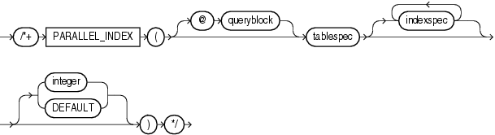

> ```
> /*+ PARALLEL_INDEX
>   ( [ @ queryblock ] tablespec [ indexspec [ indexspec ]... ]
>     [ { integer | DEFAULT } ] ) */
> ```
  
  

(See "Specifying a Query Block in a Hint", tablespec::=, indexspec::=)

The `PARALLEL_INDEX` hint instructs the optimizer to use the specified number of concurrent servers to parallelize index range scans, full scans, and fast full scans for partitioned indexes.

The `integer` value indicates the degree of parallelism for the specified index. Specifying `DEFAULT` or no value signifies that the query coordinator should examine the settings of the initialization parameters to determine the default degree of parallelism. For example, the following hint indicates three parallel execution processes are to be used:

```
SELECT /*+ PARALLEL_INDEX(table1, index1, 3) */
```

See Also:

"Note on Parallel Hints" for more information on the parallel hints

### PQ\_DISTRIBUTE Hint

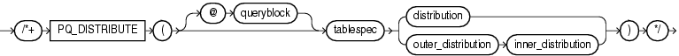

> ```
> /*+ PQ_DISTRIBUTE
>   ( [ @ queryblock ] tablespec 
>     { distribution | outer_distribution inner_distribution }
>   ) */
> ```
  
  

(See "Specifying a Query Block in a Hint", tablespec::=)

The `PQ_DISTRIBUTE` hint instructs the optimizer how to distribute rows among producer and consumer query servers. You can control the distribution of rows for either joins or for load.

Control of Distribution for Load You can control the distribution of rows for parallel `INSERT`... `SELECT` and parallel `CREATE` `TABLE`... `AS` `SELECT` statements to direct how rows should be distributed between the producer (query) and the consumer (load) servers. Use the upper branch of the syntax by specifying a single distribution method. The values of the distribution methods and their semantics are described in Table 3-22.

Table 3-22 Distribution Values for Load

| Distribution | Description |
| --- | --- |
| `NONE` | No distribution. That is the query and load operation are combined into each query server. All servers will load all partitions. This lack of distribution is useful to avoid the overhead of distributing rows where there is no skew. Skew can occur due to empty segments or to a predicate in the statement that filters out all rows evaluated by the query. If skew occurs due to using this method, then use either `RANDOM` or `RANDOM_LOCAL` distribution instead.  Note: Use this distribution with care. Each partition loaded requires a minimum of 512 KB per process of PGA memory. If you also use compression, then approximately 1.5 MB of PGA memory is consumer per server. |
| `PARTITION` | This method uses the partitioning information of `tablespec` to distribute the rows from the query servers to the load servers. Use this distribution method when it is not possible or desirable to combine the query and load operations, when the number of partitions being loaded is greater than or equal to the number of load servers, and the input data will be evenly distributed across the partitions being loaded—that is, there is no skew. |
| `RANDOM` | This method distributes the rows from the producers in a round-robin fashion to the consumers. Use this distribution method when the input data is highly skewed. |
| `RANDOM_LOCAL` | This method distributes the rows from the producers to a set of servers that are responsible for maintaining a given set of partitions. Two or more servers can be loading the same partition, but no servers are loading all partitions. Use this distribution method when the input data is skewed and combining query and load operations is not possible due to memory constraints. |

For example, in the following direct-load insert operation, the query and load portions of the operation are combined into each query server:

```
INSERT /*+ APPEND PARALLEL(target_table, 16) PQ_DISTRIBUTE(target_table, NONE) */
  INTO target_table
  SELECT * FROM source_table;
```

In the following table creation example, the optimizer uses the partitioning of target\_table to distribute the rows:

```
CREATE /*+ PQ_DISTRIBUTE(target_table, PARTITION) */ TABLE target_table
  NOLOGGING PARALLEL 16
  PARTITION BY HASH (l_orderkey) PARTITIONS 512
  AS SELECT * FROM source_table;
```

Control of Distribution for Joins You control the distribution method for joins by specifying two distribution methods, as shown in the lower branch of the syntax diagram, one distribution for the outer table and one distribution for the inner table.

- `outer_distribution` is the distribution for the outer table.
- `inner_distribution` is the distribution for the inner table.

The values of the distributions are `HASH`, `BROADCAST`, `PARTITION`, and `NONE`. Only six combinations table distributions are valid, as described in Table 3-23:

Table 3-23 Distribution Values for Joins

| Distribution | Description |
| --- | --- |
| `HASH`, `HASH` | The rows of each table are mapped to consumer query servers, using a hash function on the join keys. When mapping is complete, each query server performs the join between a pair of resulting partitions. This distribution is recommended when the tables are comparable in size and the join operation is implemented by hash-join or sort merge join. |
| `BROADCAST`, `NONE` | All rows of the outer table are broadcast to each query server. The inner table rows are randomly partitioned. This distribution is recommended when the outer table is very small compared with the inner table. As a general rule, use this distribution when the inner table size multiplied by the number of query servers is greater than the outer table size. |
| `NONE`, `BROADCAST` | All rows of the inner table are broadcast to each consumer query server. The outer table rows are randomly partitioned. This distribution is recommended when the inner table is very small compared with the outer table. As a general rule, use this distribution when the inner table size multiplied by the number of query servers is less than the outer table size. |
| `PARTITION`, `NONE` | The rows of the outer table are mapped using the partitioning of the inner table. The inner table must be partitioned on the join keys. This distribution is recommended when the number of partitions of the outer table is equal to or nearly equal to a multiple of the number of query servers; for example, 14 partitions and 15 query servers.  Note: The optimizer ignores this hint if the inner table is not partitioned or not equijoined on the partitioning key. |
| `NONE`, `PARTITION` | The rows of the inner table are mapped using the partitioning of the outer table. The outer table must be partitioned on the join keys. This distribution is recommended when the number of partitions of the outer table is equal to or nearly equal to a multiple of the number of query servers; for example, 14 partitions and 15 query servers.  Note: The optimizer ignores this hint if the outer table is not partitioned or not equijoined on the partitioning key. |
| `NONE`, `NONE` | Each query server performs the join operation between a pair of matching partitions, one from each table. Both tables must be equipartitioned on the join keys. |

For example, given two tables `r` and `s` that are joined using a hash join, the following query contains a hint to use hash distribution:

```
SELECT /*+ORDERED PQ_DISTRIBUTE(s HASH, HASH) USE_HASH (s)*/ column_list
  FROM r,s
  WHERE r.c=s.c;
```

To broadcast the outer table `r`, the query is:

```
SELECT /*+ORDERED PQ_DISTRIBUTE(s BROADCAST, NONE) USE_HASH (s) */ column_list
  FROM r,s
  WHERE r.c=s.c;
```

See Also:

[Oracle Database Performance Tuning Guide](https://docs.oracle.com/cd/E11882_01/server.112/e41573/hintsref.htm#PFGRF94942) for more information on how Oracle parallelizes join operations

### PUSH\_PRED Hint

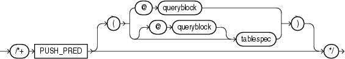

> ```
> /*+ PUSH_PRED [ ( @ queryblock )  | ( [ @ queryblock ] tablespec ) ] */
> ```
  
  

(See "Specifying a Query Block in a Hint", tablespec::=)

The `PUSH_PRED` hint instructs the optimizer to push a join predicate into the view. For example:

```
SELECT /*+ NO_MERGE(v) PUSH_PRED(v) */ *
  FROM employees e,
    (SELECT manager_id
      FROM employees) v
  WHERE e.manager_id = v.manager_id(+)
    AND e.employee_id = 100;
```

### PUSH\_SUBQ Hint

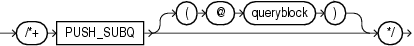

> ```
> /*+ PUSH_SUBQ [ ( @ queryblock ) ] */
> ```
  
  

(See "Specifying a Query Block in a Hint")

The `PUSH_SUBQ` hint instructs the optimizer to evaluate nonmerged subqueries at the earliest possible step in the execution plan. Generally, subqueries that are not merged are executed as the last step in the execution plan. If the subquery is relatively inexpensive and reduces the number of rows significantly, then evaluating the subquery earlier can improve performance.

This hint has no effect if the subquery is applied to a remote table or one that is joined using a merge join.

### PX\_JOIN\_FILTER Hint

  
[Description of the illustration ''px\_join\_filter\_hint.gif''](https://docs.oracle.com/cd/E11882_01/server.112/e41084/img_text/px_join_filter_hint.htm)  
  

This hint forces the optimizer to use parallel join bitmap filtering.

### QB\_NAME Hint

  
[Description of the illustration ''qb\_name\_hint.gif''](https://docs.oracle.com/cd/E11882_01/server.112/e41084/img_text/qb_name_hint.htm)  
  

(See "Specifying a Query Block in a Hint")

Use the `QB_NAME` hint to define a name for a query block. This name can then be used in a hint in the outer query or even in a hint in an inline view to affect query execution on the tables appearing in the named query block.

If two or more query blocks have the same name, or if the same query block is hinted twice with different names, then the optimizer ignores all the names and the hints referencing that query block. Query blocks that are not named using this hint have unique system-generated names. These names can be displayed in the plan table and can also be used in hints within the query block, or in query block hints. For example:

```
SELECT /*+ QB_NAME(qb) FULL(@qb e) */ employee_id, last_name
  FROM employees e
  WHERE last_name = 'Smith';
```

### RESULT\_CACHE Hint

  
[Description of the illustration ''result\_cache\_hint.gif''](https://docs.oracle.com/cd/E11882_01/server.112/e41084/img_text/result_cache_hint.htm)  
  

The `RESULT_CACHE` hint instructs the database to cache the results of the current query or query fragment in memory and then to use the cached results in future executions of the query or query fragment. The hint is recognized in the top-level query, the `subquery_factoring_clause`, or `FROM` clause inline view. The cached results reside in the result cache memory portion of the shared pool.

A cached result is automatically invalidated whenever a database object used in its creation is successfully modified. This hint takes precedence over settings of the `RESULT_CACHE_MODE` initialization parameter.

The query is eligible for result caching only if all functions entailed in the query—for example, built-in or user-defined functions or virtual columns—are deterministic.

If the query is executed from OCI client and OCI client result cache is enabled, then `RESULT_CACHE` hint enables client caching for the current query.

See Also:

[Oracle Database Performance Tuning Guide](https://docs.oracle.com/cd/E11882_01/server.112/e41573/memory.htm#PFGRF987) for information about using this hint, Oracle Database Reference for information about the [`RESULT_CACHE_MODE`](https://docs.oracle.com/cd/E11882_01/server.112/e40402/initparams221.htm#REFRN10270) initialization parameter, and [Oracle Call Interface Programmer's Guide](https://docs.oracle.com/cd/E11882_01/appdev.112/e10646/oci10new.htm#LNOCI10103) for more information about the OCI result cache and usage guidelines

### RETRY\_ON\_ROW\_CHANGE Hint

  
[Description of the illustration ''retry\_on\_row\_change.gif''](https://docs.oracle.com/cd/E11882_01/server.112/e41084/img_text/retry_on_row_change.htm)  
  

Note:

The `CHANGE_DUPKEY_ERROR_INDEX`, `IGNORE_ROW_ON_DUPKEY_INDEX`, and `RETRY_ON_ROW_CHANGE` hints are unlike other hints in that they have a semantic effect. The general philosophy explained in "Hints" does not apply for these three hints.

This hint is valid only for `UPDATE` and `DELETE` operations. It is not supported for `INSERT` or `MERGE` operations. When you specify this hint, the operation is retried when the `ORA_ROWSCN` for one or more rows in the set has changed from the time the set of rows to be modified is determined to the time the block is actually modified.

### REWRITE Hint

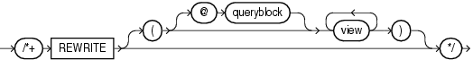

> ```
> /*+ REWRITE [ ( [ @ queryblock ] view [ view ]... ) ] */
> ```
  
  

(See "Specifying a Query Block in a Hint")

The `REWRITE` hint instructs the optimizer to rewrite a query in terms of materialized views, when possible, without cost consideration. Use the `REWRITE` hint with or without a view list. If you use `REWRITE` with a view list and the list contains an eligible materialized view, then Oracle uses that view regardless of its cost.

Oracle does not consider views outside of the list. If you do not specify a view list, then Oracle searches for an eligible materialized view and always uses it regardless of the cost of the final plan.

See Also:

- [Oracle Database Concepts](https://docs.oracle.com/cd/E11882_01/server.112/e40540/schemaob.htm#CNCPT411) and [Oracle Database Advanced Replication](https://docs.oracle.com/cd/E11882_01/server.112/e10706/repplan.htm#REPLN101) for more information on materialized views
- [Oracle Database Data Warehousing Guide](https://docs.oracle.com/cd/E11882_01/server.112/e25554/qrbasic.htm#DWHSG018) for more information on using `REWRITE` with materialized views

### STAR\_TRANSFORMATION Hint

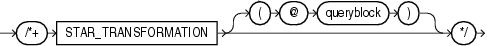

> ```
> /*+ STAR_TRANSFORMATION [ ( @ queryblock ) ] */
> ```
  
  

(See "Specifying a Query Block in a Hint")

The `STAR_TRANSFORMATION` hint instructs the optimizer to use the best plan in which the transformation has been used. Without the hint, the optimizer could make a query optimization decision to use the best plan generated without the transformation, instead of the best plan for the transformed query. For example:

```
SELECT /*+ STAR_TRANSFORMATION */ s.time_id, s.prod_id, s.channel_id
  FROM sales s, times t, products p, channels c
  WHERE s.time_id = t.time_id
    AND s.prod_id = p.prod_id
    AND s.channel_id = c.channel_id
    AND c.channel_desc = 'Tele Sales';
```

Even if the hint is specified, there is no guarantee that the transformation will take place. The optimizer generates the subqueries only if it seems reasonable to do so. If no subqueries are generated, then there is no transformed query, and the best plan for the untransformed query is used, regardless of the hint.

See Also:

- [Oracle Database Data Warehousing Guide](https://docs.oracle.com/cd/E11882_01/server.112/e25554/schemas.htm#DWHSG019) for a full discussion of star transformation.
- [Oracle Database Reference](https://docs.oracle.com/cd/E11882_01/server.112/e40402/initparams253.htm#REFRN10213) for more information on the `STAR_TRANSFORMATION_ENABLED` initialization parameter.

### STATEMENT\_QUEUING Hint

  
[Description of the illustration ''statement\_queuing\_hint.gif''](https://docs.oracle.com/cd/E11882_01/server.112/e41084/img_text/statement_queuing_hint.htm)  
  

The `NO_STATEMENT_QUEUING` hint influences whether or not a statement is queued with parallel statement queuing.

When `PARALLEL_DEGREE_POLICY` is not set to `AUTO`, this hint enables a statement to be considered for parallel statement queuing, but to run only when enough parallel processes are available to run at the requested DOP. The number of available parallel execution servers, before queuing is enabled, is equal to the difference between the number of parallel execution servers in use and the maximum number allowed in the system, which is defined by the `PARALLEL_SERVERS_TARGET` initialization parameter.

For example:

```
SELECT /*+ STATEMENT_QUEUING */ emp.last_name, dpt.department_name
  FROM employees emp, departments dpt
  WHERE emp.department_id = dpt.department_id;
```

See Also:

"NO\_STATEMENT\_QUEUING Hint"

### UNNEST Hint

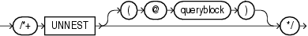

> ```
> /*+ UNNEST [ ( @ queryblock ) ] */
> ```
  
  

(See "Specifying a Query Block in a Hint")

The `UNNEST` hint instructs the optimizer to unnest and merge the body of the subquery into the body of the query block that contains it, allowing the optimizer to consider them together when evaluating access paths and joins.

Before a subquery is unnested, the optimizer first verifies whether the statement is valid. The statement must then pass heuristic and query optimization tests. The `UNNEST` hint instructs the optimizer to check the subquery block for validity only. If the subquery block is valid, then subquery unnesting is enabled without checking the heuristics or costs.

See Also:

- ["Collection Unnesting: Examples"](statements_10002.md) for more information on unnesting nested subqueries and the conditions that make a subquery block valid
- [Oracle Database Performance Tuning Guide](https://docs.oracle.com/cd/E11882_01/server.112/e41573/optimops.htm#PFGRF10104) for additional information on subquery unnesting

### USE\_CONCAT Hint

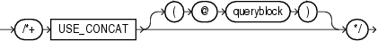

> ```
> /*+ USE_CONCAT [ ( @ queryblock ) ] */
> ```
  
  

(See "Specifying a Query Block in a Hint")

The `USE_CONCAT` hint instructs the optimizer to transform combined `OR` -conditions in the `WHERE` clause of a query into a compound query using the `UNION` `ALL` set operator. Without this hint, this transformation occurs only if the cost of the query using the concatenations is cheaper than the cost without them. The `USE_CONCAT` hint overrides the cost consideration. For example:

```
SELECT /*+ USE_CONCAT */ *
  FROM employees e
  WHERE manager_id = 108
     OR department_id = 110;
```

See Also:

The "NO\_EXPAND Hint", which is the opposite of this hint

### USE\_HASH Hint

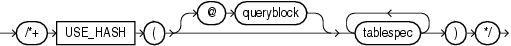

> ```
> /*+ USE_HASH ( [ @ queryblock ] tablespec [ tablespec ]... ) */
> ```
  
  

(See "Specifying a Query Block in a Hint", tablespec::=)

The `USE_HASH` hint instructs the optimizer to join each specified table with another row source using a hash join. For example:

```
SELECT /*+ USE_HASH(l h) */ *
  FROM orders h, order_items l
  WHERE l.order_id = h.order_id
    AND l.order_id > 2400;
```

### USE\_MERGE Hint

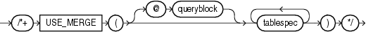

> ```
> /*+ USE_MERGE ( [ @ queryblock ] tablespec [ tablespec ]... ) */
> ```
  
  

(See "Specifying a Query Block in a Hint", tablespec::=)

The `USE_MERGE` hint instructs the optimizer to join each specified table with another row source using a sort-merge join. For example:

```
SELECT /*+ USE_MERGE(employees departments) */ * 
  FROM employees, departments 
  WHERE employees.department_id = departments.department_id;
```

Use of the `USE_NL` and `USE_MERGE` hints is recommended with the `LEADING` and `ORDERED` hints. The optimizer uses those hints when the referenced table is forced to be the inner table of a join. The hints are ignored if the referenced table is the outer table.

### USE\_NL Hint

The `USE_NL` hint instructs the optimizer to join each specified table to another row source with a nested loops join, using the specified table as the inner table.

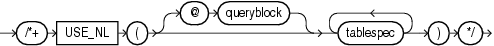

> ```
> /*+ USE_NL ( [ @ queryblock ] tablespec [ tablespec ]... ) */
> ```
  
  

(See "Specifying a Query Block in a Hint", tablespec::=)

The `USE_NL` hint instructs the optimizer to join each specified table to another row source with a nested loops join, using the specified table as the inner table.

Use of the `USE_NL` and `USE_MERGE` hints is recommended with the `LEADING` and `ORDERED` hints. The optimizer uses those hints when the referenced table is forced to be the inner table of a join. The hints are ignored if the referenced table is the outer table.

In the following example, where a nested loop is forced through a hint, `orders` is accessed through a full table scan and the filter condition `l.order_id = h.order_id` is applied to every row. For every row that meets the filter condition, `order_items` is accessed through the index `order_id`.

```
SELECT /*+ USE_NL(l h) */ h.customer_id, l.unit_price * l.quantity
  FROM orders h, order_items l
  WHERE l.order_id = h.order_id;
```

Adding an `INDEX` hint to the query could avoid the full table scan on `orders`, resulting in an execution plan similar to one used on larger systems, even though it might not be particularly efficient here.

### USE\_NL\_WITH\_INDEX Hint

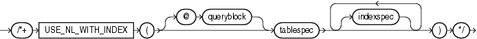

> ```
> /*+ USE_NL_WITH_INDEX ( [ @ queryblock ] tablespec [ indexspec [ indexspec ]... ] ) */
> ```
  
  

(See "Specifying a Query Block in a Hint", tablespec::=, indexspec::=)

The `USE_NL_WITH_INDEX` hint instructs the optimizer to join the specified table to another row source with a nested loops join using the specified table as the inner table. For example:

```
SELECT /*+ USE_NL_WITH_INDEX(l item_product_ix) */ *
  FROM orders h, order_items l
  WHERE l.order_id = h.order_id
    AND l.order_id > 2400;
```

The following conditions apply:

- If no index is specified, then the optimizer must be able to use some index with at least one join predicate as the index key.
- If an index is specified, then the optimizer must be able to use that index with at least one join predicate as the index key.