Purpose

Use the `ALTER` `DATABASE` statement to modify, maintain, or recover an existing database.

Note:

In earlier versions of Oracle Database, you could use the `ALTER` `DATABASE` for two conversion operations:
- The `RESET` `COMPATIBILITY` clause lets you reset the database to an earlier version at the next instance startup.
- The `CONVERT` clause lets you upgrade an Oracle7 data dictionary to an Oracle8i or Oracle9i data dictionary.

These clauses are no longer supported. Refer to [Oracle Database Upgrade Guide](https://docs.oracle.com/cd/E11882_01/server.112/e23633/intro.htm#UPGRD005) for more information on migration and interoperability issues.

See Also:

- [Oracle Database Backup and Recovery User's Guide](https://docs.oracle.com/cd/E11882_01/backup.112/e10642/rcmcomre.htm#BRADV8152) for examples of performing media recovery
- [Oracle Data Guard Concepts and Administration](https://docs.oracle.com/cd/E11882_01/server.112/e41134/create_ls.htm#SBYDB00300) for additional information on using the `ALTER` `DATABASE` statement to maintain standby databases
- [CREATE DATABASE](statements_5004.md) for information on creating a database

Prerequisites

You must have the `ALTER` `DATABASE` system privilege.

To specify the `startup_clauses`, you must also be connected `AS` `SYSDBA` or `AS` `SYSOPER`.

To specify the `general_recovery` clause, you must also have the `SYSDBA` system privilege.

Syntax

alter\_database::=

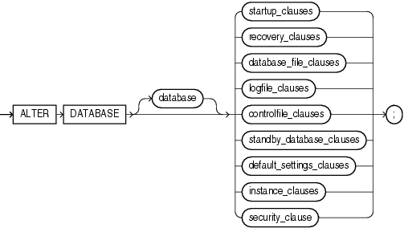

> ```
> ALTER DATABASE [ database ]
>   { startup_clauses
>   | recovery_clauses
>   | database_file_clauses
>   | logfile_clauses
>   | controlfile_clauses
>   | standby_database_clauses
>   | default_settings_clauses
>   | instance_clauses
>   | security_clause
>   } ;
> ```
  
  

Groups of ALTER DATABASE syntax:

startup\_clauses::=

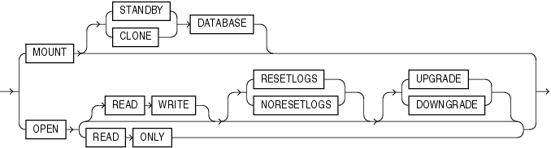

> ```
> { MOUNT [ { STANDBY | CLONE } DATABASE ]
> | OPEN
>   { [ READ WRITE ]
>       [ RESETLOGS | NORESETLOGS ]
>         [ UPGRADE | DOWNGRADE ]
>   | READ ONLY
>   }
> }
> ```
  
  

recovery\_clauses::=

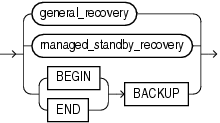

> ```
> { general_recovery
> | managed_standby_recovery
> | BEGIN BACKUP
> | END BACKUP
> }
> ```
  
  

(general\_recovery::=, managed\_standby\_recovery::=)

general\_recovery::=

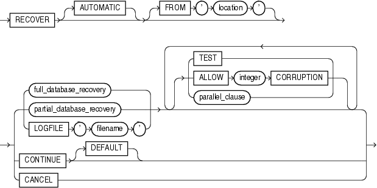

> ```
> RECOVER
> [ AUTOMATIC ]
> [ FROM 'location' ]
> { { full_database_recovery
>   | partial_database_recovery
>   | LOGFILE 'filename'
>   }
>   [ { TEST
>     | ALLOW integer CORRUPTION
>     | parallel_clause
>     }...
>   ]
> | CONTINUE [ DEFAULT ]
> | CANCEL
> }
> ```
  
  

(full\_database\_recovery::=, partial\_database\_recovery::=, parallel\_clause::=)

full\_database\_recovery::=

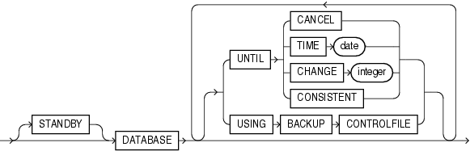

> ```
> [ STANDBY ] DATABASE
> [ { UNTIL { CANCEL
>           | TIME date
>           | CHANGE integer
>           | CONSISTENT
>           }
>   | USING BACKUP CONTROLFILE
>   }...
> ]
> ```
  
  

partial\_database\_recovery::=

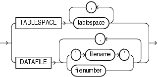

> ```
> { TABLESPACE tablespace [, tablespace ]...
> | DATAFILE { 'filename' | filenumber }
>              [, 'filename' | filenumber ]...
> }
> ```
  
  

parallel\_clause::=


> ```
> { NOPARALLEL | PARALLEL [ integer ] }
> ```
  
  

managed\_standby\_recovery::=

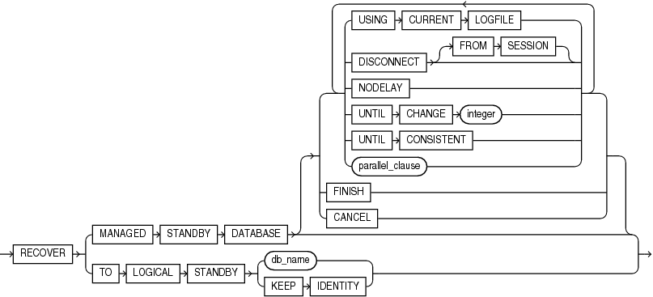

> ```
> RECOVER
> { MANAGED STANDBY DATABASE
>     [ { USING CURRENT LOGFILE
>       | DISCONNECT [FROM SESSION]
>       | NODELAY
>       | UNTIL CHANGE integer
>       | UNTIL CONSISTENT
>       | parallel_clause
>       }...
>     | FINISH
>     | CANCEL
>     ]
> | TO LOGICAL STANDBY { db_name | KEEP IDENTITY }
> }
> ```
  
  

(parallel\_clause::=)

Note:

Several subclauses of `managed_standby_recovery` are no longer needed and have been deprecated. These clauses no longer appear in the syntax diagrams. Refer to the semantics of managed\_standby\_recovery.

database\_file\_clauses::=

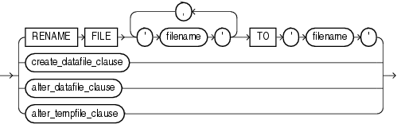

> ```
> { RENAME FILE  'filename' [, 'filename' ]...
>    TO 'filename'
> | create_datafile_clause
> | alter_datafile_clause
> | alter_tempfile_clause
> }
> ```
  
  

(create\_datafile\_clause::=, alter\_datafile\_clause::=, alter\_tempfile\_clause::=)

create\_datafile\_clause::=

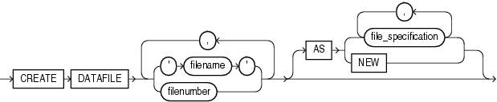

> ```
> CREATE DATAFILE
>    { 'filename' | filenumber }
>      [, 'filename' | filenumber ]...
>    }
>    [ AS { file_specification
>           [, file_specification ]...
>         | NEW
>         }
>    ]
> ```
  
  

([file\_specification::=](clauses004.md))

alter\_datafile\_clause::=

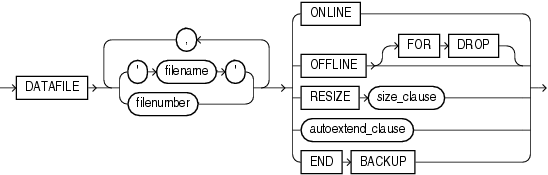

> ```
> DATAFILE
>    { 'filename' | filenumber }
>      [, 'filename' | filenumber ]...
>    }
>    { ONLINE
>    | OFFLINE [ FOR DROP ]
>    | RESIZE size_clause
>    | autoextend_clause
>    | END BACKUP
>    }
> ```
  
  

(autoextend\_clause::=, [size\_clause::=](clauses008.md))

alter\_tempfile\_clause::=

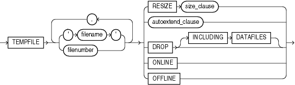

> ```
> TEMPFILE
>    { 'filename' [, 'filename' ]...
>    | filenumber [, filenumber ]...
>    }
>    { RESIZE size_clause
>    | autoextend_clause
>    | DROP [ INCLUDING DATAFILES ]
>    | ONLINE
>    | OFFLINE
>    }
> ```
  
  

(autoextend\_clause::=, [size\_clause::=](clauses008.md))

autoextend\_clause::=

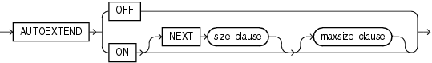

> ```
> AUTOEXTEND
>    { OFF
>    | ON [ NEXT size_clause ]
>         [ maxsize_clause ]
>    }
> ```
  
  

maxsize\_clause::=

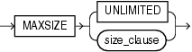

> ```
> MAXSIZE { UNLIMITED | size_clause }
> ```
  
  

([size\_clause::=](clauses008.md))

logfile\_clauses::=

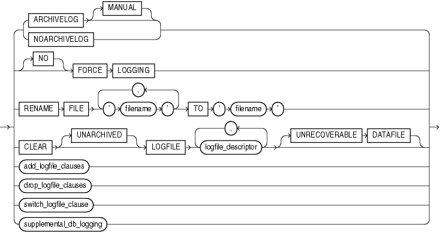

> ```
> { { ARCHIVELOG [ MANUAL ]
>   | NOARCHIVELOG
>   }
> | [ NO ] FORCE LOGGING
> | RENAME FILE 'filename' [, 'filename' ]...
>     TO 'filename'
> | CLEAR [ UNARCHIVED ]
>     LOGFILE logfile_descriptor [, logfile_descriptor ]...
>     [ UNRECOVERABLE DATAFILE ]
> | add_logfile_clauses
> | drop_logfile_clauses
> | switch_logfile_clause
> | supplemental_db_logging
> }
> ```
  
  

(logfile\_descriptor::=, add\_logfile\_clauses::=, drop\_logfile\_clauses::=, switch\_logfile\_clause::=, supplemental\_db\_logging::=)

add\_logfile\_clauses::=

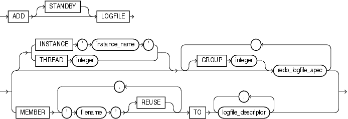

> ```
> ADD [ STANDBY ] LOGFILE
>    { 
>      { [ INSTANCE 'instance_name' ] | [ THREAD 'integer' ] }
>      [ GROUP integer ] redo_log_file_spec
>        [, [ GROUP integer ] redo_log_file_spec ]...
>    | MEMBER 'filename' [ REUSE ] [, 'filename' [ REUSE ] ]...
>         TO logfile_descriptor [, logfile_descriptor ]...
>    }
> ```
  
  

([redo\_log\_file\_spec::=](clauses004.md), logfile\_descriptor::=)

drop\_logfile\_clauses::=

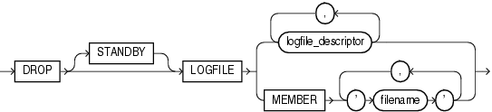

> ```
> DROP [ STANDBY ] LOGFILE
>    { logfile_descriptor
>      [, logfile_descriptor ]...
>    | MEMBER 'filename'
>             [, 'filename' ]...
>    }
> ```
  
  

(logfile\_descriptor::=)

switch\_logfile\_clause::=

  
[Description of the illustration ''switch\_logfile\_clause.gif''](https://docs.oracle.com/cd/E11882_01/server.112/e41084/img_text/switch_logfile_clause.htm)  
  

supplemental\_db\_logging::=

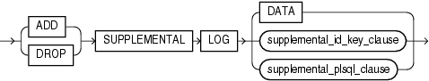

> ```
> { ADD | DROP } SUPPLEMENTAL LOG
> { DATA
> | supplemental_id_key_clause
> | supplemental_plsql_clause
> }
> ```
  
  

(supplemental\_id\_key\_clause::=)

supplemental\_id\_key\_clause::=

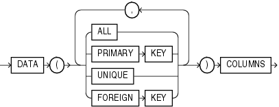

> ```
> DATA
> ( { ALL | PRIMARY KEY | UNIQUE | FOREIGN KEY }
>     [, { ALL | PRIMARY KEY | UNIQUE | FOREIGN KEY } ]...
> )
> COLUMNS
> ```
  
  

supplemental\_plsql\_clause::=

  
[Description of the illustration ''supplemental\_plsql\_clause.gif''](https://docs.oracle.com/cd/E11882_01/server.112/e41084/img_text/supplemental_plsql_clause.htm)  
  

logfile\_descriptor::=

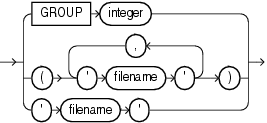

> ```
> { GROUP integer
> | ('filename' [, 'filename' ]...)
> | 'filename'
> }
> ```
  
  

controlfile\_clauses::=

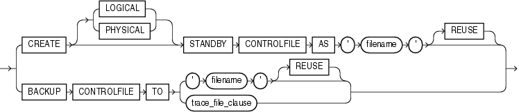

> ```
> { CREATE [ LOGICAL | PHYSICAL ]
>      STANDBY CONTROLFILE AS
>      'filename' [ REUSE ]
> | BACKUP CONTROLFILE TO
>      { 'filename' [ REUSE ]
>      | trace_file_clause
>      }
> }
> ```
  
  

(trace\_file\_clause::=)

trace\_file\_clause::=

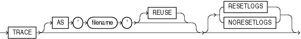

> ```
> TRACE
>   [ AS 'filename' [ REUSE ] ]
>   [ RESETLOGS | NORESETLOGS ]
> ```
  
  

standby\_database\_clauses::=

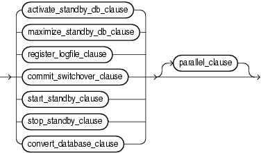

> ```
> { activate_standby_db_clause
> | maximize_standby_db_clause
> | register_logfile_clause
> | commit_switchover_clause
> | start_standby_clause
> | stop_standby_clause
> | convert_database_clause
> } [ parallel_clause ]
> ```
  
  

(activate\_standby\_db\_clause::=, maximize\_standby\_db\_clause::=, register\_logfile\_clause::=, commit\_switchover\_clause::=, start\_standby\_clause::=, stop\_standby\_clause::=, convert\_database\_clause::=, parallel\_clause::=)

activate\_standby\_db\_clause::=

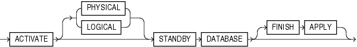

> ```
> ACTIVATE
>      [ PHYSICAL | LOGICAL ]
>      STANDBY DATABASE
>      [ FINISH APPLY ]
> ```
  
  

maximize\_standby\_db\_clause::=

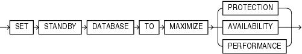

> ```
> SET STANDBY DATABASE TO MAXIMIZE
> { PROTECTION | AVAILABILITY | PERFORMANCE }
> ```
  
  

register\_logfile\_clause::=

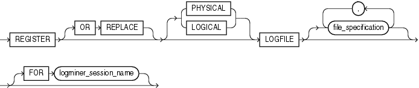

> ```
> REGISTER [ OR REPLACE ]
>   [ PHYSICAL | LOGICAL ]
> LOGFILE [ file_specification  [, file_specification ]...
>   [ FOR logminer_session_name ]
> ```
  
  

([file\_specification::=](clauses004.md))

commit\_switchover\_clause::=

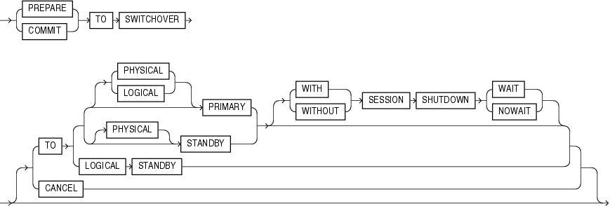

> ```
> { PREPARE | COMMIT } TO SWITCHOVER
> [ TO { { [ PHYSICAL | LOGICAL ] PRIMARY
>      | [ PHYSICAL ] STANDBY
>      } [ { WITH | WITHOUT } SESSION SHUTDOWN
>          { WAIT | NOWAIT }
>        ]
>      | LOGICAL STANDBY
>      }
> | CANCEL
> ]
> ```
  
  

start\_standby\_clause::=

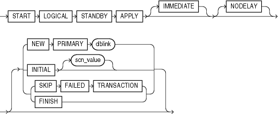

> ```
> START LOGICAL STANDBY APPLY
> [ IMMEDIATE ]
> [ NODELAY ]
> [ NEW PRIMARY dblink
> | INITIAL [ scn_value ]
> | { SKIP FAILED TRANSACTION | FINISH }
> ]
> ```
  
  

stop\_standby\_clause::=

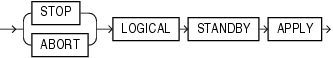

> ```
> { STOP | ABORT } LOGICAL STANDBY APPLY
> ```
  
  

convert\_database\_clause::=

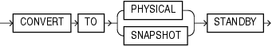

> ```
> CONVERT TO ( PHYSICAL | SNAPSHOT ) STANDBY
> ```
  
  

default\_settings\_clauses::=

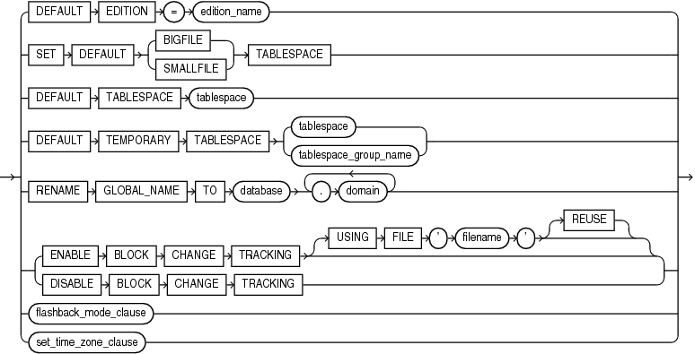

> ```
> { DEFAULT EDITION = edition_name
> | SET DEFAULT
>      { BIGFILE | SMALLFILE } TABLESPACE
> | DEFAULT TABLESPACE tablespace
> | DEFAULT TEMPORARY TABLESPACE
>      { tablespace | tablespace_group_name }
> | RENAME GLOBAL_NAME TO
>      database.domain [.domain ]...
> | { ENABLE BLOCK CHANGE TRACKING
>     [ USING FILE 'filename' [ REUSE ] ]
>   | DISABLE BLOCK CHANGE TRACKING
>   }
> | flashback_mode_clause
> | set_time_zone_clause
> }
> ```
  
  

(flashback\_mode\_clause::=, set\_time\_zone\_clause::=)

set\_time\_zone\_clause::=

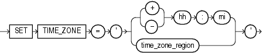

> ```
> SET TIME_ZONE =
>    '{ { + | - } hh : mi | time_zone_region }'
> ```
  
  

flashback\_mode\_clause::=

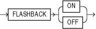

> ```
> FLASHBACK { ON | OFF }
> ```
  
  

instance\_clauses::=

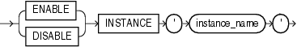

> ```
> { ENABLE | DISABLE } INSTANCE 'instance_name'
> ```
  
  

security\_clause::=

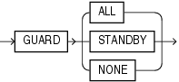

> ```
> GUARD { ALL | STANDBY | NONE }
> ```
  

Semantics

database

Specify the name of the database to be altered. The database name can contain only ASCII characters. If you omit `database`, then Oracle Database alters the database identified by the value of the initialization parameter `DB_NAME`. You can alter only the database whose control files are specified by the initialization parameter `CONTROL_FILES`. The database identifier is not related to the Oracle Net database specification.

startup\_clauses

The `startup_clauses` let you mount and open the database so that it is accessible to users.

MOUNT Clause

Use the `MOUNT` clause to mount the database. Do not use this clause when the database is already mounted.

MOUNT STANDBY DATABASE You can specify `MOUNT` `STANDBY` `DATABASE` to mount a physical standby database. The keywords `STANDBY` `DATABASE` are optional, because Oracle Database determines automatically whether the database to be mounted is a primary or standby database. As soon as this statement executes, the standby instance can receive redo data from the primary instance.

See Also:

[Oracle Data Guard Concepts and Administration](https://docs.oracle.com/cd/E11882_01/server.112/e41134/create_ls.htm#SBYDB00300) for more information on standby databases

MOUNT CLONE DATABASE Specify `MOUNT` `CLONE` `DATABASE` to mount the clone database.

OPEN Clause

Use the `OPEN` clause to make the database available for normal use. You must mount the database before you can open it.

If you specify only `OPEN` without any other keywords, then the default is `OPEN` `READ` `WRITE` `NORESETLOGS` on a primary database, logical standby database, or snapshot standby database and `OPEN` `READ` `ONLY` on a physical standby database.

OPEN READ WRITE Specify `OPEN` `READ` `WRITE` to open the database in read/write mode, allowing users to generate redo logs. This is the default if you are opening a primary database. You cannot specify this clause for a physical standby database.

See Also:

"READ ONLY / READ WRITE: Example"

RESETLOGS | NORESETLOGS This clause determines whether Oracle Database resets the current log sequence number to 1, archives any unarchived logs (including the current log), and discards any redo information that was not applied during recovery, ensuring that it will never be applied. Oracle Database uses `NORESETLOGS` automatically except in the following specific situations, which require a setting for this clause:

- You must specify `RESETLOGS`:
	- After performing incomplete media recovery or media recovery using a backup control file
		- After a previous `OPEN` `RESETLOGS` operation that did not complete
		- After a `FLASHBACK` `DATABASE` operation
- If a created control file is mounted, then you must specify `RESETLOGS` if the online logs are lost, or you must specify `NORESETLOGS` if they are not lost.

UPGRADE | DOWNGRADE Use these `OPEN` clause parameters only if you are upgrading or downgrading a database. This clause instructs Oracle Database to modify system parameters dynamically as required for upgrade and downgrade, respectively. You can achieve the same result using the SQL\*Plus `STARTUP` `UPGRADE` or `STARTUP` `DOWNGRADE` command.

See Also:

- Oracle Database Upgrade Guide for information on the steps required to [upgrade](https://docs.oracle.com/cd/E11882_01/server.112/e23633/upgrade.htm#UPGRD003) or [downgrade](https://docs.oracle.com/cd/E11882_01/server.112/e23633/downgrade.htm#UPGRD007) a database from one release to another
- [SQL\*Plus User's Guide and Reference](https://docs.oracle.com/cd/E11882_01/server.112/e16604/toc.htm) for information on the SQL\*Plus `STARTUP` command

OPEN READ ONLY Specify `OPEN` `READ` `ONLY` to restrict users to read-only transactions, preventing them from generating redo logs. This setting is the default when you are opening a physical standby database, so that the physical standby database is available for queries even while archive logs are being copied from the primary database site.

Restrictions on Opening a Database The following restrictions apply to opening a database:

- You cannot open a database in `READ` `ONLY` mode if it is currently opened in `READ` `WRITE` mode by another instance.
- You cannot open a database in `READ` `ONLY` mode if it requires recovery.
- You cannot take tablespaces offline while the database is open in `READ` `ONLY` mode. However, you can take data files offline and online, and you can recover offline data files and tablespaces while the database is open in `READ` `ONLY` mode.
	See Also:
	[Oracle Data Guard Concepts and Administration](https://docs.oracle.com/cd/E11882_01/server.112/e41134/manage_ps.htm#SBYDB00706) for additional information about opening a physical standby database

recovery\_clauses

The `recovery_clauses` include post-backup operations. For all of these clauses, Oracle Database recovers the database using any incarnations of data files and log files that are known to the current control file.

See Also:

[Oracle Database Backup and Recovery User's Guide](https://docs.oracle.com/cd/E11882_01/backup.112/e10642/rcmintro.htm#BRADV8001) for information on backing up the database and "Database Recovery: Examples"

general\_recovery

The `general_recovery` clause lets you control media recovery for the database or standby database or for specified tablespaces or files. You can use this clause when your instance has the database mounted, open or closed, and the files involved are not in use.

Note:

Parallelism is enabled by default during full or partial database recovery and logfile recovery. The database computes the degree of parallelism. You can disable parallelism of these operations by specifying `NOPARALLEL`, or specify a degree of parallelism with `PARALLEL` `integer`, as shown in the respective syntax diagrams.

Restrictions on General Database Recovery General recovery is subject to the following restrictions:

- You can recover the entire database only when the database is closed.
- Your instance must have the database mounted in exclusive mode.
- You can recover tablespaces or data files when the database is open or closed, if the tablespaces or data files to be recovered are offline.
- You cannot perform media recovery if you are connected to Oracle Database through the shared server architecture.

See Also:

- [Oracle Database Backup and Recovery User's Guide](https://docs.oracle.com/cd/E11882_01/backup.112/e10642/rcmcomre.htm#BRADV8152) for more information on [RMAN media recovery](https://docs.oracle.com/cd/E11882_01/backup.112/e10642/rcmcomre.htm#BRADV8152) and user-defined media recovery
- [SQL\*Plus User's Guide and Reference](https://docs.oracle.com/cd/E11882_01/server.112/e16604/toc.htm) for information on the SQL\*Plus `RECOVER` command

AUTOMATIC

Specify `AUTOMATIC` if you want Oracle Database to automatically generate the name of the next archived redo log file needed to continue the recovery operation. If the `LOG_ARCHIVE_DEST_` `n` parameters are defined, then Oracle Database scans those that are valid and enabled for the first local destination. It uses that destination in conjunction with `LOG_ARCHIVE_FORMAT` to generate the target redo log filename. If the `LOG_ARCHIVE_DEST_` `n` parameters are not defined, then Oracle Database uses the value of the `LOG_ARCHIVE_DEST` parameter instead.

If the resulting file is found, then Oracle Database applies the redo contained in that file. If the file is not found, then Oracle Database prompts you for a filename, displaying the generated filename as a suggestion.

If you specify neither `AUTOMATIC` nor `LOGFILE`, then Oracle Database prompts you for a filename, displaying the generated filename as a suggestion. You can then accept the generated filename or replace it with a fully qualified filename. If you know that the archived filename differs from what Oracle Database would generate, then you can save time by using the `LOGFILE` clause.

FROM 'location'

Specify `FROM` `'location'` to indicate the location from which the archived redo log file group is read. The value of `location` must be a fully specified file location following the conventions of your operating system. If you omit this parameter, then Oracle Database assumes that the archived redo log file group is in the location specified by the initialization parameter `LOG_ARCHIVE_DEST` or `LOG_ARCHIVE_DEST_1`.

full\_database\_recovery

The `full_database_recovery` clause lets you recover an entire database.

DATABASE Specify the `DATABASE` clause to recover the entire database. This is the default. You can use this clause only when the database is closed.

STANDBY DATABASE Specify the `STANDBY` `DATABASE` clause to manually recover a physical standby database using the control file and archived redo log files copied from the primary database. The standby database must be mounted but not open.

This clause recovers only online data files.

- Use the `UNTIL` clause to specify the duration of the recovery operation.
	- `CANCEL` indicates cancel-based recovery. This clause recovers the database until you issue the `ALTER` `DATABASE` statement with the `RECOVER` `CANCEL` clause.
		- `TIME` indicates time-based recovery. This parameter recovers the database to the time specified by the date. The date must be a character literal in the format `'YYYY-MM-DD:HH24:MI:SS'`.
		- `CHANGE` indicates change-based recovery. This parameter recovers the database to a transaction-consistent state immediately before the system change number specified by `integer`.
		- `CONSISTENT` recovers the database until all online files are brought to a consistent SCN point so that the database can be open in read only mode. This clauses requires the controlfile to be a backup controlfile.
- Specify `USING` `BACKUP` `CONTROLFILE` if you want to use a backup control file instead of the current control file.

partial\_database\_recovery

The `partial_database_recovery` clause lets you recover individual tablespaces and data files.

TABLESPACE Specify the `TABLESPACE` clause to recover only the specified tablespaces. You can use this clause if the database is open or closed, provided the tablespaces to be recovered are offline.

See Also:

"Using Parallel Recovery Processes: Example"

DATAFILE Specify the `DATAFILE` clause to recover the specified data files. You can use this clause when the database is open or closed, provided the data files to be recovered are offline.

You can identify the data file by name or by number. If you identify it by number, then `filenumber` is an integer representing the number found in the `FILE#` column of the `V$DATAFILE` dynamic performance view or in the `FILE_ID` column of the `DBA_DATA_FILES` data dictionary view.

STANDBY {TABLESPACE | DATAFILE} In earlier releases, you could specify `STANDBY` `TABLESPACE` or `STANDBY` `DATAFILE` to recover older backups of a specific tablespace or a specific datafile on the standby to be consistent with the rest of the standby database. These two clauses are now obsolete. Instead, to recover the standby database to a consistent point, but no further, use the statement `ALTER` `DATABASE` `RECOVER` `MANAGED` `STANDBY` `DATABASE` `UNTIL` `CONSISTENT`.

LOGFILE

Specify the `LOGFILE` ' `filename` ' to continue media recovery by applying the specified redo log file.

TEST

Use the `TEST` clause to conduct a trial recovery. A trial recovery is useful if a normal recovery procedure has encountered some problem. It lets you look ahead into the redo stream to detect possible additional problems. The trial recovery applies redo in a way similar to normal recovery, but it does not write changes to disk, and it rolls back its changes at the end of the trial recovery.

You can use this clause only if you have restored a backup taken since the last `RESETLOGS` operation. Otherwise, Oracle Database returns an error.

ALLOW... CORRUPTION

The `ALLOW` `integer` `CORRUPTION` clause lets you specify, in the event of logfile corruption, the number of corrupt blocks that can be tolerated while allowing recovery to proceed.

See Also:

- [Oracle Database Backup and Recovery User's Guide](https://docs.oracle.com/cd/E11882_01/backup.112/e10642/rcmintro.htm#BRADV8001) for information on database recovery in general
- [Oracle Data Guard Concepts and Administration](https://docs.oracle.com/cd/E11882_01/server.112/e41134/log_apply.htm#SBYDB00530) for information on managed recovery of standby databases

CONTINUE

Specify `CONTINUE` to continue multi-instance recovery after it has been interrupted to disable a thread.

Specify `CONTINUE` `DEFAULT` to continue recovery using the redo log file that Oracle Database would automatically generate if no other logfile were specified. This clause is equivalent to specifying `AUTOMATIC`, except that Oracle Database does not prompt for a filename.

CANCEL

Specify `CANCEL` to terminate cancel-based recovery.

managed\_standby\_recovery

Use the `managed_standby_recovery` clause to start and stop Redo Apply on a physical standby database. Redo Apply keeps the standby database transactionally consistent with the primary database by continuously applying redo received from the primary database.

A primary database transmits its redo data to standby sites. As the redo data is written to redo log files at the physical standby site, the log files become available for use by Redo Apply. You can use the `managed_standby_recovery` clause when your standby instance has the database mounted or is opened read-only.

Note:

Parallelism is enabled by default during Redo Apply. The database computes the degree of parallelism. You can disable parallelism of these operations by specifying `NOPARALLEL`, or specify a degree of parallelism with `PARALLEL` `integer`, as shown in the respective syntax diagrams.

Restrictions on Managed Standby Recovery The same restrictions listed under general\_recovery apply to this clause.

See Also:

[Oracle Data Guard Concepts and Administration](https://docs.oracle.com/cd/E11882_01/server.112/e41134/log_apply.htm#SBYDB00530) for more information on the use of this clause

USING CURRENT LOGFILE Clause Specify `USING` `CURRENT` `LOGFILE` to invoke real-time apply, which recovers redo from the standby redo log files as soon as they are written, without requiring them to be archived first at the physical standby database.

See Also:

[Oracle Data Guard Concepts and Administration](https://docs.oracle.com/cd/E11882_01/server.112/e41134/log_apply.htm#SBYDB0050) for more information on real-time apply

DISCONNECT Specify `DISCONNECT` to indicate that Redo Apply should be performed in the background, leaving the current session available for other tasks. The `FROM` `SESSION` keywords are optional and are provided for semantic clarity.

NODELAY The `NODELAY` clause overrides the `DELAY` attribute on the `LOG_ARCHIVE_DEST_n` parameter on the primary database. If you do not specify the `NODELAY` clause, then application of the archived redo log file is delayed according to the `DELAY` attribute of the `LOG_ARCHIVE_DEST_` `n` setting (if any). If the `DELAY` attribute was not specified on that parameter, then the archived redo log file is applied immediately to the standby database.

If you specify real-time apply with the `USING` `CURRENT` `LOGFILE` clause, then any `DELAY` value specified for the `LOG_ARCHIVE_DEST_` `n` parameter at the primary for this standby is ignored, and `NODELAY` is the default.

UNTIL CHANGE Clause Use this clause to instruct Redo Apply to recover redo data up to, but not including, the specified system change number.

UNTIL CONSISTENT

Use this clause to recover the standby database to a consistent SCN point so that the standby database can be opened in read only mode.

FINISH Specify `FINISH` to complete applying all available redo data in preparation for a failover.

Use the `FINISH` clause only in the event of the failure of the primary database. This clause overrides any specified delay intervals and applies all available redo immediately. After the `FINISH` command completes, this database can no longer run in the standby database role, and it must be converted to a primary database by issuing the `ALTER` `DATABASE` `COMMIT` `TO` `SWITCHOVER` `TO` `PRIMARY` statement.

CANCEL Specify `CANCEL` to stop Redo Apply immediately. Control is returned as soon as Redo Apply stops.

TO LOGICAL STANDBY Clause Use this clause to convert a physical standby database into a logical standby database.

db\_name Specify a database name to identify the new logical standby database. If you are using a server parameter file (spfile) at the time you issue this statement, then the database will update the file with appropriate information about the new logical standby database. If you are not using an spfile, then the database issues a message reminding you to set the name of the `DB_NAME` parameter after shutting down the database. In addition, you must invoke the `DBMS_LOGSTDBY.BUILD` PL/SQL procedure on the primary database before using this clause on the standby database.

See Also:

[Oracle Database PL/SQL Packages and Types Reference](https://docs.oracle.com/cd/E11882_01/appdev.112/e40758/d_lsbydb.htm#ARPLS363) for information about the `DBMS_LOGSTDBY.BUILD` procedure

KEEP IDENTITY Use this clause if you want to use the rolling upgrade feature provided by a logical standby and also revert to the original configuration of a primary database and a physical standby. A logical standby database created using this clause provides only limited support for switchover and failover. Therefore, do not use this clause create a general-purpose logical standby database.

See Also:

[Oracle Data Guard Concepts and Administration](https://docs.oracle.com/cd/E11882_01/server.112/e41134/rollup.htm#SBYDB00830) for more information on rolling upgrade

Deprecated Managed Standby Recovery Clauses

The following clauses appeared in the syntax of earlier releases. They have been deprecated and are no longer needed. Oracle recommends that you do not use these clauses.

FINISH FORCE, FINISH WAIT, FINISH NOWAIT These optional forms of the `FINISH` clause are deprecated. Their semantics are presented here for backward compatibility:

- `FORCE` terminates inactive redo transport sessions that would otherwise prevent `FINISH` processing from beginning.
- `NOWAIT` returns control to the foreground process before the recovery completes
- `WAIT` (the default) returns control to the foreground process after recovery completes

When specified, these clauses are ignored. Terminal recovery now runs in the foreground and always terminates all redo transport sessions. Therefore control is not returned to the user until recovery completes.

CANCEL IMMEDIATE, CANCEL WAIT, CANCEL NOWAIT These optional forms of the `CANCEL` clause are deprecated. Their semantics are presented here for backward compatibility:

- Include the `IMMEDIATE` keyword to stop Redo Apply before completely applying the current redo log file. Session control returns when Redo Apply actually stops.
- Include the `NOWAIT` keyword to return session control without waiting for the `CANCEL` operation to complete.

When specified, these clauses are ignored. Redo Apply is now always cancelled immediately and control returns to the session only after the operation completes.

BACKUP Clauses

Use these clauses to move all the data files in the database into or out of online backup mode (also called hot backup mode).

See Also:

[ALTER TABLESPACE](statements_3002.md) for information on moving all data files in an individual tablespace into and out of online backup mode

BEGIN BACKUP Clause

Specify `BEGIN` `BACKUP` to move all data files in the database into online backup mode. The database must be mounted and open, and media recovery must be enabled (the database must be in `ARCHIVELOG` mode).

While the database is in online backup mode, you cannot shut down the instance normally, begin backup of an individual tablespace, or take any tablespace offline or make it read only.

This clause has no effect on data files that are in offline or on read-only tablespaces.

END BACKUP Clause

Specify `END` `BACKUP` to take out of online backup mode any data files in the database currently in online backup mode. The database must be mounted (either open or closed) when you perform this operation.

After a system failure, instance failure, or `SHUTDOWN` `ABORT` operation, Oracle Database does not know whether the files in online backup mode match the files at the time the system crashed. If you know the files are consistent, then you can take either individual data files or all data files out of online backup mode. Doing so avoids media recovery of the files upon startup.

- To take an individual data file out of online backup mode, use the `ALTER` `DATABASE` `DATAFILE`... `END` `BACKUP` statement. See database\_file\_clauses.
- To take all data files in a tablespace out of online backup mode, use an `ALTER` `TABLESPACE`... `END` `BACKUP` statement.

database\_file\_clauses

The `database_file_clauses` let you modify data files and temp files. You can use any of the following clauses when your instance has the database mounted, open or closed, and the files involved are not in use.

RENAME FILE Clause

Use the `RENAME` `FILE` clause to rename data files, temp files, or redo log file members. You must create each filename using the conventions for filenames on your operating system before specifying this clause.

- To use this clause for a data file or temp file, the database must be mounted. The database can also be open, but the data file or temp file being renamed must be offline. In addition, you must first rename the file on the file system to the new name.
- To use this clause for logfiles, the database must be mounted but not open.
- If you have enabled block change tracking, then you can use this clause to rename the block change tracking file. The database must be mounted but not open when you rename the block change tracking file.

This clause renames only files in the control file. It does not actually rename them on your operating system. The operating system files continue to exist, but Oracle Database no longer uses them.

See Also:

- [Oracle Database Backup and Recovery User's Guide](https://docs.oracle.com/cd/E11882_01/backup.112/e10642/rcmcomre.htm#BRADV8152) for information on recovery of data files and temp files
- "Renaming a Log File Member: Example" and "Manipulating Temp Files: Example"

create\_datafile\_clause

Use the `CREATE` `DATAFILE` clause to create a new empty data file in place of an old one. You can use this clause to re-create a data file that was lost with no backup. The `filename` or `filenumber` must identify a file that is or was once part of the database. If you identify the file by number, then `filenumber` is an integer representing the number found in the `FILE#` column of the `V$DATAFILE` dynamic performance view or in the `FILE_ID` column of the `DBA_DATA_FILES` data dictionary view.

- Specify `AS` `NEW` to create an Oracle-managed data file with a system-generated filename, the same size as the file being replaced, in the default file system location for data files.
- Specify `AS` `file_specification` to assign a file name (and optional size) to the new data file. Use the `datafile_tempfile_spec` form of `file_specification` (see [file\_specification](clauses004.md)) to list regular data files and temp files in an operating system file system or to list Oracle Automatic Storage Management (Oracle ASM) disk group files.

If the original file (`filename` or `filenumber`) is an existing Oracle-managed data file, then Oracle Database attempts to delete the original file after creating the new file. If the original file is an existing user-managed data file, then Oracle Database does not attempt to delete the original file.

If you omit the `AS` clause entirely, then Oracle Database creates the new file with the same name and size as the file specified by `filename` or `filenumber`.

During recovery, all archived redo logs written to since the original data file was created must be applied to the new, empty version of the lost data file.

Oracle Database creates the new file in the same state as the old file when it was created. You must perform media recovery on the new file to return it to the state of the old file at the time it was lost.

Restrictions on Creating New Data Files The creation of new data files is subject to the following restrictions:

- You cannot create a new file based on the first data file of the `SYSTEM` tablespace.
- You cannot specify the `autoextend_clause` of `datafile_tempfile_spec` in this `CREATE` `DATAFILE` clause.

See Also:

- ["DATAFILE Clause"](statements_5003.md) of `CREATE` `DATABASE` for information on the result of this clause if you do not specify a name for the new data file
- [file\_specification](clauses004.md) for a full description of the file specification (`datafile_tempfile_spec`) and "Creating a New Data File: Example"

alter\_datafile\_clause

The `DATAFILE` clause lets you manipulate a file that you identify by name or by number. If you identify it by number, then `filenumber` is an integer representing the number found in the `FILE#` column of the `V$DATAFILE` dynamic performance view or in the `FILE_ID` column of the `DBA_DATA_FILES` data dictionary view. The `DATAFILE` clauses affect your database files as follows:

ONLINE Specify `ONLINE` to bring the data file online.

OFFLINE Specify `OFFLINE` to take the data file offline. If the database is open, then you must perform media recovery on the data file before bringing it back online, because a checkpoint is not performed on the data file before it is taken offline.

FOR DROP If the database is in `NOARCHIVELOG` mode, then you must specify `FOR` `DROP` clause to take a data file offline. However, this clause does not remove the data file from the database. To do that, you must use an operating system command or drop the tablespace in which the data file resides. Until you do so, the data file remains in the data dictionary with the status `RECOVER` or `OFFLINE`.

If the database is in `ARCHIVELOG` mode, then Oracle Database ignores the `FOR` `DROP` clause.

RESIZE Specify `RESIZE` if you want Oracle Database to attempt to increase or decrease the size of the data file to the specified absolute size in bytes. There is no default, so you must specify a size.

If sufficient disk space is not available for the increased size, or if the file contains data beyond the specified decreased size, then Oracle Database returns an error.

See Also:

"Resizing a Data File: Example"

END BACKUP Specify `END` `BACKUP` to take the data file out of online backup mode. The `END` `BACKUP` clause is described more fully at the top level of the syntax of `ALTER` `DATABASE`. See "END BACKUP Clause".

alter\_tempfile\_clause

Use the `TEMPFILE` clause to resize your temporary data file or specify the `autoextend_clause`, with the same effect as for a permanent data file. The database must be open. You can identify the temp file by name or by number. If you identify it by number, then `filenumber` is an integer representing the number found in the `FILE#` column of the `V$TEMPFILE` dynamic performance view.

Note:

On some operating systems, Oracle does not allocate space for a temp file until the temp file blocks are actually accessed. This delay in space allocation results in faster creation and resizing of temp files, but it requires that sufficient disk space is available when the temp files are later used. To avoid potential problems, before you create or resize a temp file, ensure that the available disk space exceeds the size of the new temp file or the increased size of a resized temp file. The excess space should allow for anticipated increases in disk space use by unrelated operations as well. Then proceed with the creation or resizing operation.

DROP Specify `DROP` to drop `tempfile` from the database. The tablespace remains.

If you specify `INCLUDING` `DATAFILES`, then Oracle Database also deletes the associated operating system files and writes a message to the alert log for each such deleted file. You can achieve the same result using an `ALTER` `TABLESPACE`... `DROP` `TEMPFILE` statement. Refer to the `ALTER` `TABLESPACE` [DROP Clause](statements_3002.md) for more information.

autoextend\_clause

Use the `autoextend_clause` to enable or disable the automatic extension of a new or existing data file or temp file. Refer to [file\_specification](clauses004.md) for information about this clause.

logfile\_clauses

The logfile clauses let you add, drop, or modify log files.

ARCHIVELOG

Specify `ARCHIVELOG` if you want the contents of a redo log file group to be archived before the group can be reused. This mode prepares for the possibility of media recovery. Use this clause only after shutting down your instance normally, or immediately with no errors, and then restarting it and mounting the database.

MANUAL Specify `MANUAL` to indicate that Oracle Database should create redo log files, but the archiving of the redo log files is controlled entirely by the user. This clause is provided for backward compatibility, for example for users who archive directly to tape. If you specify `MANUAL`, then:

- Oracle Database does not archive redo log files when a log switch occurs. You must handle this manually.
- You cannot have specified a standby database as an archivelog destinations. As a result, the database cannot be in `MAXIMUM` `PROTECTION` or `MAXIMUM` `AVAILABILITY` standby protection mode.

If you omit this clause, then Oracle Database automatically archives the redo log files to the destination specified in the `LOG_ARCHIVE_DEST_` `n` initialization parameters.

NOARCHIVELOG

Specify `NOARCHIVELOG` if you do not want the contents of a redo log file group to be archived so that the group can be reused. This mode does not prepare for recovery after media failure. Use this clause only if your instance has the database mounted but not open.

\[NO\] FORCE LOGGING

Use this clause to put the database into or take the database out of `FORCE` `LOGGING` mode. The database must be mounted or open.

In `FORCE` `LOGGING` mode, Oracle Database logs all changes in the database except changes in temporary tablespaces and temporary segments. This setting takes precedence over and is independent of any `NOLOGGING` or `FORCE` `LOGGING` settings you specify for individual tablespaces and any `NOLOGGING` settings you specify for individual database objects.

If you specify `FORCE` `LOGGING`, then Oracle Database waits for all ongoing unlogged operations to finish.

See Also:

[Oracle Database Administrator's Guide](https://docs.oracle.com/cd/E11882_01/server.112/e25494/create.htm#ADMIN002) for information on when to use `FORCE` `LOGGING` mode

RENAME FILE Clause

This clause has the same function for logfiles that it has for data files and temp files. See "RENAME FILE Clause".

CLEAR LOGFILE Clause

Use the `CLEAR` `LOGFILE` clause to reinitialize an online redo log, optionally without archiving the redo log. `CLEAR` `LOGFILE` is similar to adding and dropping a redo log, except that the statement may be issued even if there are only two logs for the thread and may be issued for the current redo log of a closed thread.

For a standby database, if the `STANDBY_FILE_MANAGEMENT` initialization parameter is set to `AUTO`, and if any of the log files are Oracle Managed Files, Oracle Database will create as many Oracle-managed log files as are in the control file. The log file members will reside in the current default log file destination.

- You must specify `UNARCHIVED` if you want to reuse a redo log that was not archived.
	Caution:
	Specifying `UNARCHIVED` makes backups unusable if the redo log is needed for recovery.
- You must specify `UNRECOVERABLE` `DATAFILE` if you have taken the data file offline with the database in `ARCHIVELOG` mode (that is, you specified `ALTER` `DATABASE`... `DATAFILE` `OFFLINE` without the `DROP` keyword), and if the unarchived log to be cleared is needed to recover the data file before bringing it back online. In this case, you must drop the data file and the entire tablespace once the `CLEAR` `LOGFILE` statement completes.
	Do not use `CLEAR` `LOGFILE` to clear a log needed for media recovery. If it is necessary to clear a log containing redo after the database checkpoint, then you must first perform incomplete media recovery. The current redo log of an open thread can be cleared. The current log of a closed thread can be cleared by switching logs in the closed thread.
	If the `CLEAR` `LOGFILE` statement is interrupted by a system or instance failure, then the database may hang. In this case, reissue the statement after the database is restarted. If the failure occurred because of I/O errors accessing one member of a log group, then that member can be dropped and other members added.
	See Also:
	"Clearing a Log File: Example"

add\_logfile\_clauses

Use these clauses to add redo log file groups to the database and to add new members to existing redo log file groups.

ADD LOGFILE Clause

Use the `ADD` `LOGFILE` clause to add one or more redo log file groups to the online redo log or standby redo log.

See Also:

- ["LOGFILE Clause"](statements_5004.md) of `CREATE` `DATABASE` for information on the result of this clause for Oracle Managed Files if you do not specify a name for the new log file group
- "Adding Redo Log File Groups: Examples"
- [Oracle Data Guard Concepts and Administration](https://docs.oracle.com/cd/E11882_01/server.112/e41134/log_transport.htm#SBYDB4752) for more information on standby redo logs

STANDBY Use the `STANDBY` clause to add a redo log file group to the standby redo log. If you do not specify this clause, then a log file group is added to the online redo log.

INSTANCE The `INSTANCE` clause is applicable only for Oracle Real Application Clusters (Oracle RAC) or Oracle RAC One Node databases. Specify the name of the instance for which you want to add a redo log file group. The instance name is a string of up to 80 characters. Oracle Database automatically uses the thread that is mapped to the specified instance. If no thread is mapped to the specified instance, then Oracle Database automatically acquires an available unmapped thread and assigns it to that instance. If you do not specify this clause, then Oracle Database executes the command as if you had specified the current instance. If the specified instance has no current thread mapping and there are no available unmapped threads, then Oracle Database returns an error.

THREAD When adding a redo log file group to the standby redo log, use the `THREAD` clause to assign the log file group to a specific primary database redo thread. Query the `V$INSTANCE` view on the primary database to determine which redo threads have been opened, and specify one of these thread numbers.

You can also use the `THREAD` clause to assign a log file group to a specific redo thread when adding the log file group to the online redo log. This usage has been deprecated. The `INSTANCE` clause achieves the same purpose and is easier to use.

GROUP The `GROUP` clause uniquely identifies the redo log file group among all groups in all threads and can range from 1 to the value specified for `MAXLOGFILES` in the `CREATE` `DATABASE` statement. You cannot add multiple redo log file groups having the same `GROUP` value. If you omit this parameter, then Oracle Database generates its value automatically. You can examine the `GROUP` value for a redo log file group through the dynamic performance view `V$LOG`.

redo\_log\_file\_spec Each `redo_log_file_spec` specifies a redo log file group containing one or more members (copies). If you do not specify a filename for the new log file, then Oracle Database creates Oracle Managed Files according to the rules described in the ["LOGFILE Clause"](statements_5004.md) of `CREATE` `DATABASE`.

See Also:

- [file\_specification](clauses004.md)
- [Oracle Database Reference](https://docs.oracle.com/cd/E11882_01/server.112/e40402/dynviews_part.htm#REFRN003) for information on dynamic performance views

ADD LOGFILE MEMBER Clause Use the `ADD` `LOGFILE` `MEMBER` clause to add new members to existing redo log file groups. Each new member is specified by `'filename'`. If the file already exists, then it must be the same size as the other group members and you must specify `REUSE`. If the file does not exist, then Oracle Database creates a file of the correct size. You cannot add a member to a group if all of the members of the group have been lost through media failure.

STANDBY You must specify `STANDBY` when adding a member to a standby redo log file group. Otherwise, Oracle Database returns an error.

You can use the `logfile_descriptor` clause to specify an existing redo log file group in one of two ways:

GROUP integer Specify the value of the `GROUP` parameter that identifies the redo log file group.

filename(s) List all members of the redo log file group. You must fully specify each filename according to the conventions of your operating system.

See Also:

- ["LOGFILE Clause"](statements_5004.md) of `CREATE` `DATABASE` for information on the result of this clause for Oracle Managed Files if you do not specify a name for the new log file group
- "Adding Redo Log File Group Members: Example"

drop\_logfile\_clauses

Use these clauses to drop redo log file groups or redo log file members.

DROP LOGFILE Clause Use the `DROP` `LOGFILE` clause to drop all members of a redo log file group. If you use this clause to drop Oracle Managed Files, then Oracle Database also removes all log file members from disk. Specify a redo log file group as indicated for the `ADD` `LOGFILE` `MEMBER` clause.

- To drop the current log file group, you must first issue an `ALTER` `SYSTEM` `SWITCH` `LOGFILE` statement.
- You cannot drop a redo log file group if it needs archiving.
- You cannot drop a redo log file group if doing so would cause the redo thread to contain less than two redo log file groups.
	See Also:
	[ALTER SYSTEM](statements_2014.md) and "Dropping Log File Members: Example"

DROP LOGFILE MEMBER Clause Use the `DROP` `LOGFILE` `MEMBER` clause to drop one or more redo log file members. Each `'filename'` must fully specify a member using the conventions for filenames on your operating system.

- To drop a log file in the current log, you must first issue an `ALTER` `SYSTEM` `SWITCH` `LOGFILE` statement. Refer to [ALTER SYSTEM](statements_2014.md) for more information.
- You cannot use this clause to drop all members of a redo log file group that contains valid data. To perform that operation, use the `DROP` `LOGFILE` clause.
	See Also:
	"Dropping Log File Members: Example"

switch\_logfile\_clause

This clause is useful when you are migrating the database to disks with a different block size that the block size of the current database. Use this clause to switch logfiles to a different block size for all externally enabled threads, including both open and closed threads. If you are migrating the database to use 4KB sector disks, then you must specify 4096 for `integer`. If you are unmigrating the database back to using 512B sector disks, then you must specify 512 for `integer`.

This clause is an extension of the existing `ALTER` `SYSTEM` `SWITCH` `LOGFILE` statement. That statement switches logs for a single thread. This clause switches logfiles for all externally enabled threads, including both open and closed threads.

Before using this clause, you must already have created at least two redo log groups with the same target block size on the migration target disk.

See Also:

[Oracle Database Administrator's Guide](https://docs.oracle.com/cd/E11882_01/server.112/e25494/onlineredo.htm#ADMIN12891) for more information on migrating the database to disks with a different block size, and ["Adding a Log File: Example"](clauses004.md)

supplemental\_db\_logging

Use these clauses to instruct Oracle Database to add or stop adding supplemental data into the log stream.

ADD SUPPLEMENTAL LOG Clause Specify `ADD` `SUPPLEMENTAL` `LOG` `DATA` to enable minimal supplemental logging. Specify `ADD` `SUPPLEMENTAL` `LOG` `supplemental_id_key_clause` to enable column data logging in addition to minimal supplemental logging. Specify `ADD` `SUPPLEMENTAL` `LOG` `supplemental_plsql_clause` to enable supplemental logging of PL/SQL calls. Oracle Database does not enable either minimal supplemental logging or supplemental logging by default.

Minimal supplemental logging ensures that LogMiner (and any products building on LogMiner technology) will have sufficient information to support chained rows and various storage arrangements such as cluster tables.

If the redo generated on one database is to be the source of changes (to be mined and applied) at another database, as is the case with logical standby, then the affected rows need to be identified using column data (as opposed to rowids). In this case, you should specify the `supplemental_id_key_clause`.

You can query the appropriate columns in the `V$DATABASE` view to determine whether any supplemental logging has already been enabled.

You can issue this statement when the database is open. However, Oracle Database will invalidate all DML cursors in the cursor cache, which will have an effect on performance until the cache is repopulated.

For a full discussion of the `supplemental_id_clause`, refer to [supplemental\_id\_key\_clause](statements_7002.md) in the documentation on `CREATE` `TABLE`.

See Also:

[Oracle Data Guard Concepts and Administration](https://docs.oracle.com/cd/E11882_01/server.112/e41134/create_ls.htm#SBYDB00308) for information on supplemental logging on the primary database to support a logical standby database

[Oracle Database Utilities](https://docs.oracle.com/cd/E11882_01/server.112/e22490/logminer.htm#SUTIL019) for examples using the `supplemental_db_logging` clause syntax

DROP SUPPLEMENTAL LOG Clause

Use this clause to stop supplemental logging.

- Specify `DROP` `SUPPLEMENTAL` `LOG` `DATA` to instruct Oracle Database to stop placing minimal additional log information into the redo log stream whenever an update operation occurs. If Oracle Database is doing column data supplemental logging specified with the `supplemental_id_key_clause`, then you must first stop the column data supplemental logging with the `DROP` `SUPPLEMENTAL` `LOG` `supplemental_id_key_clause` and then specify this clause.
- Specify `DROP` `SUPPLEMENTAL` `LOG` `supplemental_id_key_clause` to drop some or all of the system-generated supplemental log groups. You must specify the `supplemental_id_key_clause` if the supplemental log groups you want to drop were added using that clause.
- Specify `DROP` `SUPPLEMENTAL` `LOG` `supplemental_plsql_clause` disable supplemental logging of PL/SQL calls.

See Also:

[Oracle Data Guard Concepts and Administration](https://docs.oracle.com/cd/E11882_01/server.112/e41134/create_ls.htm#SBYDB00308) for information on supplemental logging

controlfile\_clauses

The `controlfile_clauses` let you create or back up a control file.

CREATE STANDBY CONTROLFILE Clause

The `CREATE` `STANDBY` `CONTROLFILE` clause lets you create a control file to be used to maintain a physical or logical standby database. If you do not specify `LOGICAL` or `PHYSICAL`, then the default is `PHYSICAL`. If the file already exists, then you must specify `REUSE`. In an Oracle RAC environment, the control file must be on shared storage.

See Also:

[Oracle Data Guard Concepts and Administration](https://docs.oracle.com/cd/E11882_01/server.112/e41134/rman.htm#SBYDB00754)

BACKUP CONTROLFILE Clause

Use the `BACKUP` `CONTROLFILE` clause to back up the current control file. The database must be open or mounted when you specify this clause.

TO 'filename' Use this clause to specify a binary backup of the control file. You must fully specify the `filename` using the conventions for your operating system. If the specified file already exists, then you must specify `REUSE`. In an Oracle RAC environment, `filename` must be on shared storage.

A binary backup contains information that is not captured if you specify `TO` `TRACE`, such as the archived log history, offline range for read-only and offline tablespaces, and backup sets and copies (if you use RMAN). If the `COMPATIBLE` initialization parameter is 10.2 or higher, binary control file backups include temp file entries.

TO TRACE Specify `TO` `TRACE` if you want Oracle Database to write SQL statements to a trace file rather than making a physical backup of the control file. You can use SQL statements written to the trace file to start up the database, re-create the control file, and recover and open the database appropriately, based on the created control file. If you issue an `ALTER` `DATABASE` `BACKUP` `CONTROLFILE` `TO` `TRACE` statement while block change tracking is enabled, then the resulting trace file will contain a command to reenable block change tracking.

The trace file will also include `ALTER` `DATABASE` `REGISTER` `LOGFILE` statements for existing logfiles that reside in the current archivelog destinations. This will implicitly create database incarnation records for the branches of redo to which the logfiles apply.

You can copy the statements from the trace file into a script file, edit the statements as necessary, and use the script if all copies of the control file are lost (or to change the size of the control file).

- Specify `AS` `filename` if you want Oracle Database to place the trace output into a file called `filename` rather than into the standard trace file.
- Specify `REUSE` to allow Oracle Database to overwrite any existing file called `filename`.
- `RESETLOGS` indicates that the SQL statement written to the trace file for starting the database is `ALTER` `DATABASE` `OPEN` `RESETLOGS`. This setting is valid only if the online logs are unavailable.
- `NORESETLOGS` indicates that the SQL statement written to the trace file for starting the database is `ALTER` `DATABASE` `OPEN` `NORESETLOGS`. This setting is valid only if all the online logs are available.

If you cannot predict the future state of the online logs, then specify neither `RESETLOGS` nor `NORESETLOGS`. In this case, Oracle Database puts both versions of the script into the trace file, and you can choose which version is appropriate when the script becomes necessary.

The trace files are stored in a subdirectory determined by the `DIAGNOSTIC_DEST` initialization parameter. You can find the name and location of the trace file to which the `CREATE` `CONTROLFILE` statements were written by looking in the alert log. You can also find the directory for trace files by querying the `NAME` and `VALUE` columns of the `V$DIAG_INFO` dynamic performance view.

See Also:

[Oracle Database Administrator's Guide](https://docs.oracle.com/cd/E11882_01/server.112/e25494/diag.htm#ADMIN11267) for information on viewing the alert log

standby\_database\_clauses

Use these clauses to activate the standby database or to specify whether it is in protected or unprotected mode.

See Also:

[Oracle Data Guard Concepts and Administration](https://docs.oracle.com/cd/E11882_01/server.112/e41134/toc.htm) for descriptions of the [physical](https://docs.oracle.com/cd/E11882_01/server.112/e41134/create_ps.htm#SBYDB00200) and [logical](https://docs.oracle.com/cd/E11882_01/server.112/e41134/create_ls.htm#SBYDB00300) standby database and for information on maintaining and using standby databases

activate\_standby\_db\_clause

Use the `ACTIVATE` `STANDBY` `DATABASE` clause to convert a standby database into a primary database.

Caution:

Before using this command, refer to [Oracle Data Guard Concepts and Administration](https://docs.oracle.com/cd/E11882_01/server.112/e41134/role_management.htm#SBYDB00600) for important usage information.

PHYSICAL Specify `PHYSICAL` to activate a physical standby database. This is the default.

LOGICAL Specify `LOGICAL` to activate a logical standby database. If you have more than one logical standby database, then you should first ensure that the same log data is available on all the standby systems.

FINISH APPLY This clause applies only to logical standby databases. Use it to initiate terminal apply, which is the application of any remaining redo to bring the logical standby database to the same state as the primary database. When terminal apply is complete, the database completes the switchover from logical standby to primary database.

If you require immediate restoration of the database in spite of data loss, then omit this clause. The database will execute the switchover from logical standby to primary database immediately without terminal apply.

maximize\_standby\_db\_clause

Use this clause to specify the level of protection for the data in your database environment. You specify this clause from the primary database.

Note:

The `PROTECTED` and `UNPROTECTED` keywords have been replaced for clarity but are still supported. `PROTECTED` is equivalent to `TO` `MAXIMIZE` `PROTECTION`. `UNPROTECTED` is equivalent to `TO` `MAXIMIZE` `PERFORMANCE`.

TO MAXIMIZE PROTECTION This setting establishes maximum protection mode and offers the highest level of data protection. A transaction does not commit until all data needed to recover that transaction has been written to at least one physical standby database that is configured to use the `SYNC` log transport mode. If the primary database is unable to write the redo records to at least one such standby database, then the primary database is shut down. This mode guarantees zero data loss, but it has the greatest potential impact on the performance and availability of the primary database.

Restriction on Establishing Maximum Protection Mode You can specify `TO` `MAXIMIZE` `PROTECTION` on an open database only if the current data protection mode is `MAXIMUM` `AVAILABILITY` and there is at least one synchronized standby database.

TO MAXIMIZE AVAILABILITY This setting establishes maximum availability mode and offers the next highest level of data protection. A transaction does not commit until all data needed to recover that transaction has been written to at least one physical or logical standby database that is configured to use the `SYNC` log transport mode. Unlike maximum protection mode, the primary database does not shut down if it is unable to write the redo records to at least one such standby database. Instead, the protection is lowered to maximum performance mode until the fault has been corrected and the standby database has caught up with the primary database. This mode guarantees zero data loss unless the primary database fails while in maximum performance mode. Maximum availability mode provides the highest level of data protection that is possible without affecting the availability of the primary database.

TO MAXIMIZE PERFORMANCE This setting establishes maximum performance mode and is the default setting. A transaction commits before the data needed to recover that transaction has been written to a standby database. Therefore, some transactions may be lost if the primary database fails and you are unable to recover the redo records from the primary database. This mode provides the highest level of data protection that is possible without affecting the performance of the primary database.

To determine the current mode of the database, query the `PROTECTION_MODE` column of the `V$DATABASE` dynamic performance view.

See Also:

[Oracle Data Guard Concepts and Administration](https://docs.oracle.com/cd/E11882_01/server.112/e41134/manage_ps.htm#SBYDB00710) for full information on using these standby database settings

register\_logfile\_clause

Specify the `REGISTER` `LOGFILE` clause from the standby database to manually register log files from the failed primary. Use the `redo_log_file_spec` form of `file_specification` (see [file\_specification](clauses004.md)) to list regular redo log files in an operating system file system or to list Oracle ASM disk group redo log files.

When a log file is from an unknown incarnation, the `REGISTER` `LOGFILE` clause causes an incarnation record to be added to the `V$DATABASE_INCARNATION` view. If the newly registered log file belongs to an incarnation having a higher `RESETLOGS_TIME` than the current `RECOVERY_TARGET_INCARNATION#`, then the `REGISTER` `LOGFILE` clause also causes `RECOVERY_TARGET_INCARNATION#` to be changed to correspond to the newly added incarnation record.

OR REPLACE Specify `OR` `REPLACE` to allow an existing archivelog entry in the standby database to be updated, for example, when its location or file specification changes. The system change numbers of the entries must match exactly, and the original entry must have been created by the managed standby log transmittal mechanism.

FOR logminer\_session\_name This clause is useful in a Streams environment. It lets you register the log file with one specified LogMiner session.

commit\_switchover\_clause

Use this clause to perform database role transitions in a Data Guard configuration.

Caution:

Before using this command, refer to [Oracle Data Guard Concepts and Administration](https://docs.oracle.com/cd/E11882_01/server.112/e41134/role_management.htm#SBYDB00600) for complete usage information.

PREPARE TO SWITCHOVER This clause prepares a primary database to become a logical standby database or a logical standby database to become a primary database.

- Specify `PREPARE` `TO` `SWITCHOVER` `TO` `LOGICAL` `STANDBY` on a primary database.
- Specify `PREPARE` `TO` `SWITCHOVER` `TO` `PRIMARY` `DATABASE` on a logical standby database.

COMMIT TO SWITCHOVER This clause switches a primary database to a standby database role or switches a standby database to the primary database role.

- Specify `COMMIT` `TO` `SWITCHOVER` `TO` `PHYSICAL` `STANDBY` or `COMMIT` `TO` `SWITCHOVER` `TO` `LOGICAL` `STANDBY` on a primary database.
- Specify `COMMIT` `TO` `SWITCHOVER` `TO` `PRIMARY` `DATABASE` on a standby database.

PHYSICAL This clause is always optional. Use of this clause with the `COMMIT` `TO` `SWITCHOVER` `TO` `PRIMARY` clause has been deprecated.

LOGICAL This clause is specified with the `PREPARE` `TO` `SWITCHOVER` or `COMMIT` `TO` `SWITCHOVER` clauses when switching a primary database to the logical standby database role. Use of this clause with the `COMMIT` `TO` `SWITCHOVER` `TO` `PRIMARY` clause has been deprecated.

WITH SESSION SHUTDOWN This clause causes all database sessions to be closed and uncommitted transactions to be rolled back before performing a database role transition.

WITHOUT SESSION SHUTDOWN This clause prevents a requested role transition from occurring if there are any database sessions. This is the default.

WAIT Specify this clause to wait for a role transition to complete before returning control to the user.

NOWAIT Specify this clause to return control to the user without waiting for a role transition to complete. This is the default.

CANCEL Specify this clause to reverse the effect of a previously specified `PREPARE` `TO` `SWITCHOVER` statement.

See Also:

[Oracle Data Guard Concepts and Administration](https://docs.oracle.com/cd/E11882_01/server.112/e41134/role_management.htm#SBYDB00605) for full information on switchover between primary and standby databases

start\_standby\_clause

Specify the `START` `LOGICAL` `STANDBY` `APPLY` clause to begin applying redo logs to a logical standby database. This clause enables primary key, unique index, and unique constraint supplemental logging as well as PL/SQL call logging.

- Specify `IMMEDIATE` to apply redo data from the current standby redo log file.
- Specify `NODELAY` if you want Oracle Database to ignore a delay for this apply. This is useful if the primary database is no longer present, which would otherwise require a PL/SQL call to be made.
- Specify `INITIAL` the first time you apply the logs to the standby database.
- The `NEW` `PRIMARY` clause is needed in two situations:
	- On a failover to a logical standby, specify this clause on a logical standby not participating in the failover operation, and on the old primary database after it has been reinstated as a logical standby database.
		- During a rolling upgrade using a logical standby database (which uses an unprepared switchover operation), specify this clause after the original primary database has been upgraded to the new database software.
- Specify `SKIP` `FAILED` \[`TRANSACTION`\] to skip the last transaction in the events table and restart the apply.
- Specify `FINISH` to force the standby redo logfile information into archived logs. If the primary database becomes disabled, then you can then apply the data in the redo log files.

stop\_standby\_clause

Use this clause to stop the log apply services. This clause applies only to logical standby databases, not to physical standby databases. Use the `STOP` clause to stop the apply in an orderly fashion.

convert\_database\_clause

Use this clause to convert a database from one form to another.

- Specify `CONVERT` `TO` `PHYSICAL` `STANDBY` to convert a primary database, a logical standby database, or a snapshot standby database into a physical standby database.
	Perform these steps before specifying this clause:
	- On an Oracle Real Application Clusters (Oracle RAC) database, shut down all but one instance.
		- Ensure that the database is mounted, but not open.
	The database is dismounted after conversion and must be restarted.
- Specify `CONVERT` `TO` `SNAPSHOT` `STANDBY` to convert a physical standby database into a snapshot standby database.
	Ensure that redo apply is stopped before specifying this clause.

Note:

A snapshot standby database must be opened at least once in read/write mode before it can be converted into a physical standby database.

See Also:

Oracle Data Guard Concepts and Administration for more information about [standby databases](https://docs.oracle.com/cd/E11882_01/server.112/e41134/manage_ps.htm#SBYDB00708)

default\_settings\_clauses

Use these clauses to modify the default settings of the database.

DEFAULT EDITION Clause

Use this clause to designate the specified edition as the default edition for the database. The specified edition must already have been created and must be `USABLE`. The change takes place immediately and is visible to all nodes in an Oracle RAC environment. New database sessions automatically start out in the specified edition. The new setting persists across database shutdown and startup.

When you designate an edition as the database default edition, all object privileges on the edition itself are revoked from all users except `SYS`, and the `USE` object privilege is granted on the specified edition to the role `PUBLIC`.

You can determine the current default edition of the database with the following query:

```
SELECT PROPERTY_VALUE FROM DATABASE_PROPERTIES 
  WHERE PROPERTY_NAME = 'DEFAULT_EDITION';
```

See Also:

[CREATE EDITION](statements_5009.md) for more information on editions and [Oracle Database PL/SQL Language Reference](https://docs.oracle.com/cd/E11882_01/appdev.112/e41502/adfns_editions.htm#ADFNS99919) for information on how editions are designated as `USABLE`

CHARACTER SET, NATIONAL CHARACTER SET

You can no longer change the database character set or the national character set using the `ALTER` `DATABASE` statement. Refer to [Oracle Database Globalization Support Guide](https://docs.oracle.com/cd/E11882_01/server.112/e10729/ch11charsetmig.htm#NLSPG011) for information on database character set migration.

SET DEFAULT TABLESPACE Clause

Use this clause to specify or change the default type of subsequently created tablespaces. Specify `BIGFILE` or `SMALLFILE` to indicate whether the tablespaces should be bigfile or smallfile tablespaces.

- A bigfile tablespace contains only one data file or temp file, which can contain up to approximately 4 billion (2 <sup>32</sup>) blocks. The maximum size of the single data file or temp file is 128 terabytes (TB) for a tablespace with 32K blocks and 32TB for a tablespace with 8K blocks.
- A smallfile tablespace is a traditional Oracle tablespace, which can contain 1022 data files or temp files, each of which can contain up to approximately 4 million (2 <sup>22</sup>) blocks.

See Also:

- [Oracle Database Administrator's Guide](https://docs.oracle.com/cd/E11882_01/server.112/e25494/tspaces.htm#ADMIN01102) for more information about bigfile tablespaces
- "Setting the Default Type of Tablespaces: Example"

DEFAULT TABLESPACE Clause

Specify this clause to establish or change the default permanent tablespace of the database. The tablespace you specify must already have been created. After this operation completes, Oracle Database automatically reassigns to the new default tablespace all non- `SYSTEM` users. All objects subsequently created by those users will by default be stored in the new default tablespace. If you are replacing a previously specified default tablespace, then you can move the previously created objects from the old to the new default tablespace, and then drop the old default tablespace if you want to.

DEFAULT TEMPORARY TABLESPACE Clause

Specify this clause to change the default temporary tablespace of the database to a new tablespace or tablespace group.

- Specify `tablespace` to indicate the new default temporary tablespace of the database. After this operation completes, Oracle Database automatically reassigns to the new default temporary tablespace all users who had been assigned to the old default temporary tablespace. You can then drop the old default temporary tablespace if you want to.
- Specify `tablespace_group_name` to indicate that all tablespaces in the tablespace group specified by `tablespace_group_name` are now default temporary tablespace for the database. After this operation completes, users who have not been explicitly assigned a default temporary tablespace can create temporary segments in any of the tablespaces that are part of `tablespace_group_name`. You cannot drop the old default temporary tablespace if it is part of the default temporary tablespace group.

To learn the name of the current default temporary tablespace or default temporary tablespace group, query the `TEMPORARY_TABLESPACE` column of the `ALL_`, `DBA-`, or `USER_USERS` data dictionary views.

Restrictions on Default Temporary Tablespaces Default temporary tablespaces are subject to the following restrictions:

- The tablespace you assign or reassign as the default temporary tablespace must have a standard block size.
- If the `SYSTEM` tablespace is locally managed, then the tablespace you specify as the default temporary tablespace must also be locally managed.

See Also:

- [Oracle Database Administrator's Guide](https://docs.oracle.com/cd/E11882_01/server.112/e25494/tspaces.htm#ADMIN01103) for information on tablespace groups
- "Changing the Default Temporary Tablespace: Examples"

instance\_clauses

In an Oracle Real Application Clusters environment, specify `ENABLE` `INSTANCE` to enable the thread that is mapped to the specified database instance. The thread must have at least two redo log file groups, and the database must be open.

Specify `DISABLE` `INSTANCE` to disable the thread that is mapped to the specified database instance. The name of the instance is a string of up to 80 characters. If no thread is currently mapped to the specified instance, then Oracle Database returns an error. The database must be open, but you cannot disable a thread if an instance using it has the database mounted.

See Also:

[Oracle Real Application Clusters Administration and Deployment Guide](https://docs.oracle.com/cd/E11882_01/rac.112/e41960/srvctladmin.htm#RACAD5023) for more information on enabling and disabling instances

RENAME GLOBAL\_NAME Clause

Specify `RENAME` `GLOBAL_NAME` to change the global name of the database. The database must be open. The `database` is the new database name and can be as long as eight bytes. The optional `domain` specifies where the database is effectively located in the network hierarchy. If you specify a domain name, then the components of the domain name must be legal identifiers. See ["Database Object Naming Rules"](sql_elements008.md) for information on valid identifiers.

Note:

Renaming your database does not change global references to your database from existing database links, synonyms, and stored procedures and functions on remote databases. Changing such references is the responsibility of the administrator of the remote databases.

See Also:

"Changing the Global Database Name: Example"

BLOCK CHANGE TRACKING Clauses

The block change tracking feature causes Oracle Database to keep track of the physical locations of all database updates on both the primary database and any physical standby database. You must enable block change tracking on each database for which you want tracking to be performed. The tracking information is maintained in a separate file called the block change tracking file. If you are using Oracle Managed Files, then Oracle Database automatically creates the block change tracking file in the location specified by `DB_CREATE_FILE_DEST`. If you are not using Oracle Managed Files, then you must specify the change tracking filename. Oracle Database uses change tracking data for some internal tasks, such as increasing the performance of incremental backups. You can enable or disable block change tracking with the database either open or mounted, in either archivelog or `NOARCHIVELOG` mode.

ENABLE BLOCK CHANGE TRACKING This clause enables block change tracking and causes Oracle Database to create a block change tracking file.

- Specify `USING` `FILE` ' `filename` ' if you want to name the block change tracking file instead of letting Oracle Database generate a name for it. You must specify this clause if you are not using Oracle Managed Files.
- Specify `REUSE` to allow Oracle Database to overwrite an existing block change tracking file of the same name.

DISABLE BLOCK CHANGE TRACKING Specify this clause if you want Oracle Database to stop tracking changes and delete the existing block change tracking file.

See Also:

[Oracle Database Backup and Recovery User's Guide](https://docs.oracle.com/cd/E11882_01/backup.112/e10642/rcmbckba.htm#BRADV8125) for information on setting up block change tracking and "Enabling and Disabling Block Change Tracking: Examples"

flashback\_mode\_clause

Use this clause to put the database in or take the database out of `FLASHBACK` mode. You can specify this clause only if the database is in `ARCHIVELOG` mode and you have already prepared a fast recovery area for the database. You can specify this clause when the database is mounted or open. This clause cannot be specified on a physical standby database if redo apply is active.

See Also:

[Oracle Database Backup and Recovery User's Guide](https://docs.oracle.com/cd/E11882_01/backup.112/e10642/rcmconfb.htm#BRADV8183) for information on preparing the fast recovery area for Flashback operations

FLASHBACK ON Use this clause to put the database in `FLASHBACK` mode. When the database is in `FLASHBACK` mode, Oracle Database automatically creates and manages Flashback Database logs in the fast recovery area. Users with `SYSDBA` system privilege can then issue a `FLASHBACK` `DATABASE` statement.

FLASHBACK OFF Use this clause to take the database out of `FLASHBACK` mode. Oracle Database stops logging Flashback data and deletes all existing Flashback Database logs. Any attempt to issue a `FLASHBACK` `DATABASE` will fail with an error.

set\_time\_zone\_clause

This clause has the same semantics in `CREATE` `DATABASE` and `ALTER` `DATABASE` statements. When used in with `ALTER` `DATABASE`, this clause resets the time zone of the database. To determine the time zone of the database, query the built-in function [DBTIMEZONE](functions048.md). After setting or changing the time zone with this clause, you must restart the database for the new time zone to take effect.

Oracle Database normalizes all new `TIMESTAMP` `WITH` `LOCAL` `TIME` `ZONE` data to the time zone of the database when the data is stored on disk.Oracle Database does not automatically update existing data in the database to the new time zone. Therefore, you cannot reset the database time zone if there is any `TIMESTAMP` `WITH` `LOCAL` `TIME` `ZONE` data in the database. You must first delete or export the `TIMESTAMP` `WITH` `LOCAL` `TIME` `ZONE` data and then reset the database time zone. For this reason, Oracle does not encourage you to change the time zone of a database that contains data.

For a full description of this clause, refer to [set\_time\_zone\_clause](statements_5004.md) in the documentation on `CREATE` `DATABASE`.

security\_clause

Use the `security_clause` (`GUARD`) to protect data in the database from being changed. You can override this setting for a current session using the `ALTER` `SESSION` `DISABLE` `GUARD` statement. Refer to [ALTER SESSION](statements_2013.md) for more information.

ALL Specify `ALL` to prevent all users other than `SYS` from making any changes to the database.

STANDBY Specify `STANDBY` to prevent all users other than `SYS` from making changes to any database object being maintained by logical standby. This setting is useful if you want report operations to be able to modify data as long as it is not being replicated by logical standby.

See Also:

[Oracle Data Guard Concepts and Administration](https://docs.oracle.com/cd/E11882_01/server.112/e41134/create_ls.htm#SBYDB00300) for information on logical standby

NONE Specify `NONE` if you want normal security for all data in the database.

Caution:

Oracle strongly recommends that you not use this setting on a logical standby database.

Examples

READ ONLY / READ WRITE: Example The following statement opens the database in read-only mode:

```
ALTER DATABASE OPEN READ ONLY;
```

The following statement opens the database in read/write mode and clears the online redo logs:

```
ALTER DATABASE OPEN READ WRITE RESETLOGS;
```

Using Parallel Recovery Processes: Example The following statement performs tablespace recovery using parallel recovery processes:

```
ALTER DATABASE
   RECOVER TABLESPACE tbs_03
   PARALLEL;
```

Adding Redo Log File Groups: Examples The following statement adds a redo log file group with two members and identifies it with a `GROUP` parameter value of 3:

```
ALTER DATABASE
  ADD LOGFILE GROUP 3 
    ('diska:log3.log' ,  
     'diskb:log3.log') SIZE 50K;
```

The following statement adds a redo log file group containing two members to thread 5 (in a Real Application Clusters environment) and assigns it a `GROUP` parameter value of 4:

```
ALTER DATABASE  
    ADD LOGFILE THREAD 5 GROUP 4  
        ('diska:log4.log', 
         'diskb:log4:log');
```

Adding Redo Log File Group Members: Example The following statement adds a member to the redo log file group added in the previous example:

```
ALTER DATABASE   
   ADD LOGFILE MEMBER 'diskc:log3.log'  
   TO GROUP 3;
```

Dropping Log File Members: Example The following statement drops one redo log file member added in the previous example:

```
ALTER DATABASE
    DROP LOGFILE MEMBER 'diskb:log3.log';
```

The following statement drops all members of the redo log file group 3:

```
ALTER DATABASE DROP LOGFILE GROUP 3;
```

Renaming a Log File Member: Example The following statement renames a redo log file member:

```
ALTER DATABASE   
    RENAME FILE 'diskc:log3.log' TO 'diskb:log3.log';
```

The preceding statement only changes the member of the redo log group from one file to another. The statement does not actually change the name of the file `diskc:log3.log` to `diskb:log3.log`. Before issuing this statement, you must change the name of the file through your operating system.

Setting the Default Type of Tablespaces: Example The following statement specifies that subsequently created tablespaces be created as bigfile tablespaces by default:

```
ALTER DATABASE
    SET DEFAULT BIGFILE TABLESPACE;
```

Changing the Default Temporary Tablespace: Examples The following statement makes the `tbs_05` tablespace (created in ["Creating a Temporary Tablespace: Example"](statements_7003.md)) the default temporary tablespace of the database. This statement either establishes a default temporary tablespace if none was specified at create time, or replaces an existing default temporary tablespace with `tbs_05`:

```
ALTER DATABASE 
   DEFAULT TEMPORARY TABLESPACE tbs_05;
```

Alternatively, a group of tablespaces can be defined as the default temporary tablespace by using a tablespace group. The following statement makes the tablespaces in the tablespace group `tbs_group_01` (created in ["Adding a Temporary Tablespace to a Tablespace Group: Example"](statements_7003.md)) the default temporary tablespaces of the database:

```
ALTER DATABASE
   DEFAULT TEMPORARY TABLESPACE tbs_grp_01;
```

Creating a New Data File: Example The following statement creates a new data file `tbs_f04.dbf` based on the file `tbs_f03.dbf`. Before creating the new data file, you must take the existing data file (or the tablespace in which it resides) offline.

```
ALTER DATABASE 
    CREATE DATAFILE 'tbs_f03.dbf' 
                 AS 'tbs_f04.dbf';
```

Manipulating Temp Files: Example The following takes offline the temp file temp02.dbf created in [Adding and Dropping Data Files and Temp Files: Examples](statements_3002.md) and then renames the temp file:

```
ALTER DATABASE TEMPFILE 'temp02.dbf' OFFLINE;

ALTER DATABASE RENAME FILE 'temp02.dbf' TO 'temp03.dbf';
```

The statement renaming the temp file requires that you first create the file `temp03.dbf` on the operating system.

Changing the Global Database Name: Example The following statement changes the global name of the database and includes both the database name and domain:

```
ALTER DATABASE  
    RENAME GLOBAL_NAME TO demo.world.example.com;
```

Enabling and Disabling Block Change Tracking: Examples The following statement enables block change tracking and causes Oracle Database to create a block change tracking file named `tracking_file` and overwrite the file if it already exists:

```
ALTER DATABASE
  ENABLE BLOCK CHANGE TRACKING
    USING FILE 'tracking_file' REUSE;
```

The following statement disables block change tracking and deletes the existing block change tracking file:

```
ALTER DATABASE
  DISABLE BLOCK CHANGE TRACKING;
```

Resizing a Data File: Example The following statement attempts to change the size of data file `diskb:tbs_f5.dbf`:

```
ALTER DATABASE  
    DATAFILE 'diskb:tbs_f5.dbf' RESIZE 10 M;
```

Clearing a Log File: Example The following statement clears a log file:

```
ALTER DATABASE  
    CLEAR LOGFILE 'diskc:log3.log';
```

Database Recovery: Examples The following statement performs complete recovery of the entire database, letting Oracle Database generate the name of the next archived redo log file needed:

```
ALTER DATABASE 
  RECOVER AUTOMATIC DATABASE;
```

The following statement explicitly names a redo log file for Oracle Database to apply:

```
ALTER DATABASE 
    RECOVER LOGFILE 'diskc:log3.log';
```

The following statement performs time-based recovery of the database:

```
ALTER DATABASE 
    RECOVER AUTOMATIC UNTIL TIME '2001-10-27:14:00:00';
```

Oracle Database recovers the database until 2:00 p.m. on October 27, 2001.

For an example of recovering a tablespace, see "Using Parallel Recovery Processes: Example".