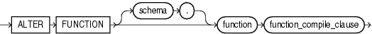

Purpose

Functions are defined using PL/SQL. Therefore, this section provides some general information but refers to [Oracle Database PL/SQL Language Reference](https://docs.oracle.com/cd/E11882_01/appdev.112/e25519/alter_function.htm#LNPLS99999) for complete syntax, semantics, and examples.

Use the `ALTER` `FUNCTION` statement to recompile an invalid standalone stored function. Explicit recompilation eliminates the need for implicit run-time recompilation and prevents associated run-time compilation errors and performance overhead.

This statement does not change the declaration or definition of an existing function. To redeclare or redefine a function, use the `CREATE` `FUNCTION` statement with the `OR` `REPLACE` clause. See [CREATE FUNCTION](statements_5011.md).

Prerequisites

The function must be in your own schema or you must have `ALTER` `ANY` `PROCEDURE` system privilege.

Syntax

alter\_function::=



> ```
> ALTER FUNCTION [ schema. ] function function_compile_clause
> ```
  
  

(`function_compile_clause`: See [Oracle Database PL/SQL Language Reference](https://docs.oracle.com/cd/E11882_01/appdev.112/e25519/alter_function.htm#LNPLS99999) for the syntax of this clause.)

Semantics

schema

Specify the schema containing the function. If you omit `schema`, then Oracle Database assumes the function is in your own schema.

function

Specify the name of the function to be recompiled.

function\_compile\_clause

See [Oracle Database PL/SQL Language Reference](https://docs.oracle.com/cd/E11882_01/appdev.112/e25519/alter_function.htm#LNPLS99999) for the syntax and semantics of this clause and for complete information on creating and compiling functions.