Purpose

A materialized view is a database object that contains the results of a query. The `FROM` clause of the query can name tables, views, and other materialized views. Collectively these source objects are called master tables (a replication term) or detail tables (a data warehousing term). This reference uses the term master tables for consistency. The databases containing the master tables are called the master databases.

Use the `ALTER` `MATERIALIZED` `VIEW` statement to modify an existing materialized view in one or more of the following ways:

- To change its storage characteristics
- To change its refresh method, mode, or time
- To alter its structure so that it is a different type of materialized view
- To enable or disable query rewrite
	Note:
	The keyword `SNAPSHOT` is supported in place of `MATERIALIZED` `VIEW` for backward compatibility.
	See Also:
	- [CREATE MATERIALIZED VIEW](statements_6002.md) for more information on creating materialized views
	- [Oracle Database Advanced Replication](https://docs.oracle.com/cd/E11882_01/server.112/e10706/repmview.htm#REPLN003) for information on materialized views in a replication environment
	- [Oracle Database Data Warehousing Guide](https://docs.oracle.com/cd/E11882_01/server.112/e25554/basicmv.htm#DWHSG008) for information on materialized views in a data warehousing environment

Prerequisites

The privileges required to alter a materialized view should be granted directly, as follows:

The materialized view must be in your own schema, or you must have the `ALTER` `ANY` `MATERIALIZED` `VIEW` system privilege.

To enable a materialized view for query rewrite:

- If all of the master tables in the materialized view are in your schema, then you must have the `QUERY` `REWRITE` privilege.
- If any of the master tables are in another schema, then you must have the `GLOBAL` `QUERY` `REWRITE` privilege.
- If the materialized view is in another user's schema, then both you and the owner of that schema must have the appropriate `QUERY` `REWRITE` privilege, as described in the preceding two items. In addition, the owner of the materialized view must have `SELECT` access to any master tables that the materialized view owner does not own.

Syntax

alter\_materialized\_view::=

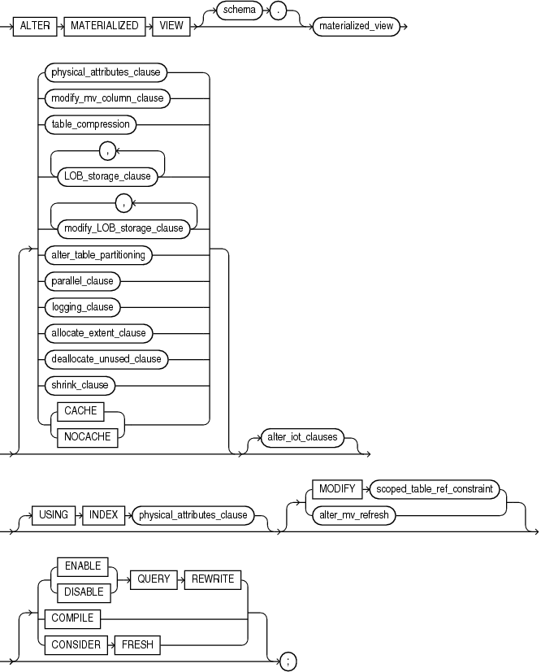

> ```
> ALTER MATERIALIZED VIEW
>   [ schema. ] materialized_view
>   [ physical_attributes_clause
>   | modify_mv_column_clause
>   | table_compression
>   | LOB_storage_clause [, LOB_storage_clause ]...
>   | modify_LOB_storage_clause [, modify_LOB_storage_clause ]...
>   | alter_table_partitioning
>   | parallel_clause
>   | logging_clause
>   | allocate_extent_clause
>   | deallocate_unused_clause
>   | shrink_clause
>   | { CACHE | NOCACHE }
>   ]
>   [ alter_iot_clauses ]
>   [ USING INDEX physical_attributes_clause ]
>   [ MODIFY scoped_table_ref_constraint
>   | alter_mv_refresh
>   ]
>   [ { ENABLE | DISABLE } QUERY REWRITE
>   | COMPILE
>   | CONSIDER FRESH
>   ] ;
> ```
  
  

(physical\_attributes\_clause::=, modify\_mv\_column\_clause::=, table\_compression::=, LOB\_storage\_clause::=, modify\_LOB\_storage\_clause::=, [alter\_table\_partitioning::=](statements_3001.md) (part of `ALTER` `TABLE`), parallel\_clause::=, logging\_clause::=, allocate\_extent\_clause::=, deallocate\_unused\_clause::=, shrink\_clause::=, alter\_iot\_clauses::=, scoped\_table\_ref\_constraint::=, alter\_mv\_refresh::=)

physical\_attributes\_clause::=


> ```
> [ { PCTFREE integer
>   | PCTUSED integer
>   | INITRANS integer
>   | storage_clause
>   }...
> ]
> ```
  
  

([storage\_clause::=](clauses009.md))

modify\_mv\_column\_clause::=

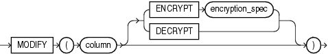

> ```
> MODIFY ( column [ ENCRYPT encryption_spec
>        | DECRYPT ] 
>        )
> ```
  
  

table\_compression::=

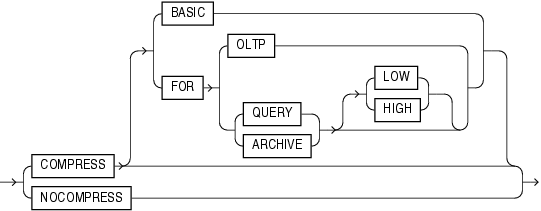

> ```
> { COMPRESS [ BASIC 
>            | FOR { OLTP
>                  | { QUERY | ARCHIVE } [ LOW | HIGH ]
>                  }
>            ]
> | NOCOMPRESS 
> }
> ```
  
  

LOB\_storage\_clause::=

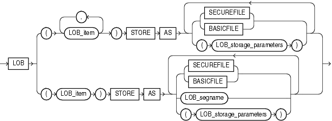

> ```
> LOB
> { (LOB_item [, LOB_item ]...)
>      STORE AS { {SECUREFILE | BASICFILE}
>               | (LOB_storage_parameters)
>               }...
> | (LOB_item)
>      STORE AS { {SECUREFILE | BASICFILE}
>               | LOB_segname 
>               | (LOB_storage_parameters)
>               }...
> }
> ```
  
  

(LOB\_storage\_parameters::=)

LOB\_storage\_parameters::=

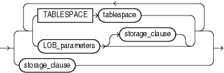

> ```
> { { TABLESPACE tablespace
>   | LOB_parameters [storage_clause]
>   }...
> | storage_clauase
> }
> ```
  
  

(LOB\_parameters::=, [storage\_clause::=](clauses009.md))

LOB\_parameters::=

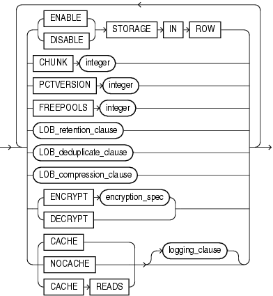

> ```
> { { ENABLE | DISABLE } STORAGE IN ROW
>   | CHUNK integer
>   | PCTVERSION integer
>   | FREEPOOLS integer
>   | LOB_retention_clause
>   | LOB_deduplicate_clause
>   | LOB_compression_clause
>   | { ENCRYPT encryption_spec | DECRYPT }
>   | { CACHE | NOCACHE | CACHE READS } [ logging_clause ] 
> }...
> ```
  
  

([storage\_clause::=](clauses009.md), [logging\_clause::=](clauses005.md))

modify\_LOB\_storage\_clause::=

  
[Description of the illustration ''modify\_lob\_storage\_clause.gif''](https://docs.oracle.com/cd/E11882_01/server.112/e41084/img_text/modify_lob_storage_clause.htm)  
  

(modify\_LOB\_parameters::=)

modify\_LOB\_parameters::=

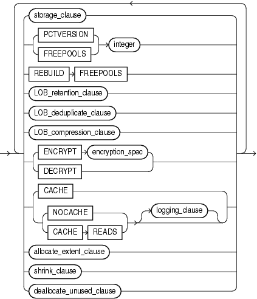

> ```
> { storage_clause
> | PCTVERSION integer
> | FREEPOOLS integer
> | REBUILD FREEPOOLS
> | LOB_retention_clause
> | LOB_deduplicate_clause
> | LOB_compression_clause
> | { ENCRYPT encryption_spec | DECRYPT }
> | { CACHE 
>   | { NOCACHE | CACHE READS } [ logging_clause ]
>   }
> | allocate_extent_clause
> | shrink_clause
> | deallocate_unused_clause
> } ...
> ```
  
  

([storage\_clause::=](clauses009.md), [LOB\_retention\_clause::=](statements_7002.md), [LOB\_compression\_clause::=](statements_7002.md), [logging\_clause::=](clauses005.md), allocate\_extent\_clause::=, shrink\_clause::=, deallocate\_unused\_clause::=)

parallel\_clause::=


> ```
> { NOPARALLEL | PARALLEL [ integer ] }
> ```
  
  

logging\_clause::=

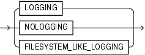

> ```
> { LOGGING | NOLOGGING |  FILESYSTEM_LIKE_LOGGING }
> ```
  
  

allocate\_extent\_clause::=


> ```
> ALLOCATE EXTENT
>   [ ( { SIZE size_clause
>       | DATAFILE 'filename'
>       | INSTANCE integer
>       } ...
>     )
>   ]
> ```
  
  

([size\_clause::=](clauses008.md))

deallocate\_unused\_clause::=


> ```
> DEALLOCATE UNUSED [ KEEP size_clause ]
> ```
  
  

([size\_clause::=](clauses008.md))

shrink\_clause::=

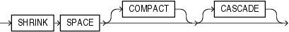

> ```
> SHRINK SPACE [ COMPACT ] [ CASCADE ]
> ```
  
  

alter\_iot\_clauses::=

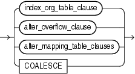

> ```
> { index_org_table_clause
> | alter_overflow_clause
> | alter_mapping_table_clauses
> | COALESCE
> }
> ```
  
  

(index\_org\_table\_clause::=, alter\_overflow\_clause::=, `alter_mapping_table_clauses`: not supported with materialized views)

index\_org\_table\_clause::=

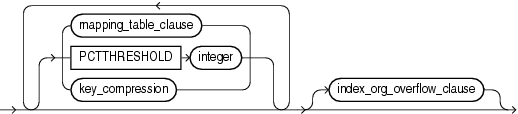

> ```
> [ { mapping_table_clause
>   | PCTTHRESHOLD integer
>   | key_compression
>   }...
> ]
> [ index_org_overflow_clause ]
> ```
  
  

(`mapping_table_clause`: not supported with materialized views, `key_compression`: not supported with materialized views, index\_org\_overflow\_clause::=)

index\_org\_overflow\_clause::=

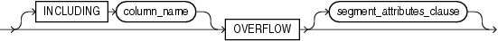

> ```
> [ INCLUDING column_name ]
> OVERFLOW [ segment_attributes_clause ]
> ```
  
  

([segment\_attributes\_clause::=](statements_3001.md) —part of `ALTER` `TABLE`)

alter\_overflow\_clause::=

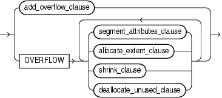

> ```
> { add_overflow_clause
> | OVERFLOW
>      { segment_attributes_clause
>      | allocate_extent_clause
>      | shrink_clause
>      | deallocate_unused_clause
>      }...
> }
> ```
  
  

(allocate\_extent\_clause::=, shrink\_clause::=, deallocate\_unused\_clause::=)

add\_overflow\_clause::=

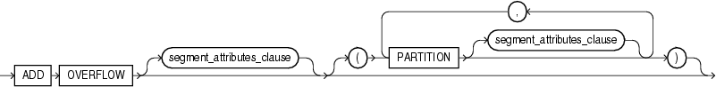

> ```
> ADD OVERFLOW [ segment_attributes_clause ]
>   [ ( PARTITION [ segment_attributes_clause ]
>     [, PARTITION [ segment_attributes_clause ] ]...
>     )
>   ]
> ```
  
  

([segment\_attributes\_clause::=](statements_3001.md) --part of `ALTER` `TABLE`)

scoped\_table\_ref\_constraint::=

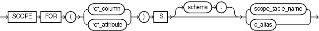

> ```
> { SCOPE FOR ({ ref_column | ref_attribute })
>   IS [ schema. ] { scope_table_name | c_alias }
> }
> ```
  
  

alter\_mv\_refresh::=

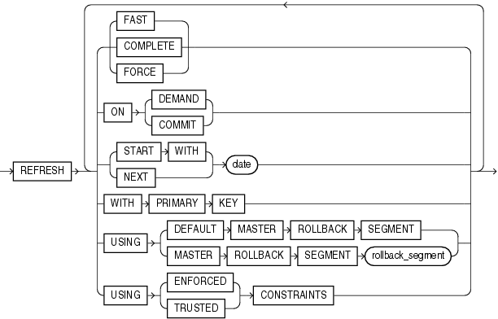

> ```
> REFRESH
>    { { FAST | COMPLETE | FORCE }
>    | ON { DEMAND | COMMIT }
>    | { START WITH | NEXT } date
>    | WITH PRIMARY KEY
>    | USING
>         { DEFAULT MASTER ROLLBACK SEGMENT
>         | MASTER ROLLBACK SEGMENT rollback_segment
>         }
>    | USING { ENFORCED | TRUSTED } CONSTRAINTS
>    }
> ```
  

Semantics

schema

Specify the schema containing the materialized view. If you omit `schema`, then Oracle Database assumes the materialized view is in your own schema.

materialized\_view

Specify the name of the materialized view to be altered.

physical\_attributes\_clause

Specify new values for the `PCTFREE`, `PCTUSED`, and `INITRANS` parameters (or, when used in the `USING` `INDEX` clause, for the `INITRANS` parameter only) and the storage characteristics for the materialized view. Refer to [ALTER TABLE](statements_3001.md) for information on the `PCTFREE`, `PCTUSED`, and `INITRANS` parameters and to [storage\_clause](clauses007.md) for information about storage characteristics.

modify\_mv\_column\_clause

Use this clause to encrypt or decrypt this column of the materialized view. Refer to the `CREATE` `TABLE` clause [encryption\_spec](statements_7002.md) for information on this clause.

table\_compression

Use the `table_compression` clause to instruct Oracle Database whether to compress data segments to reduce disk and memory use. Refer to the [table\_compression](statements_7002.md) clause of `CREATE` `TABLE` for the full semantics of this clause.

LOB\_storage\_clause

The `LOB_storage_clause` lets you specify the storage characteristics of a new LOB. LOB storage behaves for materialized views exactly as it does for tables. Refer to the [LOB\_storage\_clause](statements_7002.md) (in `CREATE` `TABLE`) for information on the LOB storage parameters.

modify\_LOB\_storage\_clause

The `modify_LOB_storage_clause` lets you modify the physical attributes of the LOB attribute `LOB_item` or the LOB object attribute. Modification of LOB storage behaves for materialized views exactly as it does for tables.

See Also:

The [modify\_LOB\_storage\_clause](statements_3001.md) of `ALTER` `TABLE` for information on the LOB storage parameters that can be modified

alter\_table\_partitioning

The syntax and general functioning of the partitioning clauses for materialized views is the same as for partitioned tables. Refer to [alter\_table\_partitioning](statements_3001.md) in the documentation for `ALTER` `TABLE`.

Restriction on Altering Materialized View Partitions You cannot specify the `LOB_storage_clause` or `modify_LOB_storage_clause` within any of the `partitioning_clauses`.

Note:

If you want to keep the contents of the materialized view synchronized with those of the master table, then Oracle recommends that you manually perform a complete refresh of all materialized views dependent on the table after dropping or truncating a table partition.

MODIFY PARTITION UNUSABLE LOCAL INDEXES Use this clause to mark `UNUSABLE` all the local index partitions associated with `partition`.

MODIFY PARTITION REBUILD UNUSABLE LOCAL INDEXES Use this clause to rebuild the unusable local index partitions associated with `partition`.

parallel\_clause

The `parallel_clause` lets you change the default degree of parallelism for the materialized view.

For complete information on this clause, refer to [parallel\_clause](statements_7002.md) in the documentation on `CREATE` `TABLE`.

logging\_clause

Specify or change the logging characteristics of the materialized view. Refer to the [logging\_clause](clauses005.md) for a full description of this clause.

allocate\_extent\_clause

The `allocate_extent_clause` lets you explicitly allocate a new extent for the materialized view. Refer to the [allocate\_extent\_clause](clauses001.md) for a full description of this clause.

deallocate\_unused\_clause

Use the `deallocate_unused_clause` to explicitly deallocate unused space at the end of the materialized view and make the freed space available for other segments. Refer to the [deallocate\_unused\_clause](clauses003.md) for a full description of this clause.

shrink\_clause

Use this clause to compact the materialized view segments. For complete information on this clause, refer to [shrink\_clause](statements_3001.md) in the documentation on `CREATE` `TABLE`.

CACHE | NOCACHE

For data that will be accessed frequently, `CACHE` specifies that the blocks retrieved for this table are placed at the most recently used end of the LRU list in the buffer cache when a full table scan is performed. This attribute is useful for small lookup tables. `NOCACHE` specifies that the blocks are placed at the least recently used end of the LRU list. Refer to ["CACHE | NOCACHE | CACHE READS"](statements_7002.md) in the documentation on `CREATE` `TABLE` for more information about this clause.

alter\_iot\_clauses

Use the `alter_iot_clauses` to change the characteristics of an index-organized materialized view. The keywords and parameters of the components of the `alter_iot_clauses` have the same semantics as in `ALTER` `TABLE`, with the restrictions that follow.

Restrictions on Altering Index-Organized Materialized Views You cannot specify the `mapping_table_clause` or the `key_compression` clause of the `index_org_table_clause`.

See Also:

[index\_org\_table\_clause](statements_6002.md) of `CREATE` `MATERIALIZED` `VIEW` for information on creating an index-organized materialized view

USING INDEX Clause

Use this clause to change the value of `INITRANS` and `STORAGE` parameters for the index Oracle Database uses to maintain the materialized view data.

Restriction on the USING INDEX clause You cannot specify the `PCTUSED` or `PCTFREE` parameters in this clause.

MODIFY scoped\_table\_ref\_constraint

Use the `MODIFY` `scoped_table_ref_constraint` clause to rescope a `REF` column or attribute to a new table or to an alias for a new column.

Restrictions on Rescoping REF Columns You can rescope only one `REF` column or attribute in each `ALTER` `MATERIALIZED` `VIEW` statement, and this must be the only clause in this statement.

alter\_mv\_refresh

Use the `alter_mv_refresh` clause to change the default method and mode and the default times for automatic refreshes. If the contents of the master tables of a materialized view are modified, then the data in the materialized view must be updated to make the materialized view accurately reflect the data currently in its master table(s). This clause lets you schedule the times and specify the method and mode for Oracle Database to refresh the materialized view.

Note:

This clause only sets the default refresh options. For instructions on actually implementing the refresh, refer to [Oracle Database Advanced Replication](https://docs.oracle.com/cd/E11882_01/server.112/e10706/repmview.htm#REPLN109) and [Oracle Database Data Warehousing Guide](https://docs.oracle.com/cd/E11882_01/server.112/e25554/refresh.htm#DWHSG015).

FAST Clause

Specify `FAST` for the incremental refresh method, which performs the refresh according to the changes that have occurred to the master tables. The changes are stored either in the materialized view log associated with the master table (for conventional DML changes) or in the direct loader log (for direct-path `INSERT` operations).

For both conventional DML changes and for direct-path `INSERT` operations, other conditions may restrict the eligibility of a materialized view for fast refresh.

See Also:

- [Oracle Database Advanced Replication](https://docs.oracle.com/cd/E11882_01/server.112/e10706/repmview.htm#REPLN109) for restrictions on fast refresh in replication environments
- [Oracle Database Data Warehousing Guide](https://docs.oracle.com/cd/E11882_01/server.112/e25554/refresh.htm#DWHSG015) for restrictions on fast refresh in data warehouse environments
- "Automatic Refresh: Examples"

Restrictions on FAST Refresh `FAST` refresh is subject to the following restrictions:

- When you specify `FAST` refresh at create time, Oracle Database verifies that the materialized view you are creating is eligible for fast refresh. When you change the refresh method to `FAST` in an `ALTER` `MATERIALIZED` `VIEW` statement, Oracle Database does not perform this verification. If the materialized view is not eligible for fast refresh, then Oracle Database returns an error when you attempt to refresh this view.
- Materialized views are not eligible for fast refresh if the defining query contains an analytic function or the `XMLTable` function.
- You cannot fast refresh a materialized view if any of its columns is encrypted.

See Also:

["Analytic Functions"](functions004.md)

COMPLETE Clause

Specify `COMPLETE` for the complete refresh method, which is implemented by executing the defining query of the materialized view. If you specify a complete refresh, then Oracle Database performs a complete refresh even if a fast refresh is possible.

See Also:

"Complete Refresh: Example"

FORCE Clause

Specify `FORCE` if, when a refresh occurs, you want Oracle Database to perform a fast refresh if one is possible or a complete refresh otherwise.

ON COMMIT Clause

Specify `ON` `COMMIT` if you want a refresh to occur whenever Oracle Database commits a transaction that operates on a master table of the materialized view.

You cannot specify both `ON` `COMMIT` and `ON` `DEMAND`. If you specify `ON` `COMMIT`, then you cannot also specify `START` `WITH` or `NEXT`.

Restriction on ON COMMIT This clause is supported only for materialized join views and single-table materialized aggregate views.

ON DEMAND Clause

Specify `ON` `DEMAND` if you want the materialized view to be refreshed on demand by calling one of the three `DBMS_MVIEW` refresh procedures. If you omit both `ON` `COMMIT` and `ON` `DEMAND`, then `ON` `DEMAND` is the default.

You cannot specify both `ON` `COMMIT` and `ON` `DEMAND`. `START` `WITH` and `NEXT` take precedence over `ON` `DEMAND`. Therefore, in most circumstances it is not meaningful to specify `ON` `DEMAND` when you have specified `START` `WITH` or `NEXT`.

See Also:

- [Oracle Database PL/SQL Packages and Types Reference](https://docs.oracle.com/cd/E11882_01/appdev.112/e40758/d_mview.htm#ARPLS027) for information on these procedures
- [Oracle Database Data Warehousing Guide](https://docs.oracle.com/cd/E11882_01/server.112/e25554/refresh.htm#DWHSG015) on the types of materialized views you can create by specifying `REFRESH` `ON` `DEMAND`

START WITH Clause

Specify `START` `WITH` `date` to indicate a date for the first automatic refresh time.

NEXT Clause

Specify `NEXT` to indicate a date expression for calculating the interval between automatic refreshes.

Both the `START` `WITH` and `NEXT` values must evaluate to a time in the future. If you omit the `START` `WITH` value, then Oracle Database determines the first automatic refresh time by evaluating the `NEXT` expression with respect to the creation time of the materialized view. If you specify a `START` `WITH` value but omit the `NEXT` value, then Oracle Database refreshes the materialized view only once. If you omit both the `START` `WITH` and `NEXT` values, or if you omit the `alter_mv_refresh` entirely, then Oracle Database does not automatically refresh the materialized view.

WITH PRIMARY KEY Clause

Specify `WITH` `PRIMARY` `KEY` to change a rowid materialized view to a primary key materialized view. Primary key materialized views allow materialized view master tables to be reorganized without affecting the ability of the materialized view to continue to fast refresh.

For you to specify this clause, the master table must contain an enabled primary key constraint and must have defined on it a materialized view log that logs primary key information.

See Also:

- [Oracle Database Advanced Replication](https://docs.oracle.com/cd/E11882_01/server.112/e10706/repmaster.htm#REPLN002) for detailed information about primary key materialized views
- "Primary Key Materialized View: Example"

USING ROLLBACK SEGMENT Clause

This clause is not valid if your database is in automatic undo mode, because in that mode Oracle Database uses undo tablespaces instead of rollback segments. Oracle strongly recommends that you use automatic undo mode. This clause is supported for backward compatibility with replication environments containing older versions of Oracle Database that still use rollback segments.

For complete information on this clause, refer to `CREATE` `MATERIALIZED` `VIEW`... ["USING ROLLBACK SEGMENT Clause"](statements_6002.md).

USING... CONSTRAINTS Clause

This clause has the same semantics in `CREATE` `MATERIALIZED` `VIEW` and `ALTER` `MATERIALIZED` `VIEW` statements. For complete information, refer to ["USING... CONSTRAINTS Clause"](statements_6002.md) in the documentation on `CREATE` `MATERIALIZED` `VIEW`.

QUERY REWRITE Clause

Use this clause to determine whether the materialized view is eligible to be used for query rewrite.

ENABLE Clause

Specify `ENABLE` to enable the materialized view for query rewrite.

See Also:

"Enabling Query Rewrite: Example"

Restrictions on Enabling Materialized Views Enabling materialized views is subject to the following restrictions:

- If the materialized view is in an invalid or unusable state, then it is not eligible for query rewrite in spite of the `ENABLE` mode.
- You cannot enable query rewrite if the materialized view was created totally or in part from a view.
- You can enable query rewrite only if all user-defined functions in the materialized view are `DETERMINISTIC`.
	See Also:
	[CREATE FUNCTION](statements_5011.md)
- You can enable query rewrite only if expressions in the statement are repeatable. For example, you cannot include `CURRENT_TIME` or `USER`.

See Also:

[Oracle Database Data Warehousing Guide](https://docs.oracle.com/cd/E11882_01/server.112/e25554/qradv.htm#DWHSG080) for more information on query rewrite

DISABLE Clause

Specify `DISABLE` if you do not want the materialized view to be eligible for use by query rewrite. If a materialized view is in the invalid state, then it is not eligible for use by query rewrite, whether or not it is disabled. However, a disabled materialized view can be refreshed.

COMPILE

Specify `COMPILE` to explicitly revalidate a materialized view. If an object upon which the materialized view depends is dropped or altered, then the materialized view remains accessible, but it is invalid for query rewrite. You can use this clause to explicitly revalidate the materialized view to make it eligible for query rewrite.

If the materialized view fails to revalidate, then it cannot be refreshed or used for query rewrite.

See Also:

"Compiling a Materialized View: Example"

CONSIDER FRESH

This clause lets you manage the staleness state of a materialized view after changes have been made to its master tables. `CONSIDER` `FRESH` directs Oracle Database to consider the materialized view fresh and therefore eligible for query rewrite in the `TRUSTED` or `STALE_TOLERATED` modes.

Caution:

The `CONSIDER` `FRESH` clause also directs Oracle Database to no longer apply any rows in a materialized view log or Partition Change Tracking changes to the materialized view prior to the issuance of the `CONSIDER` `FRESH` clause. In other words, the pending changes will be ignored and deleted, not applied to the materialized view. This may result in the materialized view containing more or less data than the base table.

Because Oracle Database cannot guarantee the freshness of the materialized view, query rewrite in `ENFORCED` mode is not supported. This clause also sets the staleness state of the materialized view to `UNKNOWN`. The staleness state is displayed in the `STALENESS` column of the `ALL_MVIEWS`, `DBA_MVIEWS`, and `USER_MVIEWS` data dictionary views.

A materialized view is stale if changes have been made to the contents of any of its master tables. This clause directs Oracle Database to assume that the materialized view is fresh and that no such changes have been made. Therefore, actual updates to those tables pending refresh are purged with respect to the materialized view.

See Also:

- [Oracle Database Data Warehousing Guide](https://docs.oracle.com/cd/E11882_01/server.112/e25554/qradv.htm#DWHSG080) for more information on query rewrite and the implications of performing partition maintenance operations on master tables
- "CONSIDER FRESH: Example"

Examples

Automatic Refresh: Examples The following statement changes the default refresh method for the `sales_by_month_by_state` materialized view (created in ["Creating Materialized Aggregate Views: Example"](statements_6002.md)) to `FAST`:

```
ALTER MATERIALIZED VIEW sales_by_month_by_state
   REFRESH FAST;
```

The next automatic refresh of the materialized view will be a fast refresh provided it is a simple materialized view and its master table has a materialized view log that was created before the materialized view was created or last refreshed.

Because the `REFRESH` clause does not specify `START` `WITH` or `NEXT` values, Oracle Database will use the refresh intervals established by the `REFRESH` clause when the `sales_by_month_by_state` materialized view was created or last altered.

The following statement establishes a new interval between automatic refreshes for the `sales_by_month_by_state` materialized view:

```
ALTER MATERIALIZED VIEW sales_by_month_by_state
   REFRESH NEXT SYSDATE+7;
```

Because the `REFRESH` clause does not specify a `START` `WITH` value, the next automatic refresh occurs at the time established by the `START` `WITH` and `NEXT` values specified when the `sales_by_month_by_state` materialized view was created or last altered.

At the time of the next automatic refresh, Oracle Database refreshes the materialized view, evaluates the `NEXT` expression `SYSDATE` +7 to determine the next automatic refresh time, and continues to refresh the materialized view automatically once a week. Because the `REFRESH` clause does not explicitly specify a refresh method, Oracle Database continues to use the refresh method specified by the `REFRESH` clause of the `CREATE` `MATERIALIZED` `VIEW` or most recent `ALTER` `MATERIALIZED` `VIEW` statement.

CONSIDER FRESH: Example The following statement instructs Oracle Database that materialized view `sales_by_month_by_state` should be considered fresh. This statement allows `sales_by_month_by_state` to be eligible for query rewrite in `TRUSTED` mode even after you have performed partition maintenance operations on the master tables of `sales_by_month_by_state`:

```
ALTER MATERIALIZED VIEW sales_by_month_by_state CONSIDER FRESH;
```

As a result of the preceding statement, any partition maintenance operations that were done to the base table since the last refresh of the materialized view will not be applied to the materialized view. For example, the add, drop, or change of data in a partition in the base table will not be reflected in the materialized view if `CONSIDER` `FRESH` is used before the next refresh of the materialized view. Refer CONSIDER FRESH for more information.

See Also:

["Splitting Table Partitions: Examples"](statements_3001.md) for a partitioning maintenance example that would require this `ALTER` `MATERIALIZED` `VIEW` example

Complete Refresh: Example The following statement specifies a new refresh method, a new `NEXT` refresh time, and a new interval between automatic refreshes of the `emp_data` materialized view (created in ["Periodic Refresh of Materialized Views: Example"](statements_6002.md)):

```
ALTER MATERIALIZED VIEW emp_data
   REFRESH COMPLETE   
   START WITH TRUNC(SYSDATE+1) + 9/24  
   NEXT SYSDATE+7;
```

The `START` `WITH` value establishes the next automatic refresh for the materialized view to be 9:00 a.m. tomorrow. At that point, Oracle Database performs a complete refresh of the materialized view, evaluates the `NEXT` expression, and subsequently refreshes the materialized view every week.

Enabling Query Rewrite: Example The following statement enables query rewrite on the materialized view `emp_data` and implicitly revalidates it:

```
ALTER MATERIALIZED VIEW emp_data
   ENABLE QUERY REWRITE;
```

Primary Key Materialized View: Example The following statement changes the rowid materialized view `order_data` (created in ["Creating Rowid Materialized Views: Example"](statements_6002.md)) to a primary key materialized view. This example requires that you have already defined a materialized view log with a primary key on `order_data`.

```
ALTER MATERIALIZED VIEW order_data 
   REFRESH WITH PRIMARY KEY;
```

Compiling a Materialized View: Example The following statement revalidates the materialized view `store_mv`:

```
ALTER MATERIALIZED VIEW order_data COMPILE;
```