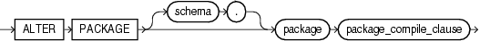

Purpose

Packages are defined using PL/SQL. Therefore, this section provides some general information but refers to [Oracle Database PL/SQL Language Reference](https://docs.oracle.com/cd/E11882_01/appdev.112/e25519/create_package.htm#LNPLS01371) for details of syntax and semantics.

Use the `ALTER` `PACKAGE` statement to explicitly recompile a package specification, body, or both. Explicit recompilation eliminates the need for implicit run-time recompilation and prevents associated run-time compilation errors and performance overhead.

Because all objects in a package are stored as a unit, the `ALTER` `PACKAGE` statement recompiles all package objects together. You cannot use the `ALTER` `PROCEDURE` statement or `ALTER` `FUNCTION` statement to recompile individually a procedure or function that is part of a package.

Note:

This statement does not change the declaration or definition of an existing package. To redeclare or redefine a package, use the [CREATE PACKAGE](statements_6006.md) or the [CREATE PACKAGE BODY](statements_6007.md) statement with the `OR` `REPLACE` clause.

Prerequisites

For you to modify a package, the package must be in your own schema or you must have `ALTER` `ANY` `PROCEDURE` system privilege.

Syntax

alter\_package::=



> ```
> ALTER PACKAGE [ schema. ] package package_compile_clause
> ```
  
  

(`package_compile_clause`: See [Oracle Database PL/SQL Language Reference](https://docs.oracle.com/cd/E11882_01/appdev.112/e25519/alter_package.htm#LNPLS99998) for the syntax of this clause.)

Semantics

schema

Specify the schema containing the package. If you omit `schema`, then Oracle Database assumes the package is in your own schema.

package

Specify the name of the package to be recompiled.

package\_compile\_clause

See [Oracle Database PL/SQL Language Reference](https://docs.oracle.com/cd/E11882_01/appdev.112/e25519/alter_package.htm#LNPLS99998) for the syntax and semantics of this clause and for complete information on creating and compiling packages.