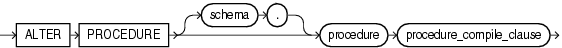

Purpose

Packages are defined using PL/SQL. Therefore, this section provides some general information but refers to [Oracle Database PL/SQL Language Reference](https://docs.oracle.com/cd/E11882_01/appdev.112/e25519/alter_procedure.htm#LNPLS99997) for details of syntax and semantics.

Use the `ALTER` `PROCEDURE` statement to explicitly recompile a standalone stored procedure. Explicit recompilation eliminates the need for implicit run-time recompilation and prevents associated run-time compilation errors and performance overhead.

To recompile a procedure that is part of a package, recompile the entire package using the `ALTER` `PACKAGE` statement (see [ALTER PACKAGE](statements_2006.md)).

Note:

This statement does not change the declaration or definition of an existing procedure. To redeclare or redefine a procedure, use the `CREATE` `PROCEDURE` statement with the `OR` `REPLACE` clause (see [CREATE PROCEDURE](statements_6009.md)).

The `ALTER` `PROCEDURE` statement is quite similar to the `ALTER` `FUNCTION` statement. Refer to [ALTER FUNCTION](statements_1009.md) for more information.

Prerequisites

The procedure must be in your own schema or you must have `ALTER` `ANY` `PROCEDURE` system privilege.

Syntax

alter\_procedure::=



> ```
> ALTER PROCEDURE [ schema. ] procedure procedure_compile_clause
> ```
  
  

(`procedure_compile_clause`: See [Oracle Database PL/SQL Language Reference](https://docs.oracle.com/cd/E11882_01/appdev.112/e25519/alter_procedure.htm#LNPLS99997) for the syntax of this clause.)

Semantics

schema

Specify the schema containing the procedure. If you omit `schema`, then Oracle Database assumes the procedure is in your own schema.

procedure

Specify the name of the procedure to be recompiled.

procedure\_compile\_clause

See [Oracle Database PL/SQL Language Reference](https://docs.oracle.com/cd/E11882_01/appdev.112/e25519/alter_procedure.htm#LNPLS99997) for the syntax and semantics of this clause and for complete information on creating and compiling procedures.