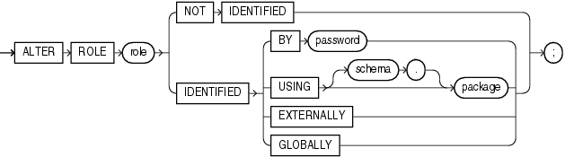

Purpose

Use the `ALTER` `ROLE` statement to change the authorization needed to enable a role.

See Also:

- [CREATE ROLE](statements_6012.md) for information on creating a role
- [SET ROLE](statements_10004.md) for information on enabling or disabling a role for your session

Prerequisites

You must either have been granted the role with the `ADMIN` `OPTION` or have `ALTER` `ANY` `ROLE` system privilege.

Before you alter a role to `IDENTIFIED` `GLOBALLY`, you must:

- Revoke all grants of roles identified externally to the role and
- Revoke the grant of the role from all users, roles, and `PUBLIC`.

The one exception to this rule is that you should not revoke the role from the user who is currently altering the role.

Syntax

alter\_role::=



> ```
> ALTER ROLE role
>   { NOT IDENTIFIED
>   | IDENTIFIED
>       { BY password
>       | USING [ schema. ] package
>       | EXTERNALLY
>       | GLOBALLY
>       }
>   } ;
> ```
  

Semantics

The keywords, parameters, and clauses in the `ALTER` `ROLE` statement all have the same meaning as in the `CREATE` `ROLE` statement.

Restriction on Altering a Role You cannot alter a `NOT` `IDENTIFIED` role to any of the `IDENTIFIED` types if it is granted to another role.

Notes on Altering a Role The following notes apply when altering a role:

- User sessions in which the role is already enabled are not affected.
- If you change a role identified by password to an application role (with the `USING` `package` clause), then password information associated with the role is lost. Oracle Database will use the new authentication mechanism the next time the role is to be enabled.
- If you have the `ALTER` `ANY` `ROLE` system privilege and you change a role that is `IDENTIFIED` `GLOBALLY` to `IDENTIFIED` `BY` `password`, `IDENTIFIED` `EXTERNALLY`, or `NOT` `IDENTIFIED`, then Oracle Database grants you the altered role with the `ADMIN` `OPTION`, as it would have if you had created the role identified nonglobally.

For more information, refer to [CREATE ROLE](statements_6012.md) and to the examples that follow.

Examples

Changing Role Identification: Example The following statement changes the role `warehouse_user` (created in ["Creating a Role: Example"](statements_6012.md)) to `NOT` `IDENTIFIED`:

```
ALTER ROLE warehouse_user NOT IDENTIFIED;
```

Changing a Role Password: Example This statement changes the password on the `dw_manager` role (created in ["Creating a Role: Example"](statements_6012.md)) to `data`:

```
ALTER ROLE dw_manager 
   IDENTIFIED BY data;
```

Users granted the `dw_manager` role must subsequently use the new password `data` to enable the role.

Application Roles: Example The following example changes the `dw_manager` role to an application role using the `hr.admin` package:

```
ALTER ROLE dw_manager IDENTIFIED USING hr.admin;
```