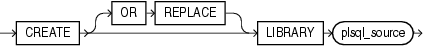

Purpose

Use the `CREATE` `LIBRARY` statement to create a schema object associated with an operating-system shared library. The name of this schema object can then be used in the `call_spec` of `CREATE` `FUNCTION` or `CREATE` `PROCEDURE` statements, or when declaring a function or procedure in a package or type, so that SQL and PL/SQL can call to third-generation-language (3GL) functions and procedures.

See Also:

[CREATE FUNCTION](statements_5011.md) and [Oracle Database PL/SQL Language Reference](https://docs.oracle.com/cd/E11882_01/appdev.112/e25519/subprograms.htm#LNPLS008) for more information on functions and procedures

Prerequisites

The `CREATE` `LIBRARY` statement is valid only on platforms that support shared libraries and dynamic linking.

To create a library in your own schema, you must have the `CREATE` `LIBRARY` system privilege. To create a library in another user's schema, you must have the `CREATE` `ANY` `LIBRARY` system privilege.

To use the library in the `call_spec` of a `CREATE` `FUNCTION` statement, or when declaring a function in a package or type, you must have the `EXECUTE` object privilege on the library and the `CREATE` `FUNCTION` system privilege. Refer to [Oracle Database PL/SQL Language Reference](https://docs.oracle.com/cd/E11882_01/appdev.112/e25519/create_function.htm#LNPLS01370) for information on the `call_spec` of a `CREATE` `FUNCTION` statement.

To use the library in the `call_spec` of a `CREATE` `PROCEDURE` statement, or when declaring a procedure in a package or type, you must have the `EXECUTE` object privilege on the library and the `CREATE` `PROCEDURE` system privilege. Refer to [Oracle Database PL/SQL Language Reference](https://docs.oracle.com/cd/E11882_01/appdev.112/e25519/create_procedure.htm#LNPLS01373) for information on the `call_spec` of a `CREATE` `PROCEDURE` statement.

To execute a procedure or function defined with the `call_spec` (including a procedure or function defined within a package or type), you must have the `EXECUTE` object privilege on the procedure or function (but you do not need the `EXECUTE` object privilege on the library).

Syntax

Libraries are defined using PL/SQL. Therefore, the syntax diagram in this book shows only the SQL keywords. Refer to [Oracle Database PL/SQL Language Reference](https://docs.oracle.com/cd/E11882_01/appdev.112/e25519/create_library.htm#LNPLS99948) for the PL/SQL syntax, semantics, and examples.

create\_library::=



> ```
> CREATE [ OR REPLACE ] LIBRARY plsql_source
> ```
  
  

(`plsql_source`: See [Oracle Database PL/SQL Language Reference](https://docs.oracle.com/cd/E11882_01/appdev.112/e25519/create_library.htm#LNPLS99948).)

Semantics

OR REPLACE

Specify `OR` `REPLACE` to re-create the library if it already exists. Use this clause to change the definition of an existing library without dropping, re-creating, and regranting object privileges granted on it.

Users who had previously been granted privileges on a redefined library can still access the library without being regranted the privileges.

plsql\_source

See [Oracle Database PL/SQL Language Reference](https://docs.oracle.com/cd/E11882_01/appdev.112/e25519/create_library.htm#LNPLS99948) for the syntax and semantics of the `plsql_source`.