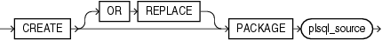

Purpose

Packages are defined using PL/SQL. Therefore, this section provides some general information but refers to [Oracle Database PL/SQL Language Reference](https://docs.oracle.com/cd/E11882_01/appdev.112/e25519/create_package.htm#LNPLS01371) for details of syntax and semantics.

Use the `CREATE` `PACKAGE` statement to create the specification for a stored package, which is an encapsulated collection of related procedures, functions, and other program objects stored together in the database. The package specification declares these objects. The package body, specified subsequently, defines these objects.

See Also:

- [CREATE PACKAGE BODY](statements_6007.md) for information on specifying the implementation of the package
- [CREATE FUNCTION](statements_5011.md) and [CREATE PROCEDURE](statements_6009.md) for information on creating standalone functions and procedures
- [ALTER PACKAGE](statements_2006.md) and [DROP PACKAGE](statements_8025.md) for information on modifying and dropping a package
- [Oracle Database Advanced Application Developer's Guide](https://docs.oracle.com/cd/E11882_01/appdev.112/e41502/adfns_packages.htm#ADFNS009) and [Oracle Database PL/SQL Packages and Types Reference](https://docs.oracle.com/cd/E11882_01/appdev.112/e40758/intro.htm#ARPLS139) for detailed discussions of packages and how to use them

Prerequisites

To create or replace a package in your own schema, you must have the `CREATE` `PROCEDURE` system privilege. To create or replace a package in another user's schema, you must have the `CREATE` `ANY` `PROCEDURE` system privilege.

To embed a `CREATE` `PACKAGE` statement inside an Oracle Database precompiler program, you must terminate the statement with the keyword `END-EXEC` followed by the embedded SQL statement terminator for the specific language.

See Also:

[Oracle Database PL/SQL Language Reference](https://docs.oracle.com/cd/E11882_01/appdev.112/e25519/create_package.htm#LNPLS01371) for more information

Syntax

Packages are defined using PL/SQL. Therefore, the syntax diagram in this book shows only the SQL keywords. Refer to [Oracle Database PL/SQL Language Reference](https://docs.oracle.com/cd/E11882_01/appdev.112/e25519/create_package.htm#LNPLS01371) for the PL/SQL syntax, semantics, and examples.

create\_package::=



> ```
> CREATE [ OR REPLACE ] PACKAGE plsql_source
> ```
  
  

(`plsql_source`: See [Oracle Database PL/SQL Language Reference](https://docs.oracle.com/cd/E11882_01/appdev.112/e25519/create_package.htm#LNPLS01371).)

Semantics

OR REPLACE

Specify `OR` `REPLACE` to re-create the package specification if it already exists. Use this clause to change the specification of an existing package without dropping, re-creating, and regranting object privileges previously granted on the package. If you change a package specification, then Oracle Database recompiles it.

Users who had previously been granted privileges on a redefined package can still access the package without being regranted the privileges.

If any function-based indexes depend on the package, then the database marks the indexes `DISABLED`.

See Also:

[`ALTER` `PACKAGE`](statements_2006.md) for information on recompiling package specifications

plsql\_source

See [Oracle Database PL/SQL Language Reference](https://docs.oracle.com/cd/E11882_01/appdev.112/e25519/create_package.htm#LNPLS01371) for the syntax and semantics of the `plsql_source`, including examples.