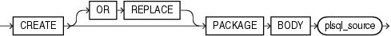

Purpose

Package bodies are defined using PL/SQL. Therefore, this section provides some general information but refers to [Oracle Database PL/SQL Language Reference](https://docs.oracle.com/cd/E11882_01/appdev.112/e25519/create_package_body.htm#LNPLS01372) for details of syntax and semantics.

Use the `CREATE` `PACKAGE` `BODY` statement to create the body of a stored package, which is an encapsulated collection of related procedures, stored functions, and other program objects stored together in the database. The package body defines these objects. The package specification, defined in an earlier `CREATE` `PACKAGE` statement, declares these objects.

Packages are an alternative to creating procedures and functions as standalone schema objects.

See Also:

- [CREATE FUNCTION](statements_5011.md) and [CREATE PROCEDURE](statements_6009.md) for information on creating standalone functions and procedures
- [CREATE PACKAGE](statements_6006.md) for a discussion of packages, including how to create packages
- [ALTER PACKAGE](statements_2006.md) for information on modifying a package
- [DROP PACKAGE](statements_8025.md) for information on removing a package from the database

Prerequisites

To create or replace a package in your own schema, you must have the `CREATE` `PROCEDURE` system privilege. To create or replace a package in another user's schema, you must have the `CREATE` `ANY` `PROCEDURE` system privilege. In both cases, the package body must be created in the same schema as the package.

To embed a `CREATE` `PACKAGE` `BODY` statement inside an Oracle Database precompiler program, you must terminate the statement with the keyword `END-EXEC` followed by the embedded SQL statement terminator for the specific language.

See Also:

[Oracle Database PL/SQL Language Reference](https://docs.oracle.com/cd/E11882_01/appdev.112/e25519/create_package_body.htm#LNPLS01372)

Syntax

Package bodies are defined using PL/SQL. Therefore, the syntax diagram in this book shows only the SQL keywords. Refer to [Oracle Database PL/SQL Language Reference](https://docs.oracle.com/cd/E11882_01/appdev.112/e25519/create_package_body.htm#LNPLS01372) for the PL/SQL syntax, semantics, and examples.

create\_package\_body::=



> ```
> CREATE [ OR REPLACE ] PACKAGE BODY plsql_source
> ```
  
  

(`plsql_source`: See [Oracle Database PL/SQL Language Reference](https://docs.oracle.com/cd/E11882_01/appdev.112/e25519/create_package_body.htm#LNPLS01372).)

Semantics

OR REPLACE

Specify `OR` `REPLACE` to re-create the package body if it already exists. Use this clause to change the body of an existing package without dropping, re-creating, and regranting object privileges previously granted on it. If you change a package body, then Oracle Database recompiles it.

Users who had previously been granted privileges on a redefined package can still access the package without being regranted the privileges.

See Also:

[ALTER PACKAGE](statements_2006.md) for information on recompiling package bodies

plsql\_source

See [Oracle Database PL/SQL Language Reference](https://docs.oracle.com/cd/E11882_01/appdev.112/e25519/create_package_body.htm#LNPLS01372) for the syntax and semantics of the `plsql_source`.