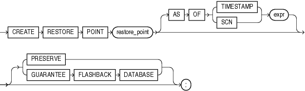

Purpose

Use the `CREATE` `RESTORE` `POINT` statement to create a restore point, which is a name associated with a timestamp or an SCN of the database. A restore point can be used to flash back a table or the database to the time specified by the restore point without the need to determine the SCN or timestamp. Restore points are also useful in various RMAN operations, including backups and database duplication. You can use RMAN to create restore points in the process of implementing an archival backup.

See Also:

- Oracle Database Backup and Recovery User's Guide for more information on [creating and using restore points and guaranteed restore points](https://docs.oracle.com/cd/E11882_01/backup.112/e10642/flashdb.htm#BRADV589), for information on [database duplication](https://docs.oracle.com/cd/E11882_01/backup.112/e10642/rcmdupdb.htm#BRADV010), and for information on [archival backups](https://docs.oracle.com/cd/E11882_01/backup.112/e10642/rcmbckba.htm#BRADV89551)
- [FLASHBACK DATABASE](statements_9011.md), [FLASHBACK TABLE](statements_9012.md), and [DROP RESTORE POINT](statements_8028.md) for information on using and dropping restore points

Prerequisites

To create a normal restore point, you must have either `SELECT` `ANY` `DICTIONARY` or `FLASHBACK` `ANY` `TABLE` privilege. To create a guaranteed restore point, you must have the `SYSDBA` system privileges.

To view or use a restore point, you must have the `SELECT` `ANY` `DICTIONARY` or `FLASHBACK` `ANY` `TABLE` system privilege or the `SELECT_CATALOG_ROLE` role.

You can create a restore point on a primary or standby database. The database can be open, or mounted but not open. If the database is mounted, then it must have been shut down consistently before being mounted unless it is a physical standby database.

You must have created a fast recovery area before creating a guaranteed restore point. You need not enable flashback database before you create the restore point. The database must be in `ARCHIVELOG` mode if you are creating a guaranteed restore point.

Syntax

create\_restore\_point::=



> ```
> CREATE RESTORE POINT restore_point
>    [ AS OF {TIMESTAMP | SCN} expr ]
>    [ PRESERVE
>    | GUARANTEE FLASHBACK DATABASE
>    ];
> ```
  

Semantics

restore\_point

Specify the name of the restore point. The name is a character value of up to 128 characters.

The database can retain at least 2048 normal restore points. Normal restore points are retained in the database for at least the number of days specified for the `CONTROL_FILE_RECORD_KEEP_TIME` initialization parameter. The default value of that parameter is 7 days. Guaranteed restore points are retained in the database until explicitly dropped by the user.

If you specify neither `PRESERVE` nor `GUARANTEE FLASHBACK DATABASE`, then the resulting restore point enables you to flash the database back to a restore point within the time period determined by the `DB_FLASHBACK_RETENTION_TARGET` initialization parameter. The database automatically manages such restore points. When the maximum number of restore points is reached, according to the rules described in `restore_point` above, the database automatically drops the oldest restore point. Under some circumstances the restore points will be retained in the RMAN recovery catalog for use in restoring long-term backups. You can explicitly drop a restore point using the `DROP` `RESTORE` `POINT` statement.

AS OF Clause

Use this clause to create a restore point at a specified datetime or SCN in the past. If you specify `TIMESTAMP`, then `expr` must be a valid datetime expression resolving to a time in the past. If you specify SCN, then `expr` must be a valid SCN in the database in the past. In either case, `expr` must refer to a datetime or SCN in the current incarnation of the database.

PRESERVE

Specify `PRESERVE` to indicate that the restore point must be explicitly deleted. Such restore points are useful for preserving a flashback database.

GUARANTEE FLASHBACK DATABASE

A guaranteed restore point enables you to flash the database back deterministically to the restore point regardless of the `DB_FLASHBACK_RETENTION_TARGET` initialization parameter setting. The guaranteed ability to flash back depends on sufficient space being available in the fast recovery area.

Guaranteed restore points guarantee only that the database will maintain enough flashback logs to flashback the database to the guaranteed restore point. It does not guarantee that the database will have enough undo to flashback any table to the same restore point.

Guaranteed restore points are always preserved. They must be dropped explicitly by the user using the `DROP` `RESTORE` `POINT` statement. They do not age out. Guaranteed restore points can use considerable space in the fast recovery area. Therefore, Oracle recommends that you create guaranteed restore points only after careful consideration.

Examples

Creating and Using a Restore Point: Example The following example creates a normal restore point, updates a table, and then flashes back the altered table to the restore point. The example assumes the user `hr` has the appropriate system privileges to use each of the statements.

```
CREATE RESTORE POINT good_data;

SELECT salary FROM employees WHERE employee_id = 108;

    SALARY
----------
     12000

UPDATE employees SET salary = salary*10
   WHERE employee_id = 108;

SELECT salary FROM employees
   WHERE employee_id = 108;

    SALARY
----------
    120000

COMMIT;

FLASHBACK TABLE employees TO RESTORE POINT good_data;

SELECT salary FROM employees
   WHERE employee_id = 108;

    SALARY
----------
     12000
```