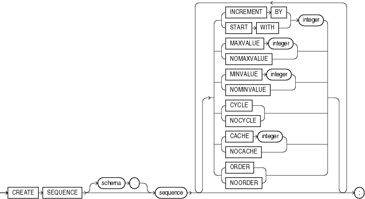

Purpose

Use the `CREATE` `SEQUENCE` statement to create a sequence, which is a database object from which multiple users may generate unique integers. You can use sequences to automatically generate primary key values.

When a sequence number is generated, the sequence is incremented, independent of the transaction committing or rolling back. If two users concurrently increment the same sequence, then the sequence numbers each user acquires may have gaps, because sequence numbers are being generated by the other user. One user can never acquire the sequence number generated by another user. After a sequence value is generated by one user, that user can continue to access that value regardless of whether the sequence is incremented by another user.

Sequence numbers are generated independently of tables, so the same sequence can be used for one or for multiple tables. It is possible that individual sequence numbers will appear to be skipped, because they were generated and used in a transaction that ultimately rolled back. Additionally, a single user may not realize that other users are drawing from the same sequence.

After a sequence is created, you can access its values in SQL statements with the `CURRVAL` pseudocolumn, which returns the current value of the sequence, or the `NEXTVAL` pseudocolumn, which increments the sequence and returns the new value.

Note on Using Sequences with Deferred Segments If you attempt to insert a sequence value into a table that uses deferred segment creation, the first value that the sequence returns will be skipped.

See Also:

- [Chapter 2, "Pseudocolumns"](pseudocolumns.md) for more information on using the `CURRVAL` and `NEXTVAL`
- ["How to Use Sequence Values"](pseudocolumns002.md) for information on using sequences
- [ALTER SEQUENCE](statements_2012.md) or [DROP SEQUENCE](statements_9001.md) for information on modifying or dropping a sequence

Prerequisites

To create a sequence in your own schema, you must have the `CREATE` `SEQUENCE` system privilege.

To create a sequence in another user's schema, you must have the `CREATE` `ANY` `SEQUENCE` system privilege.

Syntax

create\_sequence::=



> ```
> CREATE SEQUENCE [ schema. ] sequence
>    [ { INCREMENT BY | START WITH } integer
>    | { MAXVALUE integer | NOMAXVALUE }
>    | { MINVALUE integer | NOMINVALUE }
>    | { CYCLE | NOCYCLE }
>    | { CACHE integer | NOCACHE }
>    | { ORDER | NOORDER }
>    ]...
> ;
> ```
  

Semantics

schema

Specify the schema to contain the sequence. If you omit `schema`, then Oracle Database creates the sequence in your own schema.

sequence

Specify the name of the sequence to be created. The name must satisfy the requirements listed in ["Database Object Naming Rules"](sql_elements008.md).

If you specify none of the following clauses, then you create an ascending sequence that starts with 1 and increases by 1 with no upper limit. Specifying only `INCREMENT` `BY` -1 creates a descending sequence that starts with -1 and decreases with no lower limit.

- To create a sequence that increments without bound, for ascending sequences, omit the `MAXVALUE` parameter or specify `NOMAXVALUE`. For descending sequences, omit the `MINVALUE` parameter or specify the `NOMINVALUE`.
- To create a sequence that stops at a predefined limit, for an ascending sequence, specify a value for the `MAXVALUE` parameter. For a descending sequence, specify a value for the `MINVALUE` parameter. Also specify `NOCYCLE`. Any attempt to generate a sequence number once the sequence has reached its limit results in an error.
- To create a sequence that restarts after reaching a predefined limit, specify values for both the `MAXVALUE` and `MINVALUE` parameters. Also specify `CYCLE`.

INCREMENT BY Specify the interval between sequence numbers. This integer value can be any positive or negative integer, but it cannot be 0. This value can have 28 or fewer digits for an ascending sequence and 27 or fewer digits for a descending sequence. The absolute of this value must be less than the difference of `MAXVALUE` and `MINVALUE`. If this value is negative, then the sequence descends. If the value is positive, then the sequence ascends. If you omit this clause, then the interval defaults to 1.

START WITH Specify the first sequence number to be generated. Use this clause to start an ascending sequence at a value greater than its minimum or to start a descending sequence at a value less than its maximum. For ascending sequences, the default value is the minimum value of the sequence. For descending sequences, the default value is the maximum value of the sequence. This integer value can have 28 or fewer digits for positive values and 27 or fewer digits for negative values.

Note:

This value is not necessarily the value to which an ascending or descending cycling sequence cycles after reaching its maximum or minimum value, respectively.

MAXVALUE Specify the maximum value the sequence can generate. This integer value can have 28 or fewer digits for positive values and 27 or fewer digits for negative values. `MAXVALUE` must be equal to or greater than `START` `WITH` and must be greater than `MINVALUE`.

NOMAXVALUE Specify `NOMAXVALUE` to indicate a maximum value of 10 <sup>28</sup> -1 for an ascending sequence or -1 for a descending sequence. This is the default.

MINVALUE Specify the minimum value of the sequence. This integer value can have 28 or fewer digits for positive values and 27 or fewer digits for negative values. `MINVALUE` must be less than or equal to `START` `WITH` and must be less than `MAXVALUE`.

NOMINVALUE Specify `NOMINVALUE` to indicate a minimum value of 1 for an ascending sequence or -(10 <sup>27</sup> -1) for a descending sequence. This is the default.

CYCLE Specify `CYCLE` to indicate that the sequence continues to generate values after reaching either its maximum or minimum value. After an ascending sequence reaches its maximum value, it generates its minimum value. After a descending sequence reaches its minimum, it generates its maximum value.

NOCYCLE Specify `NOCYCLE` to indicate that the sequence cannot generate more values after reaching its maximum or minimum value. This is the default.

CACHE Specify how many values of the sequence the database preallocates and keeps in memory for faster access. This integer value can have 28 or fewer digits. The minimum value for this parameter is 2. For sequences that cycle, this value must be less than the number of values in the cycle. You cannot cache more values than will fit in a given cycle of sequence numbers. Therefore, the maximum value allowed for `CACHE` must be less than the value determined by the following formula:

```
(CEIL (MAXVALUE - MINVALUE)) / ABS (INCREMENT)
```

If a system failure occurs, then all cached sequence values that have not been used in committed DML statements are lost. The potential number of lost values is equal to the value of the `CACHE` parameter.

Note:

Oracle recommends using the `CACHE` setting to enhance performance if you are using sequences in an Oracle Real Application Clusters environment.

NOCACHE Specify `NOCACHE` to indicate that values of the sequence are not preallocated. If you omit both `CACHE` and `NOCACHE`, then the database caches 20 sequence numbers by default.

ORDER Specify `ORDER` to guarantee that sequence numbers are generated in order of request. This clause is useful if you are using the sequence numbers as timestamps. Guaranteeing order is usually not important for sequences used to generate primary keys.

`ORDER` is necessary only to guarantee ordered generation if you are using Oracle Real Application Clusters. If you are using exclusive mode, then sequence numbers are always generated in order.

NOORDER Specify `NOORDER` if you do not want to guarantee sequence numbers are generated in order of request. This is the default.

Example

Creating a Sequence: Example The following statement creates the sequence `customers_seq` in the sample schema `oe`. This sequence could be used to provide customer ID numbers when rows are added to the `customers` table.

```
CREATE SEQUENCE customers_seq
 START WITH     1000
 INCREMENT BY   1
 NOCACHE
 NOCYCLE;
```

The first reference to `customers_seq.nextval` returns 1000. The second returns 1001. Each subsequent reference will return a value 1 greater than the previous reference.