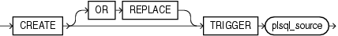

Purpose

Triggers are defined using PL/SQL. Therefore, this section provides some general information but refers to [Oracle Database PL/SQL Language Reference](https://docs.oracle.com/cd/E11882_01/appdev.112/e25519/create_trigger.htm#LNPLS01374) for details of syntax and semantics.

Use the `CREATE` `TRIGGER` statement to create a database trigger, which is:

- A stored PL/SQL block associated with a table, a schema, or the database or
- An anonymous PL/SQL block or a call to a procedure implemented in PL/SQL or Java

Oracle Database automatically executes a trigger when specified conditions occur.

See Also:

[ALTER TRIGGER](statements_4001.md) and [DROP TRIGGER](statements_9005.md)

Prerequisites

To create a trigger in your own schema on a table in your own schema or on your own schema (`SCHEMA`), you must have the `CREATE` `TRIGGER` system privilege.

To create a trigger in any schema on a table in any schema, or on another user's schema (`schema`.`SCHEMA`), you must have the `CREATE` `ANY` `TRIGGER` system privilege.

In addition to the preceding privileges, to create a trigger on `DATABASE`, you must have the `ADMINISTER` `DATABASE` `TRIGGER` system privilege.

If the trigger issues SQL statements or calls procedures or functions, then the owner of the trigger must have the privileges necessary to perform these operations. These privileges must be granted directly to the owner rather than acquired through roles.

Syntax

Triggers are defined using PL/SQL. Therefore, the syntax diagram in this book shows only the SQL keywords. Refer to Oracle Database PL/SQL Language Reference for the PL/SQL syntax, semantics, and examples.

create\_trigger::=



> ```
> CREATE [ OR REPLACE ] TRIGGER plsql_source
> ```
  
  

(`plsql_source`: See [Oracle Database PL/SQL Language Reference](https://docs.oracle.com/cd/E11882_01/appdev.112/e25519/create_trigger.htm#LNPLS01374).)

Semantics

OR REPLACE

Specify `OR` `REPLACE` to re-create the trigger if it already exists. Use this clause to change the definition of an existing trigger without first dropping it.

plsql\_source

See [Oracle Database PL/SQL Language Reference](https://docs.oracle.com/cd/E11882_01/appdev.112/e25519/create_trigger.htm#LNPLS01374) for the semantics of `plsql_source`.