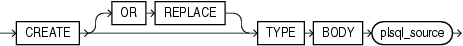

Purpose

Type bodies are defined using PL/SQL. Therefore, this section provides some general information but refers to [Oracle Database PL/SQL Language Reference](https://docs.oracle.com/cd/E11882_01/appdev.112/e25519/create_type_body.htm#LNPLS01376) for details of syntax and semantics.

Use the `CREATE` `TYPE` `BODY` to define or implement the member methods defined in the object type specification. You create object types with the `CREATE` `TYPE` and the `CREATE` `TYPE` `BODY` statements. The `CREATE` `TYPE` statement specifies the name of the object type, its attributes, methods, and other properties. The `CREATE` `TYPE` `BODY` statement contains the code for the methods that implement the type.

For each method specified in an object type specification for which you did not specify the `call_spec,` you must specify a corresponding method body in the object type body.

Note:

If you create a SQLJ object type, then specify it as a Java class.

See Also:

- [CREATE TYPE](statements_8001.md) for information on creating a type specification
- [ALTER TYPE](statements_4002.md) for information on modifying a type specification

Prerequisites

Every member declaration in the `CREATE` `TYPE` specification for object types must have a corresponding construct in the `CREATE` `TYPE` or `CREATE` `TYPE` `BODY` statement.

To create or replace a type body in your own schema, you must have the `CREATE` `TYPE` or the `CREATE` `ANY` `TYPE` system privilege. To create an object type in another user's schema, you must have the `CREATE` `ANY` `TYPE` system privilege. To replace an object type in another user's schema, you must have the `DROP` `ANY` `TYPE` system privilege.

Syntax

Type bodies are defined using PL/SQL. Therefore, the syntax diagram in this book shows only the SQL keywords. Refer to [Oracle Database PL/SQL Language Reference](https://docs.oracle.com/cd/E11882_01/appdev.112/e25519/create_type_body.htm#LNPLS01376) for the PL/SQL syntax, semantics, and examples.

create\_type\_body::=



> ```
> CREATE [ OR REPLACE ] TYPE BODY plsql_source
> ```
  
  

(`plsql_source`: See [Oracle Database PL/SQL Language Reference](https://docs.oracle.com/cd/E11882_01/appdev.112/e25519/create_type_body.htm#LNPLS01376).)

Semantics

OR REPLACE

Specify `OR` `REPLACE` to re-create the type body if it already exists. Use this clause to change the definition of an existing type body without first dropping it.

Users previously granted privileges on the re-created object type body can use and reference the object type body without being granted privileges again.

You can use this clause to add new member subprogram definitions to specifications added with the `ALTER` `TYPE`... `REPLACE` statement.

plsql\_source

See [Oracle Database PL/SQL Language Reference](https://docs.oracle.com/cd/E11882_01/appdev.112/e25519/create_type_body.htm#LNPLS01376) for the syntax and semantics of the `plsql_source`.