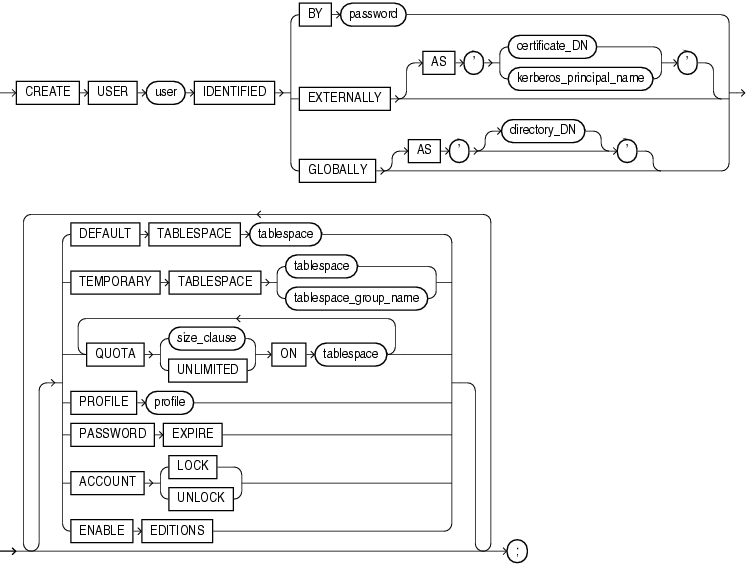

Purpose

Use the `CREATE` `USER` statement to create and configure a database user, which is an account through which you can log in to the database, and to establish the means by which Oracle Database permits access by the user.

You can issue this statement in an Oracle Automatic Storage Management (Oracle ASM) cluster to add a user and password combination to the password file that is local to the Oracle ASM instance of the current node. Each node's Oracle ASM instance can use this statement to update its own password file. The password file itself must have been created by the `ORAPWD` utility.

You can enable a user to connect to the database through a proxy application or application server. For syntax and discussion, refer to [ALTER USER](statements_4003.md).

Prerequisites

You must have the `CREATE` `USER` system privilege. When you create a user with the `CREATE` `USER` statement, the user's privilege domain is empty. To log on to Oracle Database, a user must have the `CREATE` `SESSION` system privilege. Therefore, after creating a user, you should grant the user at least the `CREATE` `SESSION` system privilege. Refer to [GRANT](statements_9013.md) for more information.

Only a user authenticated `AS` `SYSASM` can issue this command to modify the Oracle ASM instance password file.

Syntax

create\_user::=



> ```
> CREATE USER user
>    IDENTIFIED { BY password
>               | EXTERNALLY [ AS 'certificate_DN'  |  AS 'kerberos_principal_name' ]
>               | GLOBALLY [ AS '[ directory_DN ]' ]
>               }
>    [ DEFAULT TABLESPACE tablespace
>    | TEMPORARY TABLESPACE
>         { tablespace | tablespace_group_name }
>    | { QUOTA { size_clause | UNLIMITED } ON tablespace }...
>    | PROFILE profile
>    | PASSWORD EXPIRE
>    | ACCOUNT { LOCK | UNLOCK }
>      [ DEFAULT TABLESPACE tablespace
>      | TEMPORARY TABLESPACE
>           { tablespace | tablespace_group_name }
>      | { QUOTA { size_clause | UNLIMITED } ON tablespace }...
>      | PROFILE profile
>      | PASSWORD EXPIRE
>      | ACCOUNT { LOCK | UNLOCK }
>      | ENABLE EDITIONS
>      ]...
>   ] ;
> ```
  
  

([size\_clause::=](clauses008.md))

Semantics

user

Specify the name of the user to be created. This name can contain only characters from your database character set and must follow the rules described in the section ["Database Object Naming Rules"](sql_elements008.md). Oracle recommends that the user name contain at least one single-byte character regardless of whether the database character set also contains multibyte characters.

Note:

Oracle recommends that user names and passwords be encoded in ASCII or EBCDIC characters only, depending on your platform.

See Also:

"Creating a Database User: Example"

IDENTIFIED Clause

The `IDENTIFIED` clause lets you indicate how Oracle Database authenticates the user.

BY password

The `BY` `password` clause lets you creates a local user and indicates that the user must specify `password` to log on to the database. Passwords are case sensitive. Any subsequent `CONNECT` string used to connect this user to the database must specify the password using the same case (upper, lower, or mixed) that is used in this `CREATE` `USER` statement or a subsequent `ALTER` `USER` statement. Passwords can contain any single-byte, multibyte, or special characters, or any combination of these, from your database character set.

See Also:

[Oracle Database Security Guide](https://docs.oracle.com/cd/E11882_01/network.112/e36292/guidelines.htm#DBSEG10005) for more information about case-sensitive passwords, password complexity, and other password guidelines

Passwords must follow the rules described in the section ["Database Object Naming Rules"](sql_elements008.md), unless you are using the Oracle Database password complexity verification routine. That routine requires a more complex combination of characters than the normal naming rules permit. You implement this routine with the `UTLPWDMG.SQL` script, which is further described in [Oracle Database Security Guide](https://docs.oracle.com/cd/E11882_01/network.112/e36292/users.htm#DBSEG002).

Note:

Oracle recommends that user names and passwords be encoded in ASCII or EBCDIC characters only, depending on your platform.

See Also:

[Oracle Database Security Guide](https://docs.oracle.com/cd/E11882_01/network.112/e36292/authentication.htm#DBSEG3225) to for a detailed discussion of password management and protection

EXTERNALLY Clause

Specify `EXTERNALLY` to create an external user. Such a user must be authenticated by an external service, such as an operating system or a third-party service. In this case, Oracle Database relies on authentication by the operating system or third-party service to ensure that a specific external user has access to a specific database user.

AS 'certificate\_DN' This clause is required for and used for SSL-authenticated external users only. The `certificate_DN` is the distinguished name in the user's PKI certificate in the user's wallet. The maximum length of `certificate_DN` is 1024 characters.

AS 'kerberos\_principal\_name' This clause is required for and used for Kerberos-authenticated external users only. The maximum length of `kerberos_principal_name` is 1024 characters.

Caution:

Oracle strongly recommends that you do not use `IDENTIFIED` `EXTERNALLY` with operating systems that have inherently weak login security.

Restrictions on Creating External Users The following restrictions apply to creating external users:

- The user `SYS` cannot be an external user.
- Oracle ASM does not support the creation of external users.

See Also:

- [Oracle Database Enterprise User Security Administrator's Guide](https://docs.oracle.com/cd/E11882_01/network.112/e10744/concepts.htm#DBIMI152) for more information on externally identified users
- "Creating External Database Users: Examples"

GLOBALLY Clause

The `GLOBALLY` clause lets you create a global user. Such a user must be authorized by the enterprise directory service (Oracle Internet Directory).

The `directory_DN` string can take one of two forms:

- The X.509 name at the enterprise directory service that identifies this user. It should be of the form `CN=` `username,other_attributes`, where `other_attributes` is the rest of the user's distinguished name (DN) in the directory. This form creates a private global schema.
- A null string (' ') indicating that the enterprise directory service will map authenticated global users to this database schema with the appropriate roles. This form is the same as specifying the `GLOBALLY` keyword alone and creates a shared global schema.

The maximum length of `directory_DN` is 1024 characters.

You can control the ability of an application server to connect as the specified user and to activate that user's roles using the `ALTER` `USER` statement.

Restriction on Creating Global Users Oracle ASM does not support the creation of global users.

See Also:

- [Oracle Database Security Guide](http://www.oracle.com/pls/topic/lookup?ctx=db112&id=DBSEG30037) for more information on global users
- [ALTER USER](statements_4003.md)
- "Creating a Global Database User: Example"

DEFAULT TABLESPACE Clause

Specify the default tablespace for objects that are created in the user's schema. If you omit this clause, then the user's objects are stored in the database default tablespace. If no default tablespace has been specified for the database, then the user's objects are stored in the `SYSTEM` tablespace.

Restriction on Default Tablespaces You cannot specify a locally managed temporary tablespace, including an undo tablespace, or a dictionary-managed temporary tablespace, as a user's default tablespace.

See Also:

- [CREATE TABLESPACE](statements_7003.md) for more information on tablespaces in general and undo tablespaces in particular
- [Oracle Database Security Guide](https://docs.oracle.com/cd/E11882_01/network.112/e36292/users.htm#DBSEG002) for more information on assigning default tablespaces to users

TEMPORARY TABLESPACE Clause

Specify the tablespace or tablespace group for the user's temporary segments. If you omit this clause, then the user's temporary segments are stored in the database default temporary tablespace or, if none has been specified, in the `SYSTEM` tablespace.

- Specify `tablespace` to indicate the user's temporary tablespace.
- Specify `tablespace_group_name` to indicate that the user can save temporary segments in any tablespace in the tablespace group specified by `tablespace_group_name`.

Restrictions on Temporary Tablespace This clause is subject to the following restrictions:

- The tablespace must be a temporary tablespace and must have a standard block size.
- The tablespace cannot be an undo tablespace or a tablespace with automatic segment-space management.

See Also:

- [Oracle Database Administrator's Guide](https://docs.oracle.com/cd/E11882_01/server.112/e25494/tspaces.htm#ADMIN01103) for information about tablespace groups and [Oracle Database Security Guide](https://docs.oracle.com/cd/E11882_01/network.112/e36292/users.htm#DBSEG002) for information on assigning temporary tablespaces to users
- [CREATE TABLESPACE](statements_7003.md) for more information on undo tablespaces and segment management
- ["Assigning a Tablespace Group: Example"](statements_4003.md)

QUOTA Clause

Use the `QUOTA` clause to specify the maximum amount of space the user can allocate in the tablespace.

A `CREATE` `USER` statement can have multiple `QUOTA` clauses for multiple tablespaces.

`UNLIMITED` lets the user allocate space in the tablespace without bound.

The maximum amount of space that you can specify is 2 terabytes (TB). If you need more space, then specify `UNLIMITED`.

Restriction on the QUOTA Clause You cannot specify this clause for a temporary tablespace.

See Also:

[size\_clause](clauses008.md) for information on that clause and [Oracle Database Security Guide](https://docs.oracle.com/cd/E11882_01/network.112/e36292/users.htm#DBSEG002) for more information on assigning tablespace quotas

PROFILE Clause

Specify the profile you want to assign to the user. The profile limits the amount of database resources the user can use. If you omit this clause, then Oracle Database assigns the `DEFAULT` profile to the user.

Note:

Oracle recommends that you use the Database Resource Manager rather SQL profiles to establish database resource limits. The Database Resource Manager offers a more flexible means of managing and tracking resource use. For more information on the Database Resource Manager, refer to [Oracle Database Administrator's Guide.](https://docs.oracle.com/cd/E11882_01/server.112/e25494/dbrm.htm#ADMIN027)

See Also:

[GRANT](statements_9013.md) and [CREATE PROFILE](statements_6010.md)

PASSWORD EXPIRE Clause

Specify `PASSWORD` `EXPIRE` if you want the user's password to expire. This setting forces the user or the DBA to change the password before the user can log in to the database.

ACCOUNT Clause

Specify `ACCOUNT` `LOCK` to lock the user's account and disable access. Specify `ACCOUNT` `UNLOCK` to unlock the user's account and enable access to the account.

ENABLE EDITIONS

This clause is not reversible. Specify `ENABLE` `EDITIONS` to allow the user to create multiple versions of editionable objects in this schema using editions. Editionable objects in schemas that are not editions-enabled cannot be editioned.

Restriction on Enabling Editions You cannot enable editions for any schemas supplied by Oracle except for the sample schemas in the seed database.

Examples

All of the following examples use the `example` tablespace, which exists in the seed database and is accessible to the sample schemas.

Creating a Database User: Example If you create a new user with `PASSWORD` `EXPIRE`, then the user's password must be changed before the user attempts to log in to the database. You can create the user `sidney` by issuing the following statement:

```
CREATE USER sidney 
    IDENTIFIED BY out_standing1 
    DEFAULT TABLESPACE example 
    QUOTA 10M ON example 
    TEMPORARY TABLESPACE temp
    QUOTA 5M ON system 
    PROFILE app_user 
    PASSWORD EXPIRE;
```

The user `sidney` has the following characteristics:

- The password `out_standing1`
- Default tablespace `example`, with a quota of 10 megabytes
- Temporary tablespace `temp`
- Access to the tablespace `SYSTEM`, with a quota of 5 megabytes
- Limits on database resources defined by the profile `app_user` (which was created in ["Creating a Profile: Example"](statements_6010.md))
- An expired password, which must be changed before `sidney` can log in to the database

Creating External Database Users: Examples The following example creates an external user, who must be identified by an external source before accessing the database:

```
CREATE USER app_user1
   IDENTIFIED EXTERNALLY
   DEFAULT TABLESPACE example
   QUOTA 5M ON example
   PROFILE app_user;
```

The user `app_user1` has the following additional characteristics:

- Default tablespace `example`
- Default temporary tablespace `example`
- 5M of space on the tablespace `example` and unlimited quota on the temporary tablespace of the database
- Limits on database resources defined by the `app_user` profile

To create another user accessible only by an operating system account, prefix the user name with the value of the initialization parameter `OS_AUTHENT_PREFIX`. For example, if this value is " `ops$` ", then you can create the externally identified user `external_user` with the following statement:

```
CREATE USER ops$external_user
   IDENTIFIED EXTERNALLY
   DEFAULT TABLESPACE example
   QUOTA 5M ON example
   PROFILE app_user;
```

Creating a Global Database User: Example The following example creates a global user. When you create a global user, you can specify the X.509 name that identifies this user at the enterprise directory server:

```
CREATE USER global_user
   IDENTIFIED GLOBALLY AS 'CN=analyst, OU=division1, O=oracle, C=US'
   DEFAULT TABLESPACE example
   QUOTA 5M ON example;
```