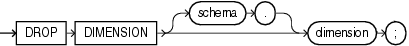

Purpose

Use the `DROP` `DIMENSION` statement to remove the named dimension.

This statement does not invalidate materialized views that use relationships specified in dimensions. However, requests that have been rewritten by query rewrite may be invalidated, and subsequent operations on such views may execute more slowly.

See Also:

- [CREATE DIMENSION](statements_5006.md) and [ALTER DIMENSION](statements_1006.md) for information on creating and modifying a dimension
- [Oracle Database Concepts](https://docs.oracle.com/cd/E11882_01/server.112/e40540/schemaob.htm#CNCPT511) for general information about dimensions

Prerequisites

The dimension must be in your own schema or you must have the `DROP` `ANY` `DIMENSION` system privilege to use this statement.

Syntax

drop\_dimension::=



> ```
> DROP DIMENSION [ schema. ] dimension ;
> ```
  

Semantics

schema

Specify the name of the schema in which the dimension is located. If you omit `schema`, then Oracle Database assumes the dimension is in your own schema.

dimension

Specify the name of the dimension you want to drop. The dimension must already exist.

Examples

Dropping a Dimension: Example This example drops the `sh.customers_dim` dimension:

```
DROP DIMENSION customers_dim;
```

See Also:

["Creating a Dimension: Examples"](statements_5006.md) and ["Modifying a Dimension: Examples"](statements_1006.md) for examples of creating and modifying this dimension