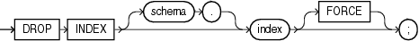

Purpose

Use the `DROP` `INDEX` statement to remove an index or domain index from the database.

When you drop a global partitioned index, a range-partitioned index, or a hash-partitioned index, all the index partitions are also dropped. If you drop a composite-partitioned index, then all the index partitions and subpartitions are also dropped.

In addition, when you drop a domain index:

- Oracle Database invokes the appropriate routine.
- If any statistics are associated with the domain index, then Oracle Database disassociates the statistics types with the `FORCE` clause and removes the user-defined statistics collected with the statistics type.
	See Also:
	- [Oracle Database Data Cartridge Developer's Guide](https://docs.oracle.com/cd/E11882_01/appdev.112/e10765/ext_idx_ref.htm#ADDCI4200) for information on the routines
	- [CREATE INDEX](statements_5012.md) and [ALTER INDEX](statements_1010.md) for information on creating and modifying an index
	- The `domain_index_clause` of [CREATE INDEX](statements_5012.md) for more information on domain indexes
	- [ASSOCIATE STATISTICS](statements_4006.md) and [DISASSOCIATE STATISTICS](statements_8006.md) for more information on statistics type associations

Prerequisites

The index must be in your own schema or you must have the `DROP` `ANY` `INDEX` system privilege.

Syntax

drop\_index::=



> ```
> DROP INDEX [ schema. ] index [ FORCE ] ;
> ```
  

Semantics

schema

Specify the schema containing the index. If you omit `schema`, then Oracle Database assumes the index is in your own schema.

index

Specify the name of the index to be dropped. When the index is dropped, all data blocks allocated to the index are returned to the tablespace that contained the index.

Restriction on Dropping Indexes You cannot drop a domain index if the index or any of its index partitions is marked `IN_PROGRESS`.

FORCE

`FORCE` applies only to domain indexes. This clause drops the domain index even if the indextype routine invocation returns an error or the index is marked `IN` `PROGRESS`. Without `FORCE`, you cannot drop a domain index if its indextype routine invocation returns an error or the index is marked `IN` `PROGRESS`.

Examples

Dropping an Index: Example This statement drops an index named `ord_customer_ix_demo`, which was created in ["Compressing an Index: Example"](statements_5012.md):

```
DROP INDEX ord_customer_ix_demo;
```