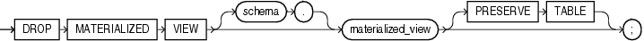

Purpose

Use the `DROP` `MATERIALIZED` `VIEW` statement to remove an existing materialized view from the database.

When you drop a materialized view, Oracle Database does not place it in the recycle bin. Therefore, you cannot subsequently either purge or undrop the materialized view.

Note:

The keyword `SNAPSHOT` is supported in place of `MATERIALIZED` `VIEW` for backward compatibility.

See Also:

- [CREATE MATERIALIZED VIEW](statements_6002.md) for more information on the various types of materialized views
- [ALTER MATERIALIZED VIEW](statements_2002.md) for information on modifying a materialized view
- [Oracle Database Advanced Replication](https://docs.oracle.com/cd/E11882_01/server.112/e10706/repmview.htm#REPLN003) for information on materialized views in a replication environment
- [Oracle Database Data Warehousing Guide](https://docs.oracle.com/cd/E11882_01/server.112/e25554/basicmv.htm#DWHSG008) for information on materialized views in a data warehousing environment

Prerequisites

The materialized view must be in your own schema or you must have the `DROP` `ANY` `MATERIALIZED` `VIEW` system privilege. You must also have the privileges to drop the internal table, views, and index that the database uses to maintain the materialized view data.

See Also:

[DROP TABLE](statements_9003.md), [DROP VIEW](statements_9009.md), and [DROP INDEX](statements_8017.md) for information on privileges required to drop objects that the database uses to maintain the materialized view

Syntax

drop\_materialized\_view::=



> ```
> DROP MATERIALIZED VIEW [ schema. ] materialized_view
>    [ PRESERVE TABLE ] ;
> ```
  

Semantics

schema

Specify the schema containing the materialized view. If you omit `schema`, then Oracle Database assumes the materialized view is in your own schema.

materialized\_view

Specify the name of the existing materialized view to be dropped.

- If you drop a simple materialized view that is the least recently refreshed materialized view of a master table, then the database automatically purges from the master table materialized view log only the rows needed to refresh the dropped materialized view.
- If you drop a materialized view that was created on a prebuilt table, then the database drops the materialized view, and the prebuilt table reverts to its identity as a table.
- When you drop a master table, the database does not automatically drop materialized views based on the table. However, the database returns an error when it tries to refresh a materialized view based on a master table that has been dropped.
- If you drop a materialized view, then any compiled requests that were rewritten to use the materialized view will be invalidated and recompiled automatically. If the materialized view was prebuilt on a table, then the table is not dropped, but it can no longer be maintained by the materialized view refresh mechanism.

PRESERVE TABLE Clause

This clause lets you retain the materialized view container table and its contents after the materialized view object is dropped. The resulting table has the same name as the dropped materialized view.

Oracle Database removes all metadata associated with the materialized view. However, indexes created on the container table automatically during creation of the materialized view are preserved, with one exception: the index created during the creation of a rowid materialized view is dropped. Also, if the materialized view has any nested table columns, then the storage tables for those columns are preserved, along with their metadata.

Restriction on the PRESERVE TABLE Clause This clause is not valid for materialized views that have been imported from releases earlier than Oracle9i, when these objects were called "snapshots".

Examples

Dropping a Materialized View: Examples The following statement drops the materialized view `emp_data` in the sample schema `hr`:

```
DROP MATERIALIZED VIEW emp_data;
```

The following statement drops the `sales_by_month_by_state` materialized view and the underlying table of the materialized view, unless the underlying table was registered in the `CREATE` `MATERIALIZED` `VIEW` statement with the `ON` `PREBUILT` `TABLE` clause:

```
DROP MATERIALIZED VIEW sales_by_month_by_state;
```