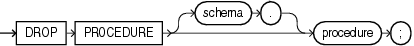

Purpose

Procedures are defined using PL/SQL. Refer to [Oracle Database PL/SQL Language Reference](https://docs.oracle.com/cd/E11882_01/appdev.112/e25519/drop_procedure.htm#LNPLS99991) for complete information on creating, altering, and dropping procedures.

Use the `DROP` `PROCEDURE` statement to remove a standalone stored procedure from the database. Do not use this statement to remove a procedure that is part of a package. Instead, either drop the entire package using the `DROP` `PACKAGE` statement, or redefine the package without the procedure using the `CREATE` `PACKAGE` statement with the `OR` `REPLACE` clause.

Prerequisites

The procedure must be in your own schema or you must have the `DROP` `ANY` `PROCEDURE` system privilege.

Syntax

drop\_procedure::=



> ```
> DROP PROCEDURE [ schema. ] procedure ;
> ```
  

Semantics

schema

Specify the schema containing the procedure. If you omit `schema`, then Oracle Database assumes the procedure is in your own schema.

procedure

Specify the name of the procedure to be dropped.

When you drop a procedure, Oracle Database invalidates any local objects that depend upon the dropped procedure. If you subsequently reference one of these objects, then the database tries to recompile the object and returns an error message if you have not re-created the dropped procedure.

Examples

Dropping a Procedure: Example The following statement drops the procedure `remove_emp` owned by the user `hr` and invalidates all objects that depend upon `remove_emp`:

```
DROP PROCEDURE hr.remove_emp;
```