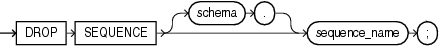

Purpose

Use the `DROP` `SEQUENCE` statement to remove a sequence from the database.

You can also use this statement to restart a sequence by dropping and then re-creating it. For example, if you have a sequence with a current value of 150 and you would like to restart the sequence with a value of 27, then you can drop the sequence and then re-create it with the same name and a `START` `WITH` value of 27.

See Also:

[CREATE SEQUENCE](statements_6015.md) and [ALTER SEQUENCE](statements_2012.md) for more information on creating and modifying a sequence

Prerequisites

The sequence must be in your own schema or you must have the `DROP` `ANY` `SEQUENCE` system privilege.

Syntax

drop\_sequence::=



> ```
> DROP SEQUENCE [ schema. ] sequence_name ;
> ```
  

Semantics

schema

Specify the schema containing the sequence. If you omit `schema`, then Oracle Database assumes the sequence is in your own schema.

sequence\_name

Specify the name of the sequence to be dropped.

Examples

Dropping a Sequence: Example The following statement drops the sequence `customers_seq` owned by the user `oe`, which was created in ["Creating a Sequence: Example"](statements_6015.md). To issue this statement, you must either be connected as user `oe` or have the `DROP` `ANY` `SEQUENCE` system privilege:

```
DROP SEQUENCE oe.customers_seq;
```