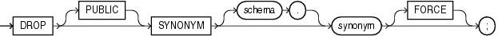

Purpose

Use the `DROP` `SYNONYM` statement to remove a synonym from the database or to change the definition of a synonym by dropping and re-creating it.

See Also:

[CREATE SYNONYM](statements_7001.md) for more information on synonyms

Prerequisites

To drop a private synonym, either the synonym must be in your own schema or you must have the `DROP` `ANY` `SYNONYM` system privilege.

To drop a `PUBLIC` synonym, you must have the `DROP` `PUBLIC` `SYNONYM` system privilege.

Syntax

drop\_synonym::=



> ```
> DROP [PUBLIC] SYNONYM [ schema. ] synonym [FORCE] ;
> ```
  

Semantics

PUBLIC

You must specify `PUBLIC` to drop a public synonym. You cannot specify `schema` if you have specified `PUBLIC`.

schema

Specify the schema containing the synonym. If you omit `schema`, then Oracle Database assumes the synonym is in your own schema.

synonym

Specify the name of the synonym to be dropped.

If you drop a synonym for the master table of a materialized view, and if the defining query of the materialized view specified the synonym rather than the actual table name, then Oracle Database marks the materialized view unusable.

If an object type synonym has any dependent tables or user-defined types, then you cannot drop the synonym unless you also specify `FORCE`.

FORCE

Specify `FORCE` to drop the synonym even if it has dependent tables or user-defined types.

Caution:

Oracle does not recommend that you specify `FORCE` to drop object type synonyms with dependencies. This operation can result in invalidation of other user-defined types or marking `UNUSED` the table columns that depend on the synonym. For information about type dependencies, see [Oracle Database Object-Relational Developer's Guide](https://docs.oracle.com/cd/E11882_01/appdev.112/e11822/adobjmng.htm#ADOBJ00402).

Examples

Dropping a Synonym: Example To drop the public synonym named `customers`, which was created in ["Oracle Database Resolution of Synonyms: Example"](statements_7001.md), issue the following statement:

```
DROP PUBLIC SYNONYM customers;
```