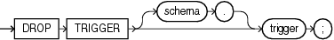

Purpose

Triggers are defined using PL/SQL. Refer to [Oracle Database PL/SQL Language Reference](https://docs.oracle.com/cd/E11882_01/appdev.112/e25519/drop_trigger.htm#LNPLS99990) for complete information on creating, altering, and dropping triggers.

Use the `DROP` `TRIGGER` statement to remove a database trigger from the database.

See Also:

[CREATE TRIGGER](statements_7004.md) and [ALTER TRIGGER](statements_4001.md)

Prerequisites

The trigger must be in your own schema or you must have the `DROP` `ANY` `TRIGGER` system privilege. To drop a trigger on `DATABASE` in another user's schema, you must also have the `ADMINISTER` `DATABASE` `TRIGGER` system privilege.

Syntax

drop\_trigger::=



> ```
> DROP TRIGGER [ schema. ] trigger ;
> ```
  

Semantics

schema

Specify the schema containing the trigger. If you omit `schema`, then Oracle Database assumes the trigger is in your own schema.

trigger

Specify the name of the trigger to be dropped. Oracle Database removes it from the database and does not fire it again.

Examples

Dropping a Trigger: Example The following statement drops the `salary_check` trigger in the schema `hr`:

```
DROP TRIGGER hr.salary_check;
```