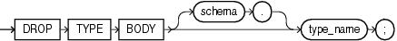

Purpose

Object types are defined using PL/SQL. Refer to [Oracle Database PL/SQL Language Reference](https://docs.oracle.com/cd/E11882_01/appdev.112/e25519/drop_type_body.htm#LNPLS99988) for complete information on creating, altering, and dropping object types.

Use the `DROP` `TYPE` `BODY` statement to drop the body of an object type, varray, or nested table type. When you drop a type body, the object type specification still exists, and you can re-create the type body. Prior to re-creating the body, you can still use the object type, although you cannot call the member functions.

Prerequisites

The object type body must be in your own schema or you must have the `DROP` `ANY` `TYPE` system privilege.

Syntax

drop\_type\_body::=



> ```
> DROP TYPE BODY [ schema. ] type_name ;
> ```
  

Semantics

schema

Specify the schema containing the object type. If you omit `schema`, then Oracle Database assumes the object type is in your own schema.

type\_name

Specify the name of the object type body to be dropped.

Restriction on Dropping Type Bodies You can drop a type body only if it has no type or table dependencies.

Examples

Dropping an Object Type Body: Example The following statement removes object type body `data_typ1`. See [Oracle Database PL/SQL Language Reference](https://docs.oracle.com/cd/E11882_01/appdev.112/e25519/create_type.htm#LNPLS01379) for the example that creates this object type.

```
DROP TYPE BODY data_typ1;
```