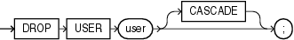

Purpose

Use the `DROP` `USER` statement to remove a database user and optionally remove the user's objects.

In an Oracle Automatic Storage Management (Oracle ASM) cluster, a user authenticated `AS` `SYSASM` can use this clause to remove a user from the password file that is local to the Oracle ASM instance of the current node.

When you drop a user, Oracle Database also purges all of that user's schema objects from the recycle bin.

Caution:

Do not attempt to drop the users `SYS` or `SYSTEM`. Doing so will corrupt your database.

See Also:

[CREATE USER](statements_8003.md) and [ALTER USER](statements_4003.md) for information on creating and modifying a user

Prerequisites

You must have the `DROP` `USER` system privilege. In an Oracle ASM cluster, you must be authenticated `AS` `SYSASM`.

Syntax

drop\_user::=



> ```
> DROP USER user [ CASCADE ] ;
> ```
  

Semantics

user

Specify the user to be dropped. Oracle Database does not drop users whose schemas contain objects unless you specify `CASCADE` or unless you first explicitly drop the user's objects.

Restriction on Dropping Users

You cannot drop a user whose schema contains a table that uses a flashback data archive for historical tracking. You must first disable the table's use of the flashback data archive.

CASCADE

Specify `CASCADE` to drop all objects in the user's schema before dropping the user. You must specify this clause to drop a user whose schema contains any objects.

- If the user's schema contains tables, then Oracle Database drops the tables and automatically drops any referential integrity constraints on tables in other schemas that refer to primary and unique keys on these tables.
- If this clause results in tables being dropped, then the database also drops all domain indexes created on columns of those tables and invokes appropriate drop routines.
	See Also:
	[Oracle Database Data Cartridge Developer's Guide](https://docs.oracle.com/cd/E11882_01/appdev.112/e10765/ext_idx_ref.htm#ADDCI4200) for more information on these routines
- Oracle Database invalidates, but does not drop, the following objects in other schemas:
	- Views or synonyms for objects in the dropped user's schema
		- Stored procedures, functions, or packages that query objects in the dropped user's schema
- Oracle Database does not drop materialized views in other schemas that are based on tables in the dropped user's schema. However, because the base tables no longer exist, the materialized views in the other schemas can no longer be refreshed.
- Oracle Database drops all triggers in the user's schema.
- Oracle Database does not drop roles created by the user.

Caution:

Oracle Database also drops with `FORCE` all types owned by the user. See the [FORCE](statements_9006.md) keyword of [DROP TYPE](statements_9006.md).

Restriction on Dropping Users

You cannot drop a user whose schema contains a table that uses a flashback data archive. You must first disable use of the flashback data archive.

Examples

Dropping a Database User: Example If user Sidney's schema contains no objects, then you can drop `sidney` by issuing the statement:

```
DROP USER sidney;
```

If Sidney's schema contains objects, then you must use the `CASCADE` clause to drop `sidney` and the objects:

```
DROP USER sidney CASCADE;
```